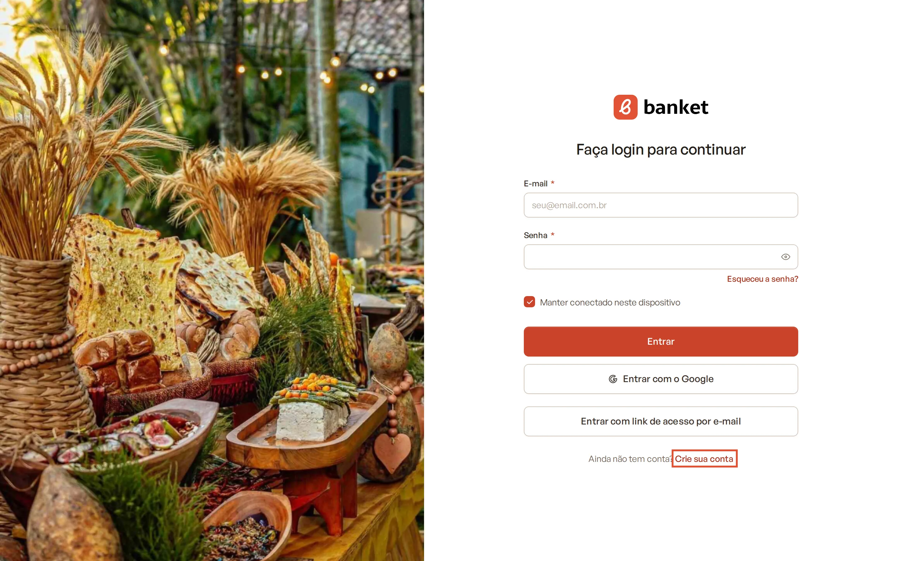
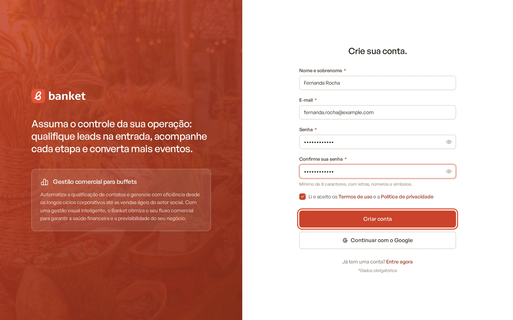
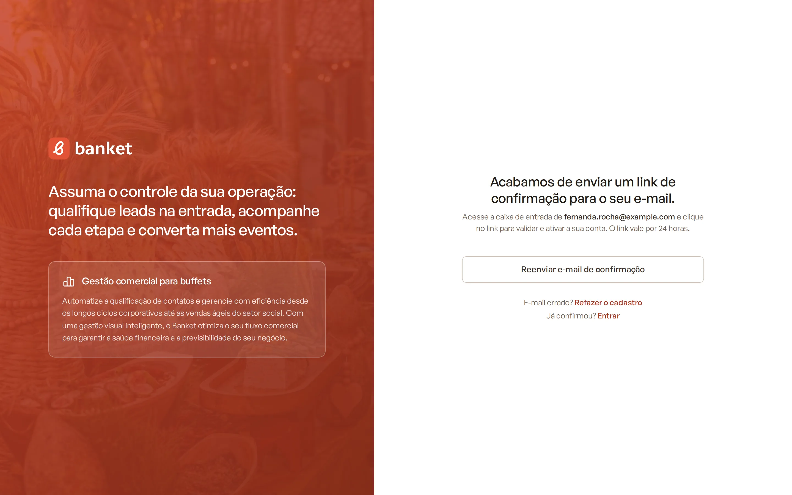
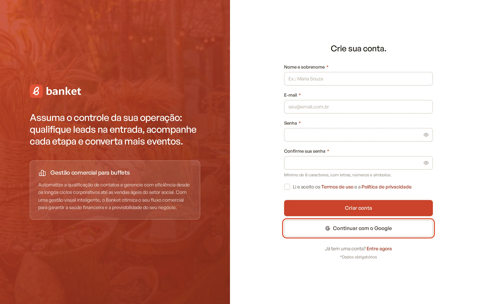
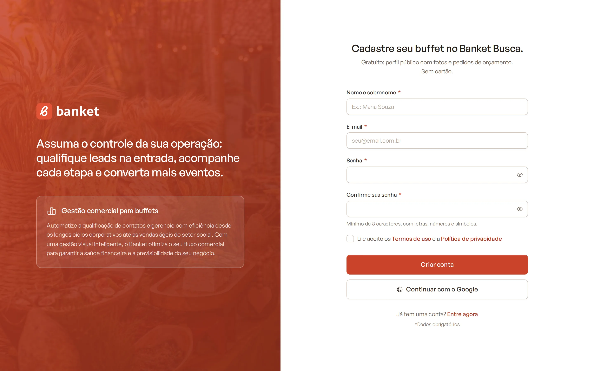

# Criar sua conta

O cadastro no Banket é feito em três etapas: você cria a conta com seu nome, e-mail e senha, confirma o e-mail e, por
fim, cadastra os dados do seu buffet. Este artigo explica a primeira etapa.

> **Disponível em:** todos os planos · **Quem pode usar:** qualquer pessoa que vá cadastrar um buffet novo

## Antes de começar

- Se o seu buffet **já usa o Banket**, não crie uma conta nova: peça ao proprietário ou administrador um convite. Veja
  [Aceitar convite](06-aceitar-convite.md).
- Cada empresa é cadastrada com um CPF ou CNPJ, e um documento só pode ter uma empresa no Banket.

## Passo a passo

1. Acesse a tela de login do Banket e clique em **Crie sua conta**.

   

2. Preencha os campos:
   - **Nome e sobrenome**: o seu nome, não o do buffet (ele vem depois).
   - **E-mail**: o endereço que você vai usar para entrar.
   - **Senha** e **Confirme sua senha**.
3. Marque **Li e aceito os Termos de uso e a Política de privacidade**.
4. Clique em **Criar conta**.

   

5. O Banket mostra a tela "Acabamos de enviar um link de confirmação para o seu e-mail". Abra sua caixa de entrada e
   siga o artigo [Confirmar o e-mail e cadastrar a empresa](03-confirmar-email-e-cadastrar-empresa.md).

   

### Cadastro com o Google

Se o botão **Continuar com o Google** aparecer na tela, você pode usá-lo no lugar do formulário:

1. Clique em **Continuar com o Google**.

   

2. Escolha a sua conta Google e aceite as permissões pedidas.
3. Como o Google já confirma o seu e-mail, você vai direto para o cadastro da empresa, sem precisar do link de
   confirmação.

Ao entrar com o Google, o Banket também pede acesso à sua agenda Google, que é usado para agendar reuniões com Google
Meet. Veja [Conectar a conta Google](10-conectar-conta-google.md).

## Regras da senha

A senha precisa ter:

- no mínimo 8 caracteres (e no máximo 128);
- letras;
- números;
- pelo menos um símbolo (por exemplo `!`, `@`, `#`, `.`).

Os dois campos de senha precisam ser iguais.

## Cadastro pelo Banket Busca

Se você chegou ao cadastro por um link da vitrine do Banket Busca, a tela mostra o título
**Cadastre seu buffet no Banket Busca.** O preenchimento é o mesmo. A diferença é que a sua empresa começa no plano
gratuito **Busca**, e você entra direto na área do seu perfil no Banket Busca.

Quem se cadastra pelo site do Banket também começa no plano Busca, mas é levado à página de escolha de plano para
iniciar o teste grátis de 30 dias.

## Perguntas frequentes

### Apareceu "Já existe uma conta com este e-mail". E agora?

Esse e-mail já foi confirmado no Banket. Clique em **Entre agora** para fazer login ou use **Esqueceu a senha?** na
tela de login. Veja [Recuperar a senha](05-recuperar-senha.md).

### Digitei o e-mail errado. Preciso esperar?

Não. Na tela de confirmação, clique em **Refazer o cadastro** e preencha de novo com o e-mail certo. Um cadastro que
ainda não foi confirmado pode ser refeito a qualquer momento.

### Apareceu "Muitas tentativas. Tente novamente mais tarde."

Por segurança, o Banket limita a quantidade de cadastros feitos a partir da mesma conexão em uma hora. Aguarde e tente
de novo.

### O nome precisa ter sobrenome?

Sim. O campo **Nome e sobrenome** exige pelo menos duas palavras.

## Artigos relacionados

- [Confirmar o e-mail e cadastrar a empresa](03-confirmar-email-e-cadastrar-empresa.md)
- [Entrar no sistema](04-entrar-no-sistema.md)
- [Aceitar convite](06-aceitar-convite.md)
- [Teste grátis de 30 dias](../20-planos-e-assinatura/02-teste-gratis-de-30-dias.md)
- [O que é o Banket Busca](../18-banket-busca/01-o-que-e-o-banket-busca.md)
