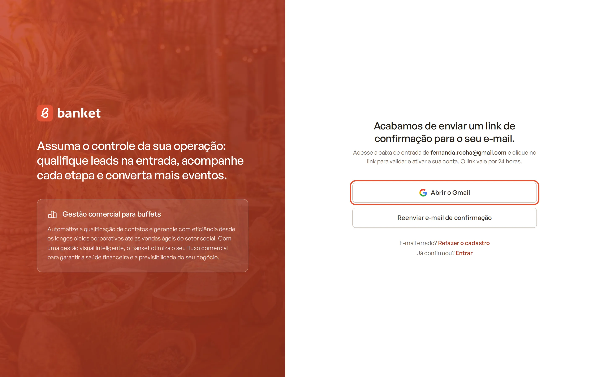

# Confirmar o e-mail e cadastrar a empresa

Depois de criar a conta, você precisa confirmar o seu e-mail e informar os dados do buffet. Só então o Banket prepara o
ambiente da sua empresa, já com etapas do funil, formatos de serviço, um espaço, um template de proposta e outros
padrões prontos para usar.

> **Disponível em:** todos os planos · **Quem pode usar:** quem acabou de criar a conta

## Passo a passo

### 1. Confirme o seu e-mail

1. Abra a caixa de entrada do e-mail que você usou no cadastro.
2. Procure a mensagem do Banket e clique no link de confirmação.
   - Se o seu e-mail for do Gmail, a tela de confirmação mostra o botão **Abrir o Gmail**, que já abre a busca pela
     mensagem.

   

3. O link vale por **24 horas**. Ao clicar, você vê a tela **E-mail validado**.

### 2. Cadastre a empresa

Na tela **E-mail validado** (ou **Complete seu cadastro**):

1. Escolha o tipo de conta: **Pessoa física** ou **Pessoa jurídica**.
2. Confira **Nome e sobrenome** e **E-mail**. Eles vêm da sua conta e não podem ser alterados aqui.
3. Preencha os campos:

| Campo | O que preencher |
|---|---|
| **Celular** | Seu celular com DDD. Ele também vai para a assinatura das propostas. |
| **CPF** | Só para pessoa física. |
| **Razão social** e **CNPJ** | Só para pessoa jurídica. |
| **Nome do buffet** | O nome como aparece nas suas propostas. |

4. Clique em **Finalizar e acessar a plataforma**.

Você passa a ser o **Proprietário** da empresa e já entra no sistema.

## O que acontece depois

- **Cadastro pelo site do Banket**: você vê a página para escolher o plano do teste grátis de 30 dias. Enquanto não
  escolher, essa página aparece a cada entrada.
- **Cadastro pelo Banket Busca**: você entra direto na área do perfil do seu buffet no Banket Busca, no plano gratuito.
- O endereço da empresa não é pedido no cadastro. Complete-o depois em **Configurações › Empresa**, junto com o logo e
  os dados que saem nas propostas.

## Perguntas frequentes

### Não recebi o e-mail de confirmação.

Confira a caixa de spam e a aba de promoções. Na tela de confirmação, clique em **Reenviar e-mail de confirmação**. Você
pode pedir até 3 reenvios a cada 15 minutos. Se o e-mail estiver errado, clique em **Refazer o cadastro**.

### O link diz que é inválido ou expirou.

O link vale por 24 horas. Entre na tela de login com seu e-mail e senha: o Banket avisa que o e-mail ainda não foi
confirmado e mostra o botão para receber um novo link.

### Apareceu "Já existe uma empresa cadastrada com este CNPJ (ou CPF)".

Cada CPF ou CNPJ só pode ter uma empresa no Banket. Se o seu buffet já está cadastrado, peça ao proprietário ou
administrador um convite de acesso. Veja [Aceitar convite](06-aceitar-convite.md).

### Fechei a página antes de terminar. Perdi o cadastro?

Não. Entre com seu e-mail e senha: o Banket leva você de volta à tela de cadastro da empresa.

### Posso mudar o nome do buffet depois?

Sim. Os dados da empresa podem ser editados em **Configurações › Empresa**.

## Artigos relacionados

- [Criar sua conta](02-criar-sua-conta.md)
- [Entrar no sistema](04-entrar-no-sistema.md)
- [Dados da empresa](../19-configuracoes/01-dados-da-empresa.md)
- [Teste grátis de 30 dias](../20-planos-e-assinatura/02-teste-gratis-de-30-dias.md)
- [Primeiros passos do Dashboard](../02-dashboard/02-primeiros-passos-do-dashboard.md)
