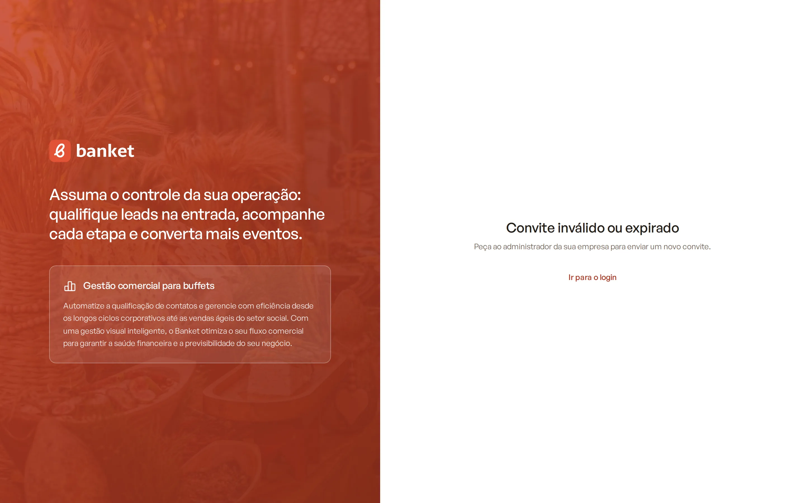

# Aceitar convite

Quando o proprietário ou um administrador do buffet convida você para o Banket, você recebe um e-mail com um link. Por
ele, você cria o seu acesso (ou usa a conta que já tem) e passa a fazer parte da empresa.

> **Disponível em:** todos os planos · **Quem pode usar:** quem recebeu um convite

## Antes de começar

- O convite é enviado pelo responsável da empresa em **Configurações › Usuários**.
- O link do convite vale por **7 dias**.
- O seu papel na empresa (Proprietário, Administrador ou Usuário) é definido por quem convidou.

## Passo a passo

### Se você ainda não tem conta no Banket

1. Abra o e-mail do convite e clique no link.
2. Na tela **Você foi convidado para o Banket**, confira o **E-mail** (ele não pode ser alterado).
3. Preencha **Nome e sobrenome**, **Senha** e **Confirme a senha**.
4. Marque **Li e aceito os Termos de uso e a Política de privacidade**.
5. Clique em **Finalizar e acessar a plataforma**.

### Se você já tem conta no Banket

Se o e-mail do convite já tem conta (por exemplo, você já trabalha em outro buffet), a tela pede só a sua senha:

1. Abra o e-mail do convite e clique no link.
2. Informe a **Senha** da sua conta.
3. Clique em **Aceitar convite e acessar**.

Esqueceu a senha? Use os links **Esqueceu a senha?** ou **Entrar com link por e-mail**, que aparecem nessa mesma tela.
Depois volte ao link do convite.

## O que acontece depois

Você entra direto no Dashboard da empresa que convidou, com a mensagem de boas-vindas. Se você pertence a mais de uma
empresa, pode trocar entre elas pelo menu do seu nome. Veja [Trocar de empresa](08-trocar-de-empresa.md).

## Regras da senha

No mínimo 8 caracteres, com letras, números e pelo menos um símbolo. Os dois campos precisam ser iguais.

## Perguntas frequentes

### Apareceu "Convite inválido ou expirado".

O convite passou de 7 dias, já foi usado ou foi cancelado. Peça ao administrador da empresa para enviar um novo convite.

### Apareceu "Senha incorreta".

Você já tem conta no Banket com esse e-mail. Digite a senha dessa conta, não uma senha nova. Se não lembrar, use
**Esqueceu a senha?**.

### Posso aceitar o convite com outro e-mail?

Não. O convite é ligado ao e-mail para o qual foi enviado. Se preferir outro endereço, peça um novo convite para ele.

### Preciso cadastrar a empresa depois de aceitar?

Não. A empresa já existe; você só passa a ter acesso a ela.

## Artigos relacionados

- [Entrar no sistema](04-entrar-no-sistema.md)
- [Trocar de empresa](08-trocar-de-empresa.md)
- [Usuários e convites](../19-configuracoes/05-usuarios-e-convites.md)
- [Papéis e permissões](../19-configuracoes/06-papeis-e-permissoes.md)
