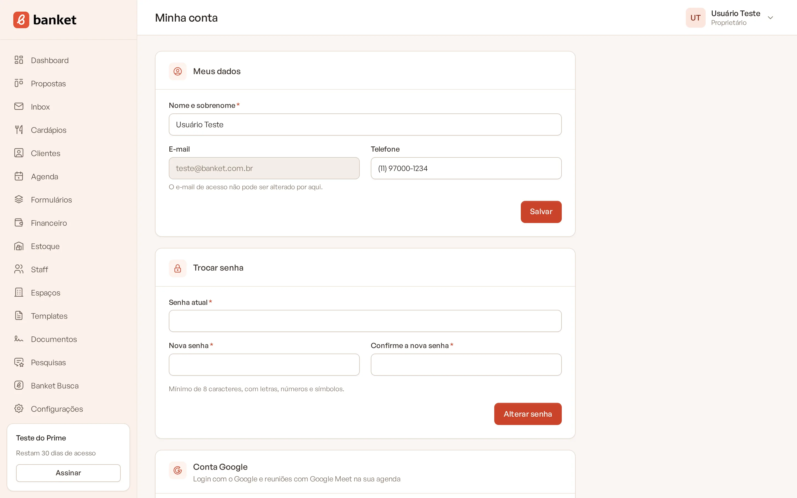
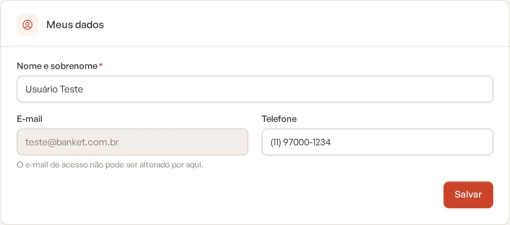
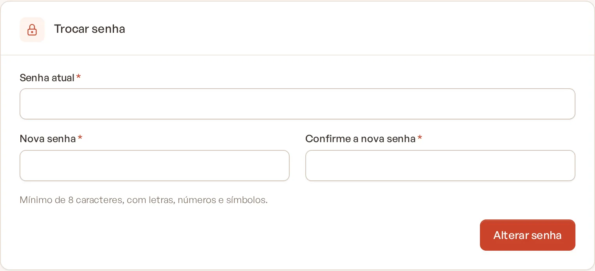
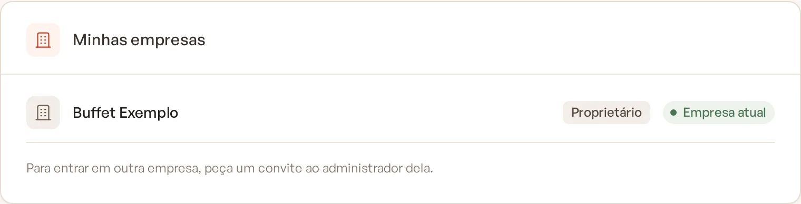

# Minha conta

Em **Minha conta** ficam os seus dados pessoais de acesso, que valem para todas as empresas em que você trabalha: nome,
telefone, senha, conta Google e a lista das suas empresas.

> **Disponível em:** todos os planos · **Quem pode usar:** todos os usuários

## Como abrir

1. No canto superior direito, clique no seu nome.
2. Clique em **Minha conta**.

   

## Atualizar seus dados

No cartão **Meus dados**:

1. Altere **Nome e sobrenome** e, se quiser, o **Telefone**.
2. Clique em **Salvar**.

O **E-mail** aparece só para consulta: o e-mail de acesso não pode ser alterado por aqui.

## Trocar a senha

No cartão **Trocar senha**:

1. Digite a **Senha atual**.
2. Preencha **Nova senha** e **Confirme a nova senha**.
3. Clique em **Alterar senha**.

A nova senha precisa ter no mínimo 8 caracteres, com letras, números e pelo menos um símbolo.

## Conta Google

O cartão **Conta Google** mostra se a sua conta Google está vinculada e se a agenda está ativa para reuniões com Google
Meet. Veja os detalhes em [Conectar a conta Google](10-conectar-conta-google.md).

## Minhas empresas

O cartão **Minhas empresas** lista todas as empresas a que você tem acesso, com o seu papel em cada uma (Proprietário,
Administrador ou Usuário). A empresa em que você está aparece marcada como **Empresa atual**.

Para entrar em outra empresa, peça um convite ao administrador dela.

## Perguntas frequentes

### Apareceu "A senha atual não confere".

A senha digitada em **Senha atual** está errada. Se não lembrar, saia do sistema e use **Esqueceu a senha?** na tela de
login.

### Entro só com o Google e não sei minha senha atual.

Use **Esqueceu a senha?** na tela de login para criar uma senha. Depois você pode trocá-la por aqui.

### Como mudo o e-mail de acesso?

O e-mail não pode ser alterado em Minha conta. Abra um chamado em **Suporte** para pedir ajuda.

### Mudar meu nome aqui muda o nome nas propostas?

O nome que aparece na assinatura das propostas é configurado em **Configurações › Empresa**, separadamente.

## Artigos relacionados

- [Conectar a conta Google](10-conectar-conta-google.md)
- [Recuperar a senha](05-recuperar-senha.md)
- [Trocar de empresa](08-trocar-de-empresa.md)
- [Abrir chamado](../21-suporte/01-abrir-chamado.md)
