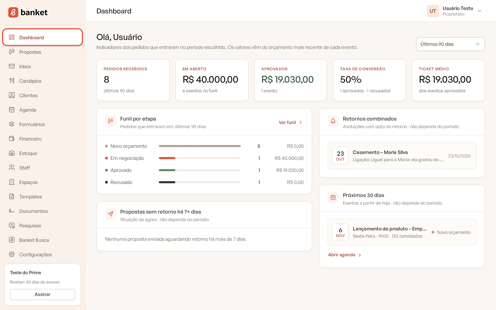
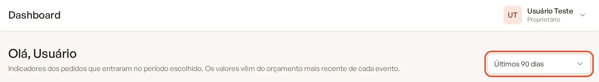
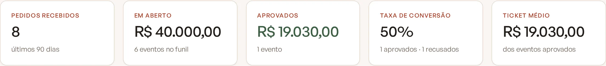
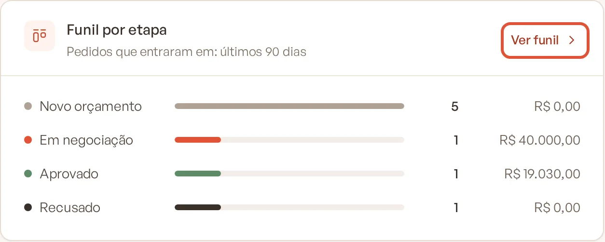
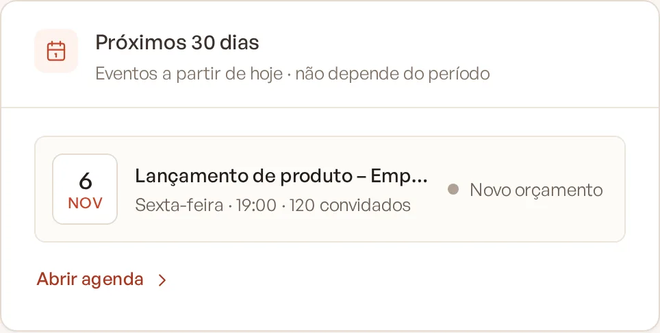

# Entender o Dashboard

O Dashboard é a página inicial do Banket. Ele resume as vendas do buffet: quantos pedidos entraram, quanto está em
negociação, quanto foi aprovado, a taxa de conversão e o ticket médio, além dos próximos eventos e do que precisa de
atenção.

> **Disponível em:** planos Essencial, Profissional, Prime e Master · **Quem pode usar:** todos os usuários

## Como abrir

No menu lateral, clique em **Dashboard**. Ele também abre automaticamente quando você entra no sistema.

## Escolher o período

No canto superior direito do Dashboard, escolha o período no seletor. A página se atualiza na hora.

- **Últimos 30 dias**
- **Últimos 90 dias** (padrão)
- **Últimos 12 meses**
- **Todo o período**

O período considera a **data em que o pedido entrou** no Banket (a data de cadastro do evento), não a data da festa.

## Indicadores do topo

| Indicador | O que mostra |
|---|---|
| **Pedidos recebidos** | Quantos eventos foram cadastrados no período, por qualquer origem (manual, formulário ou Banket Busca). |
| **Em aberto** | Soma dos valores dos eventos que ainda estão em etapas de entrada ou de negociação, e quantos são. |
| **Aprovados** | Soma dos valores dos eventos em etapas de aprovado, e quantos são. |
| **Taxa de conversão** | Aprovados divididos pela soma de aprovados e recusados. Mostra quantos dos pedidos já decididos foram fechados. |
| **Ticket médio** | Valor aprovado dividido pelo número de eventos aprovados. |

Quando não há dados suficientes (por exemplo, nenhum evento aprovado ou recusado), o indicador aparece como **—**.

### De onde vem o valor de cada evento

O valor de um evento é o **total da versão atual do orçamento**. Eventos que ainda não têm orçamento contam como
R$ 0,00 nos valores, mas entram na contagem de eventos.

### Como o Banket sabe o que é aprovado ou recusado

Cada etapa do funil tem um tipo, definido em **Configurações › Etapas do funil**: entrada de pedidos, negociação,
aprovado ou recusado. O Dashboard usa esse tipo, e não o nome da etapa. Assim, se você renomear "Fechado" para
"Contrato assinado", os números continuam certos.

## Funil por etapa

O cartão **Funil por etapa** mostra cada etapa do seu Painel de Propostas com:

- a cor da etapa;
- uma barra proporcional à quantidade de eventos;
- o número de eventos;
- a soma dos valores.

Ele também segue o período escolhido. Clique no nome de uma etapa para abrir a lista de eventos dessa etapa, ou em
**Ver funil** para abrir o Painel de Propostas.

## Próximos 30 dias

O cartão **Próximos 30 dias** lista até 8 eventos com data de hoje até 30 dias à frente, com o dia, o horário de início,
o número de convidados e a etapa. Eventos recusados não aparecem. Este cartão **não depende do período** escolhido.

Clique num evento para abri-lo, ou em **Abrir agenda** para ver o calendário completo.

## Os outros cartões

- **Retornos combinados** e **Propostas sem retorno há 7+ dias**: veja
  [Retornos combinados e propostas sem retorno](03-retornos-combinados-e-orcamentos-parados.md).
- **Primeiros passos**: aparece para empresas novas. Veja
  [Primeiros passos do Dashboard](02-primeiros-passos-do-dashboard.md).

## Perguntas frequentes

### Os números não batem com o Painel de Propostas.

O Dashboard conta os eventos pela data de entrada do pedido dentro do período escolhido. O Painel de Propostas pode
estar mostrando outro intervalo (por exemplo, pela data do evento). Escolha **Todo o período** para comparar.

### Por que um evento aprovado aparece com valor zero?

O evento ainda não tem orçamento, ou o orçamento está com total zero. Abra o evento e confira a aba Orçamento.

### Mudei o valor do orçamento. O Dashboard atualiza?

Sim. O Dashboard sempre usa o total da versão atual do orçamento. Basta recarregar a página.

### No plano Busca, por que não vejo o Dashboard?

O Dashboard faz parte do módulo de propostas, disponível nos planos pagos. No plano Busca, a página inicial é a área do
Banket Busca.

## Artigos relacionados

- [Primeiros passos do Dashboard](02-primeiros-passos-do-dashboard.md)
- [Retornos combinados e propostas sem retorno](03-retornos-combinados-e-orcamentos-parados.md)
- [Painel de Propostas](../03-propostas-e-eventos/01-painel-de-propostas.md)
- [Etapas do funil](../19-configuracoes/08-etapas-do-funil.md)
- [Versões do orçamento](../04-orcamento/08-versoes-do-orcamento.md)
