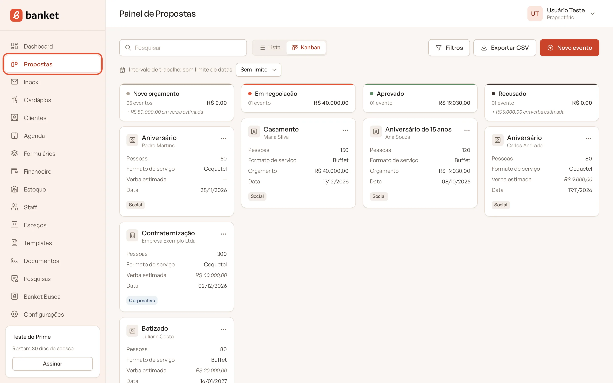
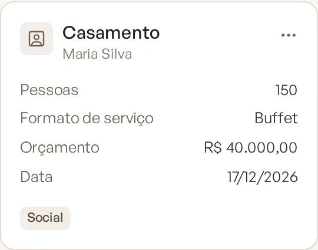
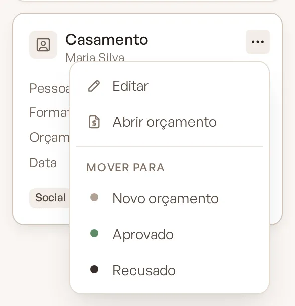
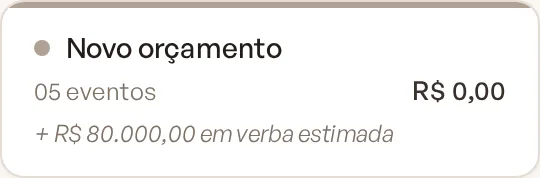
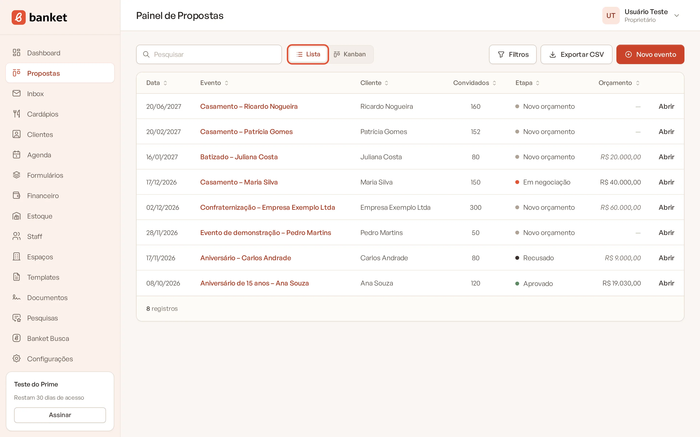

# Usar o Painel de Propostas

O **Painel de Propostas** reúne todos os pedidos de evento da sua empresa, do primeiro contato ao fechamento. Cada
evento é um card, e cada coluna é uma etapa do seu funil de vendas.

> **Disponível em:** planos Essencial, Profissional, Prime e Master · **Quem pode usar:** todos os usuários

## Abrir o painel

1. No menu lateral, clique em **Propostas**.

   

2. O painel abre na visão **Kanban**. Para ver os eventos em tabela, clique em **Lista** no topo da tela.

## A visão Kanban

Cada coluna é uma **Etapa** do funil (por exemplo: entrada de pedidos, em negociação, aprovado, recusado). As etapas,
seus nomes e cores são definidos em **Configurações › Etapas do funil**.

No cabeçalho de cada coluna você vê:

- a quantidade de eventos na etapa;
- a soma dos orçamentos dos eventos da etapa;
- quando há eventos ainda sem orçamento, a linha **+ R$ … em verba estimada**, com a soma da verba informada pelo
  cliente. A verba só conta enquanto o evento não tem orçamento: os dois valores nunca se misturam.

Cada card mostra:

| Informação | O que é |
|---|---|
| Título | A ocasião do evento (ou o título, se não houver ocasião) |
| Cliente | Nome do cliente, com ícone de pessoa física ou de empresa |
| Pessoas | Número de convidados |
| Formato de serviço | Buffet, Coquetel, Empratado etc. |
| Orçamento ou Verba estimada | O valor da versão atual do orçamento; sem orçamento, a verba informada pelo cliente |
| Data | Data do evento |
| Etiquetas | O **Tipo** (Corporativo ou Social) e, quando o evento está parado, o aviso **há N dias nesta etapa** (a partir de 3 dias; fica em destaque a partir de 7) |

Clique em qualquer ponto do card para abrir o resumo do evento. O botão de três pontos do card abre um menu com
**Editar**, **Orçamento** (ou **Abrir orçamento**, se já existir) e a lista **Mover para** com as outras etapas.

Os cards de cada coluna ficam em ordem de data do evento. Eventos sem data aparecem no fim.

## A visão Lista

A lista mostra os eventos em tabela, com as colunas **Data**, **Evento**, **Cliente**, **Convidados**, **Etapa**,
**Orçamento** e a ação **Abrir**. Clique no título de uma coluna para ordenar por ela. A lista é paginada e mostra 20
eventos por página.

Na coluna **Orçamento**, eventos sem orçamento mostram a verba estimada pelo cliente em destaque diferente.

## Intervalo de trabalho

Para o quadro não ficar cheio de eventos distantes, a visão Kanban mostra só os eventos de hoje até alguns meses à
frente. Esse período é o **intervalo de trabalho**. A faixa logo acima das colunas mostra o intervalo em uso, por exemplo:
"Intervalo de trabalho: 3 meses, de hoje até 18/01/2027 (eventos sem data também aparecem)".

- Eventos **sem data** aparecem sempre.
- As opções são **1 mês**, **3 meses**, **6 meses** ou **Sem limite**.
- Proprietários e administradores trocam o intervalo no seletor ao lado do texto. A mudança vale para toda a empresa e
  fica salva.
- Se você escolher datas no filtro, elas substituem o intervalo enquanto o filtro estiver ativo. Para voltar, clique em
  **Voltar ao intervalo de trabalho**.

A visão **Lista** não usa o intervalo de trabalho: mostra todos os eventos, respeitando apenas os filtros.

## No celular

No celular, o Kanban mostra uma etapa por vez. Toque nos botões com o nome das etapas, no topo, para trocar de coluna.
Para mudar um evento de etapa, use o menu de três pontos do card e escolha a etapa em **Mover para**.

## Perguntas frequentes

### Por que um evento não aparece no Kanban?
Provavelmente a data dele está fora do intervalo de trabalho (por exemplo, um evento daqui a 8 meses com o intervalo de
3 meses) ou já passou. Use a visão **Lista** ou escolha **Sem limite** no intervalo.

### O valor da coluna inclui a verba estimada?
Não. A soma principal considera só os orçamentos. A verba dos eventos sem orçamento aparece separada, na linha
"em verba estimada".

### Posso mudar os nomes e as cores das colunas?
Sim, em **Configurações › Etapas do funil** (proprietários e administradores).

## Artigos relacionados
- [Criar um evento](02-criar-evento.md)
- [Mover um evento entre etapas](04-mover-evento-entre-etapas.md)
- [Filtrar e exportar eventos](05-filtrar-e-exportar-eventos.md)
- [Etapas do funil](../19-configuracoes/08-etapas-do-funil.md)
