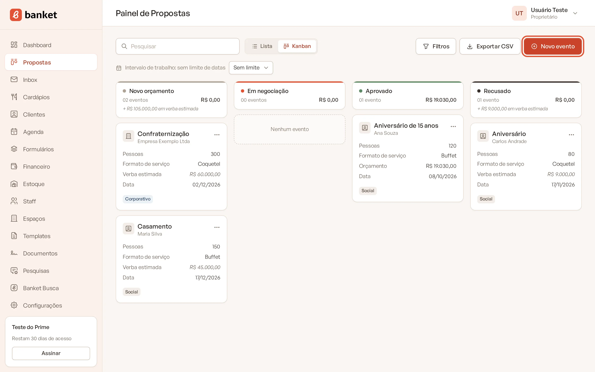
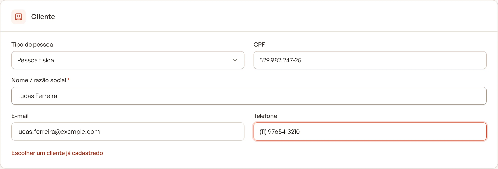
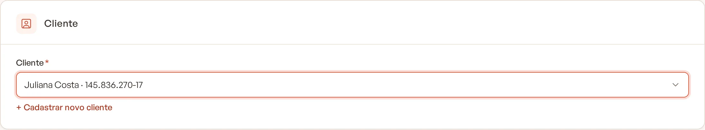
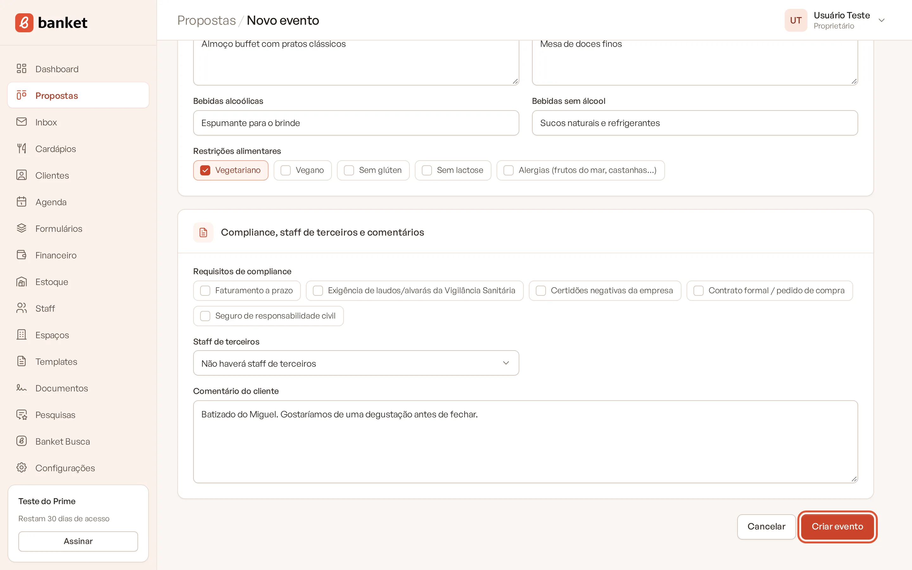
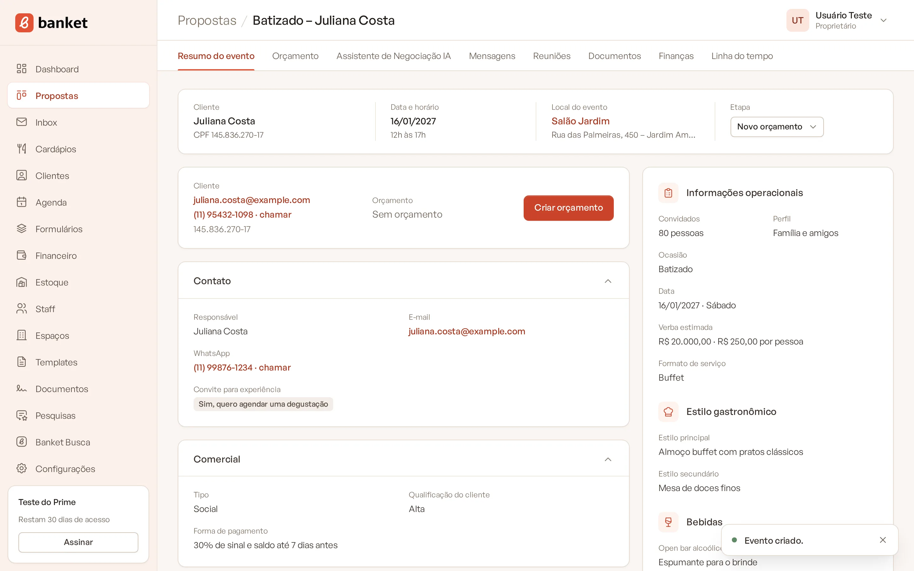
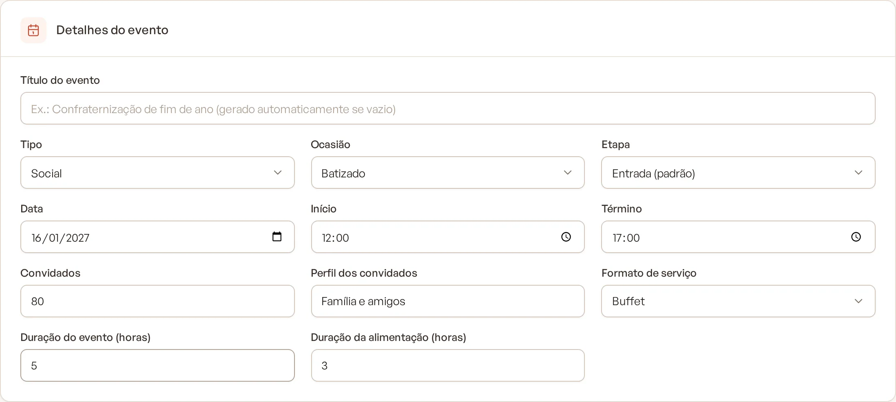
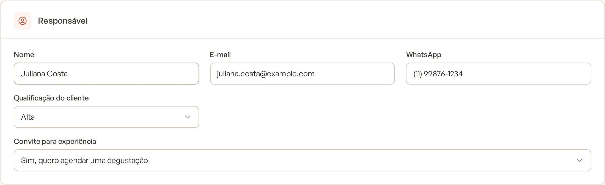
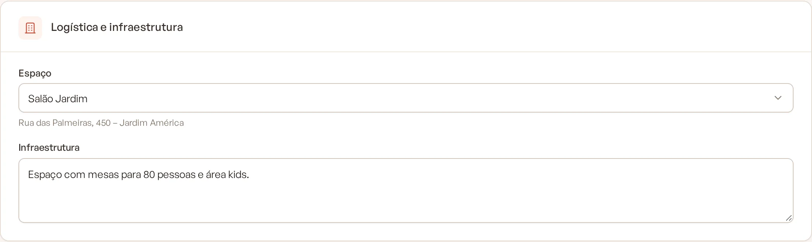
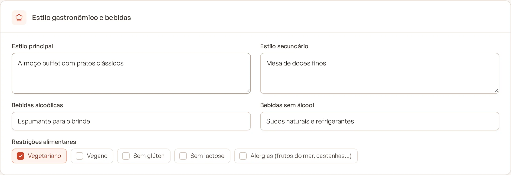

# Criar um evento

Cada pedido de orçamento vira um evento no Banket. O evento guarda o briefing completo (cliente, data, convidados,
local, estilo gastronômico, restrições) e é a partir dele que você monta o orçamento e envia a proposta.

> **Disponível em:** planos Essencial, Profissional, Prime e Master · **Quem pode usar:** todos os usuários

Pedidos que chegam pelo formulário de captação ou pelo Banket Busca viram eventos sozinhos. Este artigo explica o
cadastro manual, para pedidos recebidos por telefone, WhatsApp ou pessoalmente.

## Passo a passo

1. No menu lateral, clique em **Propostas**.
2. Clique em **Novo evento**.

   

3. No card **Cliente**, escolha um cliente já cadastrado no campo **Cliente**, ou clique em **+ Cadastrar novo cliente**
   e preencha **Tipo de pessoa**, **CPF** ou **CNPJ**, **Nome / razão social**, **E-mail** e **Telefone**.

   

   

4. Preencha os demais cards com o que você já sabe do pedido (veja a tabela abaixo). Só o cliente é obrigatório.
5. Clique em **Criar evento**.

   

   

O evento abre no **Resumo do evento**, já com a mensagem "Evento criado.". Ele entra na primeira etapa do funil
(a etapa de entrada), a menos que você tenha escolhido outra.

## Entenda os campos

### Detalhes do evento

| Campo | O que preencher |
|---|---|
| Título do evento | Opcional. Se ficar vazio, o Banket gera o título como "Ocasião – Cliente" (por exemplo, "Casamento – Maria Silva") |
| Tipo | **Corporativo** ou **Social** |
| Ocasião | Casamento, Aniversário, Confraternização… As opções dependem do Tipo escolhido (definido em **Configurações › Ocasiões**) |
| Etapa | Em que ponto do funil o evento começa. Padrão: **Entrada (padrão)** |
| Data, Início e Término | Data e horários do evento. O término precisa ser depois do início (eventos que passam da meia-noite são aceitos) |
| Convidados | Número de convidados |
| Perfil dos convidados | Ex.: Clientes VIPs, Colaboradores, Família e amigos |
| Formato de serviço | Serviço volante, Buffet, Ilhas gastronômicas, Empratado, Coquetel… |
| Duração do evento (horas) e Duração da alimentação (horas) | Quanto tempo dura o evento e o serviço de comida |

### Responsável

Nome, e-mail e WhatsApp de quem está organizando o evento (pode ser diferente do cliente, por exemplo, a secretária de
uma empresa). Aqui também ficam a **Qualificação do cliente** (Alta, Média ou Baixa) e o **Convite para experiência**
(degustação, visita ao espaço ou apenas a estimativa inicial).

O e-mail do responsável é sugerido como destinatário quando você envia a proposta.

### Logística e infraestrutura

- **Espaço**: escolha um dos **Nossos espaços**, um dos **Espaços de terceiros** ou **Outro local (empresa, residência
  ou espaço alugado)**. O espaço padrão da empresa já vem selecionado. Com "Outro local", informe **Nome do local** e
  **Endereço**.
- **Infraestrutura**: o que existe (ou falta) no local, por exemplo "precisaremos de montagem completa".

O espaço define a locação calculada no orçamento. Cadastre seus espaços no menu **Espaços**.

### Orçamento e pagamento

**Estimativa de verba total (R$)**, **Verba por pessoa (R$)** e **Forma de pagamento** (ex.: 30/60 dias). A verba
aparece no Painel de Propostas enquanto o evento não tem orçamento.

### Estilo gastronômico e bebidas

**Estilo principal**, **Estilo secundário**, **Bebidas alcoólicas**, **Bebidas sem álcool** e **Restrições
alimentares** (Vegetariano, Vegano, Sem glúten, Sem lactose, Alergias).

### Compliance, staff de terceiros e comentários

- **Requisitos de compliance**: faturamento a prazo, laudos e alvarás da Vigilância Sanitária, certidões negativas,
  contrato formal ou pedido de compra, seguro de responsabilidade civil. Comum em eventos corporativos.
- **Staff de terceiros**: se o cliente vai levar profissionais próprios e quantos.
- **Comentário do cliente**: qualquer observação do pedido.

## Dicas

- Na página de um cliente, você pode criar um evento já com aquele cliente selecionado.
- Se algum campo estiver com erro, o formulário mostra um aviso no topo e a mensagem junto do campo. O que você digitou
  não se perde.
- Preencha convidados, formato e espaço antes de criar o orçamento: eles alimentam o cálculo de staff, locação e
  lista de compras.

## Perguntas frequentes

### O cliente precisa estar cadastrado antes?
Não. Use **+ Cadastrar novo cliente** dentro do próprio formulário do evento. O cliente é salvo junto com o evento.

### Não encontro a ocasião que quero.
As ocasiões aparecem conforme o Tipo escolhido. Peça a um proprietário ou administrador para ligar a ocasião ao tipo em
**Configurações › Ocasiões**.

### O e-mail do novo cliente deu erro de duplicado.
Já existe um cliente com esse e-mail (ou documento) na empresa. Clique em **Escolher um cliente já cadastrado** e
selecione-o.

## Artigos relacionados
- [Editar o briefing do evento](03-editar-briefing-do-evento.md)
- [Resumo do evento](06-resumo-do-evento.md)
- [Criar o orçamento](../04-orcamento/01-criar-orcamento.md)
- [Cadastrar um cliente](../08-clientes/01-cadastrar-cliente.md)
- [Cadastrar um espaço](../14-espacos/01-cadastrar-espaco.md)
- [Como o pedido vira evento](../10-formularios/04-como-o-pedido-vira-evento.md)
