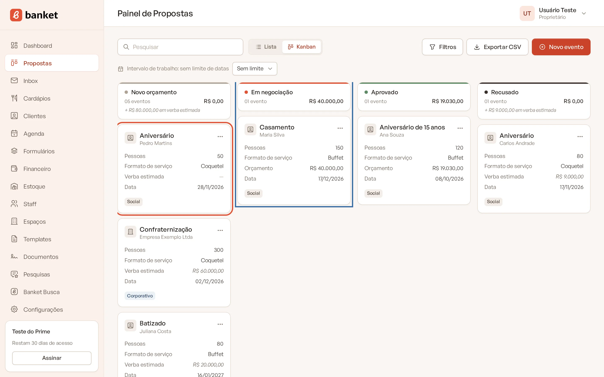
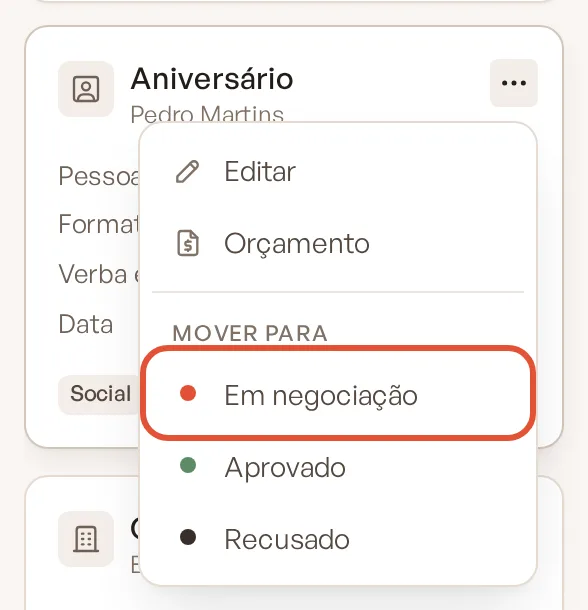
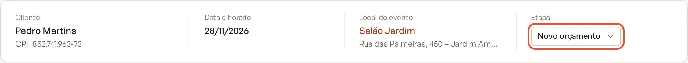
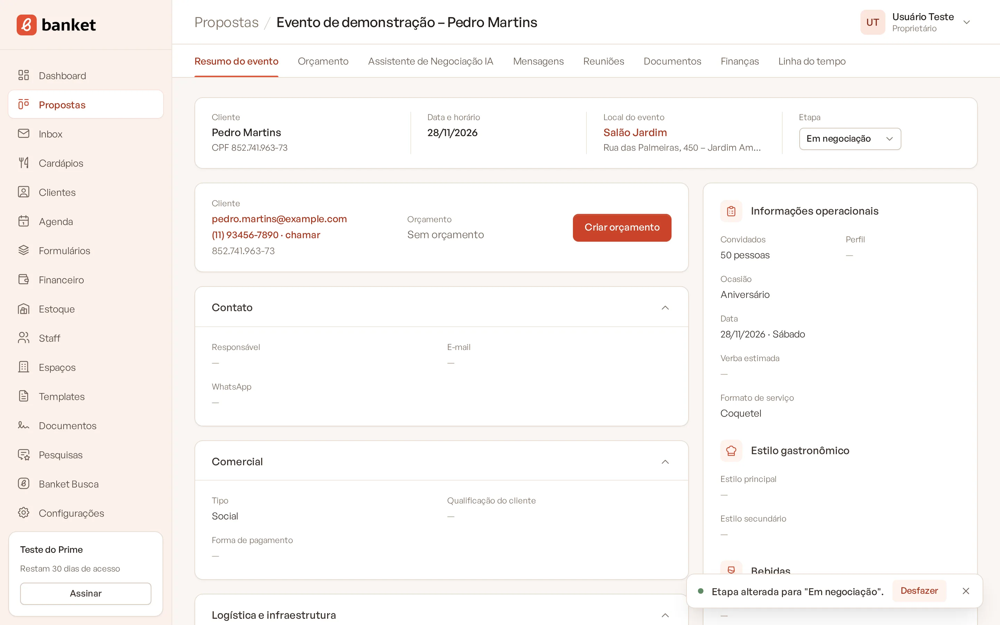
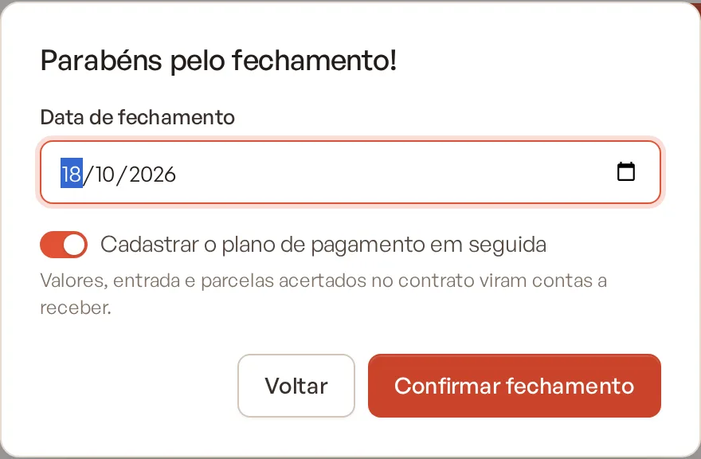
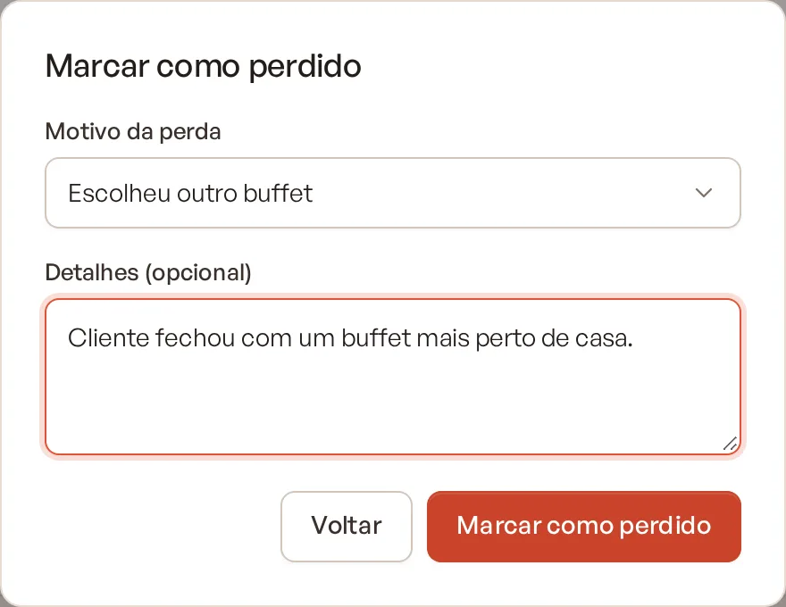
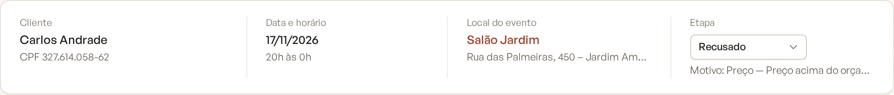
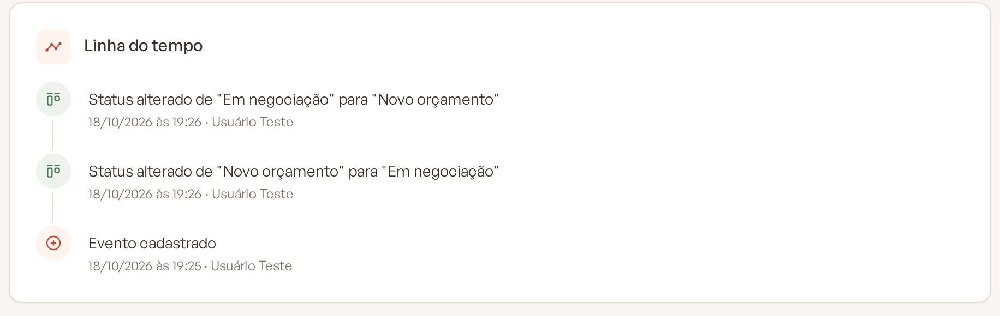

# Mover um evento entre etapas

Conforme a negociação avança, mova o evento para a etapa certa do funil. As etapas de fechamento (aprovado e recusado)
pedem um complemento: a data de fechamento ou o motivo da perda.

> **Disponível em:** planos Essencial, Profissional, Prime e Master · **Quem pode usar:** todos os usuários

## Três formas de mudar a etapa

### Arrastar no Kanban
1. No menu lateral, clique em **Propostas**.
2. Arraste o card do evento e solte-o na coluna da nova etapa.

   

### Pelo menu do card
1. No Kanban, clique no botão de três pontos do card.
2. Em **Mover para**, clique na etapa desejada.

   

É a forma usada no celular, onde não dá para arrastar.

### Pelo resumo do evento
1. Abra o evento.
2. Na faixa do topo, no campo **Etapa**, escolha a nova etapa.

   

3. A mensagem "Etapa alterada para …" aparece com o botão **Desfazer**. Clique nele para voltar à etapa anterior
   ("Etapa restaurada.").

   

## Quando a etapa é de fechamento

### Etapa de aprovado
Abre a janela **Parabéns pelo fechamento!**:

1. Confira a **Data de fechamento** (vem com a data de hoje).
2. Proprietários e administradores veem a opção **Cadastrar o plano de pagamento em seguida**, já ligada. Com ela, depois
   de confirmar, você vai direto para a aba Finanças do evento para lançar entrada e parcelas acertadas no contrato.
   Desligue se quiser fazer isso depois.
3. Clique em **Confirmar fechamento**.

### Etapa de recusado
Abre a janela **Marcar como perdido**:

1. Escolha o **Motivo da perda**: Preço, Data indisponível, Escolheu outro buffet, Evento cancelado, Sem retorno do
   cliente ou Outro.
2. Se quiser, escreva em **Detalhes (opcional)** (até 300 caracteres).
3. Clique em **Marcar como perdido**.

Para desistir da mudança, clique em **Voltar** (ou fora da janela). O evento continua onde estava.

O motivo e a data aparecem na faixa do resumo do evento ("Motivo: Preço", "Fechado em 18/10/2026"). Se o evento sair
dessa etapa depois, o motivo ou a data de fechamento são apagados.

## O que acontece depois

- A mudança vai para a **Linha do tempo**, por exemplo: Status alterado de "Em negociação" para "Recusado" — motivo:
  Preço.
- Os totais das colunas do Kanban são atualizados na hora.
- O Dashboard usa as etapas de aprovado e recusado para calcular a taxa de conversão.
- Eventos aprovados com data já passada ficam disponíveis para o envio da pesquisa de satisfação.
- Se o Banket não conseguir gravar a mudança, o card volta para a coluna de origem e uma mensagem de erro aparece.

## Perguntas frequentes

### Criar o orçamento muda a etapa?
Sim. Ao criar o orçamento de um evento que está na etapa de entrada, ele vai automaticamente para a primeira etapa de
negociação.

### Errei a etapa no Kanban. Como desfaço?
Mova o card de volta para a coluna certa. No resumo do evento, use o botão **Desfazer** da mensagem que aparece logo
após a mudança.

### Posso mudar o motivo da perda depois?
Mova o evento para outra etapa e de volta para a etapa de recusado: a janela pede o motivo de novo.

## Artigos relacionados
- [Usar o Painel de Propostas](01-painel-de-propostas.md)
- [Resumo do evento](06-resumo-do-evento.md)
- [Plano de pagamento do evento](../11-financeiro/04-plano-de-pagamento-do-evento.md)
- [Etapas do funil](../19-configuracoes/08-etapas-do-funil.md)
- [Entender o Dashboard](../02-dashboard/01-entender-o-dashboard.md)
