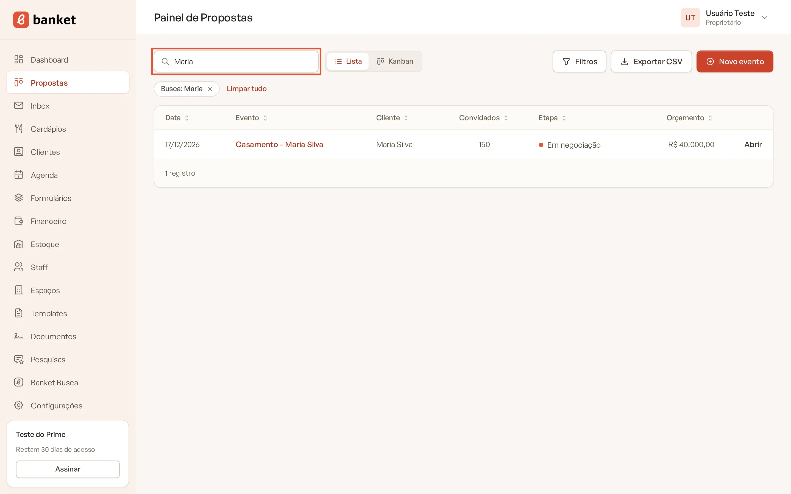
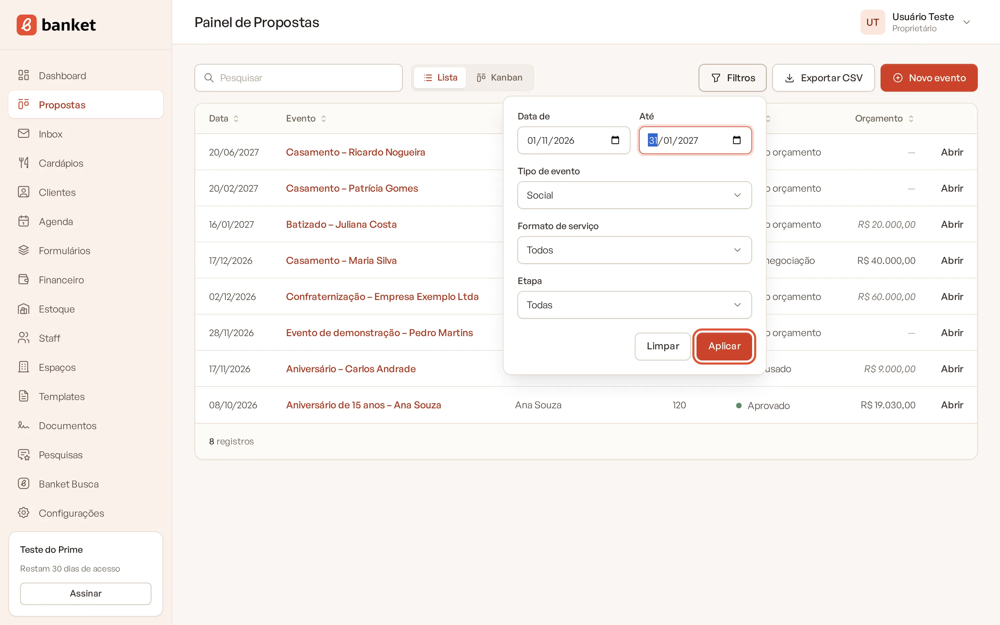
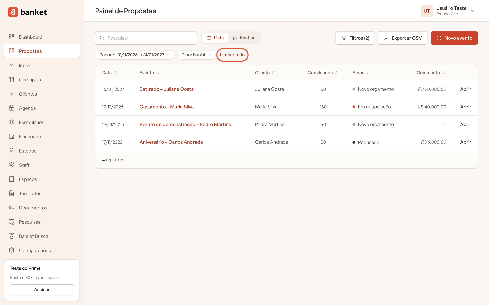
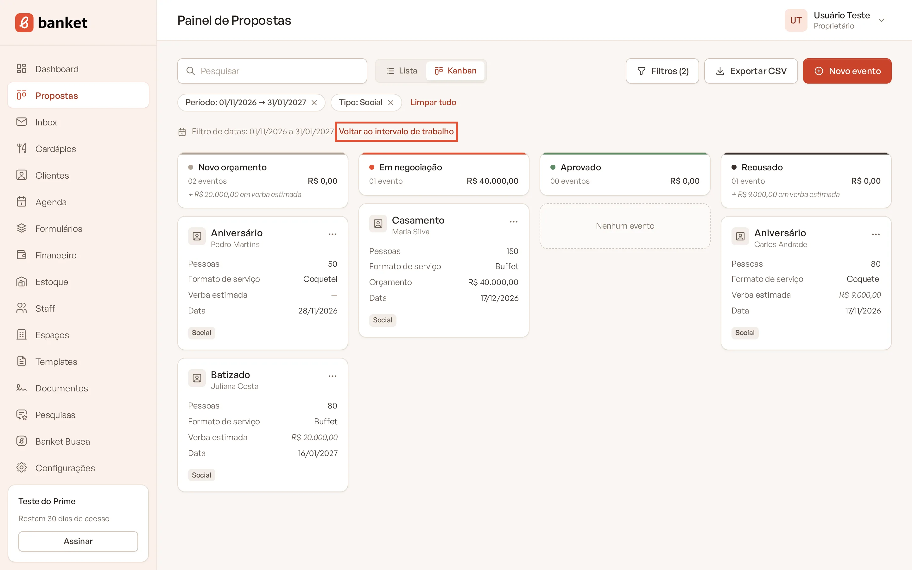

# Filtrar e exportar eventos

No Painel de Propostas você encontra rapidamente um evento pela pesquisa e pelos filtros, e pode baixar a lista em
planilha para analisar no Excel ou no Google Planilhas.

> **Disponível em:** planos Essencial, Profissional, Prime e Master · **Quem pode usar:** todos os usuários

## Pesquisar

1. No menu lateral, clique em **Propostas**.
2. Digite no campo **Pesquisar** e confirme.

   

A pesquisa procura no título do evento, no nome do cliente, no nome do responsável e no nome do local.

## Filtrar

1. Clique em **Filtros**.
2. Preencha o que quiser:
   - **Data de** e **Até**: período da data do evento.
   - **Tipo de evento**: Corporativo ou Social.
   - **Formato de serviço**.
   - **Etapa**: no Kanban, mostra só a coluna escolhida.

   

3. Clique em **Aplicar**.

   

O botão passa a mostrar quantos filtros estão ativos, por exemplo **Filtros (2)**. Logo abaixo da barra aparecem
etiquetas com cada filtro. Clique no **×** de uma etiqueta para tirar só aquele filtro, ou em **Limpar tudo** para tirar
todos. O botão **Limpar**, dentro do painel de filtros, faz o mesmo.

Os filtros valem tanto no **Kanban** quanto na **Lista**, e continuam ao trocar de visão.

### Filtro de datas e intervalo de trabalho
No Kanban, as datas do filtro substituem o intervalo de trabalho enquanto estiverem ativas. Assim você consegue ver, por
exemplo, os eventos de um mês do ano que vem. Clique em **Voltar ao intervalo de trabalho** para retornar.

## Exportar para planilha

1. Aplique a pesquisa e os filtros que quiser (opcional).
2. Clique em **Exportar CSV**.

   

O arquivo `eventos-AAAA-MM-DD.csv` é baixado com os eventos que atendem aos filtros e à pesquisa, em ordem de data. As
colunas são: Evento, Cliente, Etapa, Data, Horário, Convidados, Tipo, Ocasião, Formato de serviço, Local, Verba,
Orçamento, Responsável, E-mail e WhatsApp.

O arquivo usa ponto e vírgula como separador e acentuação compatível com o Excel em português: basta abrir com dois
cliques.

## Perguntas frequentes

### A exportação respeita o intervalo de trabalho do Kanban?
Não. A exportação considera só a pesquisa e os filtros escolhidos. Sem filtros, ela traz todos os eventos da empresa.

### Como vejo apenas os eventos perdidos?
Abra **Filtros**, escolha a etapa de recusado em **Etapa** e clique em **Aplicar**. Na visão Lista você também pode
ordenar pela coluna **Etapa**.

### O valor exportado é o da proposta enviada?
A coluna **Orçamento** traz o total da versão atual do orçamento. A coluna **Verba** traz a estimativa informada pelo
cliente.

## Artigos relacionados
- [Usar o Painel de Propostas](01-painel-de-propostas.md)
- [Mover um evento entre etapas](04-mover-evento-entre-etapas.md)
