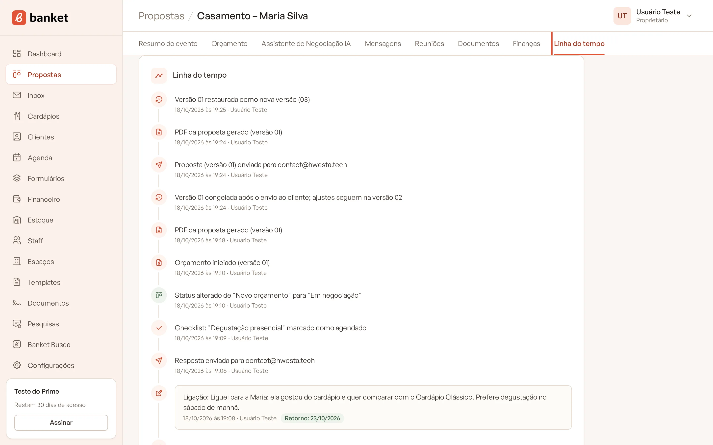
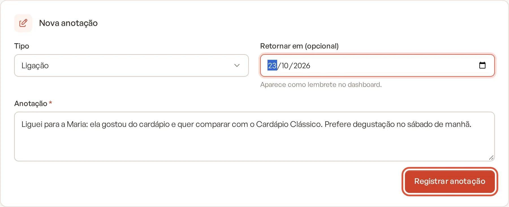
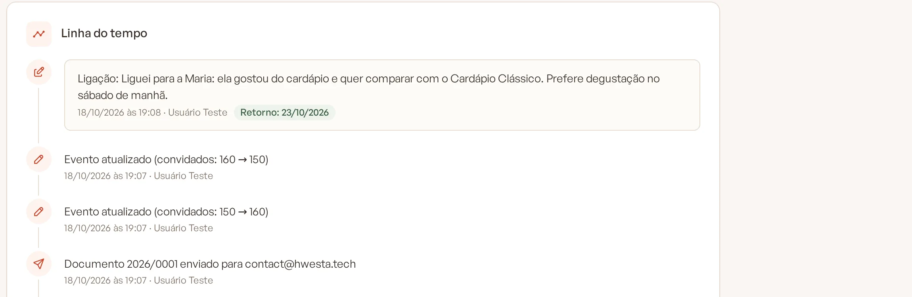

# Linha do tempo e anotações

A **Linha do tempo** é o histórico do evento: cada alteração importante fica registrada com data, hora e o nome de quem
fez. Ali você também escreve anotações sobre os contatos com o cliente e agenda retornos.

> **Disponível em:** planos Essencial, Profissional, Prime e Master · **Quem pode usar:** todos os usuários

## Consultar o histórico

1. Abra o evento.
2. Clique na aba **Linha do tempo**.

   

Os registros aparecem do mais recente para o mais antigo. O Banket registra sozinho, entre outros:

- criação do evento (manual, pelo formulário ou pelo Banket Busca);
- edições do briefing, com o antes e o depois de data, convidados, cliente e espaço;
- mudanças de etapa, com o motivo da perda ou a data de fechamento;
- mudanças de status no checklist;
- criação do orçamento e de novas versões, geração do PDF da proposta;
- e-mails enviados e respostas recebidas do cliente;
- documentos gerados, reuniões agendadas, lançamentos financeiros e pesquisa de satisfação respondida.

Ao lado da data aparece quem fez a ação. Registros automáticos aparecem como **Formulário público** (pedido recebido) ou
**Cliente** (pesquisa respondida).

## Registrar uma anotação

Use as anotações para guardar o que foi conversado fora do sistema: uma ligação, uma visita, uma conversa no WhatsApp.

1. Na aba **Linha do tempo**, vá até o card **Nova anotação**.
2. Em **Tipo**, escolha **Ligação**, **WhatsApp**, **E-mail**, **Visita**, **Degustação** ou **Anotação**.
3. Escreva o que aconteceu no campo **Anotação** (até 2.000 caracteres).
4. Se combinou de voltar a falar com o cliente, escolha a data em **Retornar em (opcional)**.
5. Clique em **Registrar anotação**.

   

A anotação entra na linha do tempo com o tipo na frente, por exemplo: "Ligação: cliente prefere degustação no sábado de
manhã."

## Retornos combinados

Quando a anotação tem data de retorno:

- a linha do tempo mostra **Retorno:** com a data; se a data já passou, ela fica destacada em vermelho;
- o retorno aparece no **Dashboard**, na lista de retornos combinados, para ninguém esquecer de ligar.

A data de retorno precisa ser hoje ou depois.

## Perguntas frequentes

### Posso editar ou apagar uma anotação?
Não. A linha do tempo é um histórico: anotações e registros não podem ser alterados nem removidos. Se precisar corrigir
algo, registre uma nova anotação.

### Outros usuários veem minhas anotações?
Sim. Todos os usuários da empresa veem a linha do tempo completa do evento.

### O que acontece com a linha do tempo se o evento for excluído?
Ela é apagada junto com o evento.

## Artigos relacionados
- [Resumo do evento](06-resumo-do-evento.md)
- [Checklist do evento](07-checklist-do-evento.md)
- [Retornos combinados e orçamentos parados](../02-dashboard/03-retornos-combinados-e-orcamentos-parados.md)
- [Assistente de Negociação](../05-assistentes-de-ia/01-assistente-de-negociacao.md)
