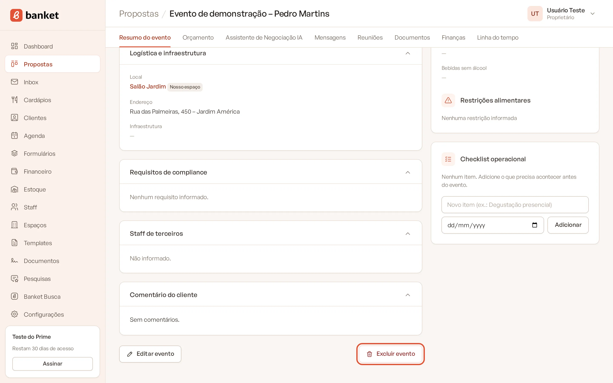
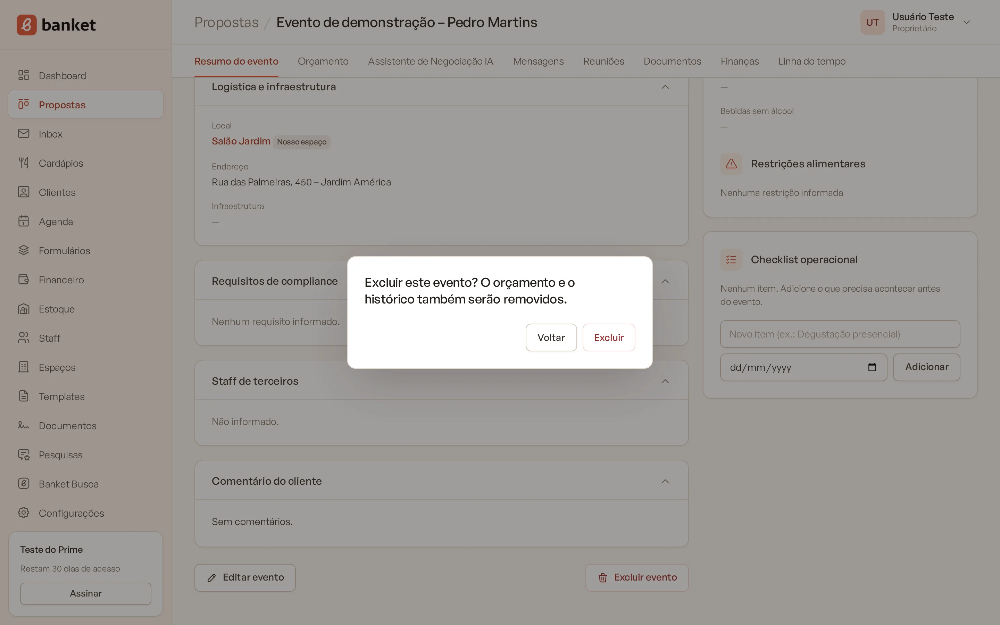
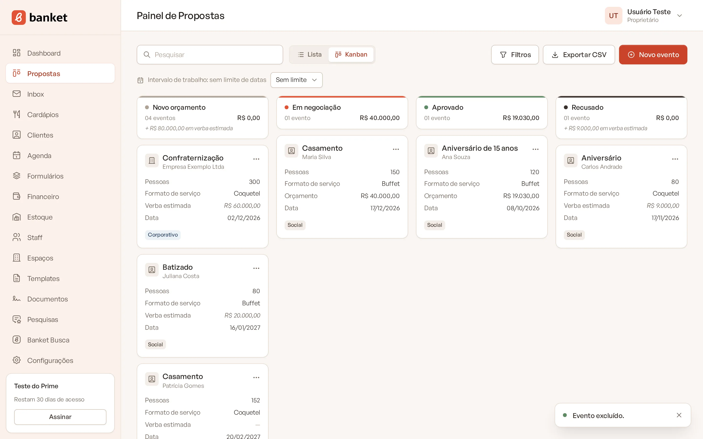

# Excluir um evento

Exclua um evento quando ele foi cadastrado por engano ou em duplicidade. A exclusão é definitiva e apaga também o
orçamento, as mensagens e o histórico do evento.

> **Disponível em:** planos Essencial, Profissional, Prime e Master · **Quem pode usar:** todos os usuários

## Antes de começar

Se o cliente desistiu ou fechou com outro buffet, **não exclua**: mova o evento para a etapa de recusado e registre o
motivo da perda. Assim o histórico fica guardado e o Dashboard calcula a taxa de conversão corretamente.

## Passo a passo

1. Abra o evento.
2. No **Resumo do evento**, role até o fim da página e clique em **Excluir evento**.

   

3. Leia o aviso "Excluir este evento? O orçamento e o histórico também serão removidos." e confirme.

   

   

Você volta para o Painel de Propostas com a mensagem "Evento excluído.".

## O que é apagado

- o orçamento, com todas as versões e os PDFs da proposta;
- as conversas e mensagens de e-mail do evento, com os anexos;
- os documentos gerados (contratos);
- o checklist e a linha do tempo, com as anotações;
- as reuniões registradas no evento;
- as análises dos assistentes de IA;
- a pesquisa de satisfação do evento.

## O que continua

- **O cliente**: o cadastro do cliente não é apagado.
- **O financeiro**: as contas a receber e a pagar do evento continuam no menu Financeiro, mas deixam de estar ligadas ao
  evento.
- **O estoque**: as movimentações de estoque continuam no histórico, sem a ligação com o evento.

## Perguntas frequentes

### Consigo recuperar um evento excluído?
Não. A exclusão não pode ser desfeita.

### Excluir o evento cancela as contas a receber?
Não. As contas continuam como estavam. Se for o caso, cancele cada uma no menu **Financeiro** (proprietários e
administradores).

### A reunião some da minha agenda do Google?
A reunião deixa de aparecer no Banket. Para avisar os participantes, cancele a reunião na aba **Reuniões** antes de
excluir o evento.

## Artigos relacionados
- [Mover um evento entre etapas](04-mover-evento-entre-etapas.md)
- [Resumo do evento](06-resumo-do-evento.md)
- [Dar baixa, cancelar e reabrir conta](../11-financeiro/03-dar-baixa-cancelar-e-reabrir-conta.md)
- [Editar e cancelar reunião](../09-agenda-e-reunioes/03-editar-e-cancelar-reuniao.md)
