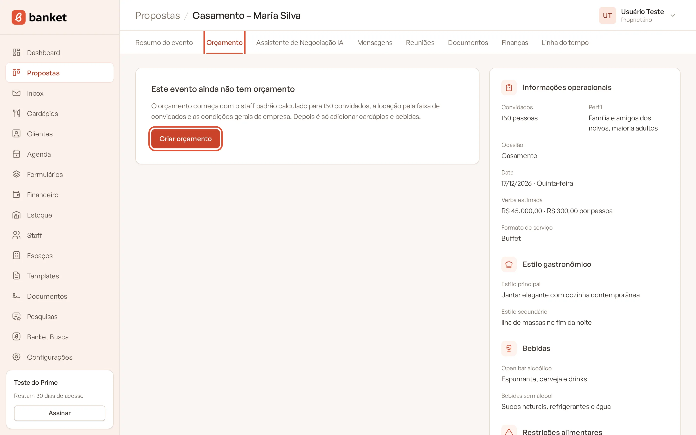
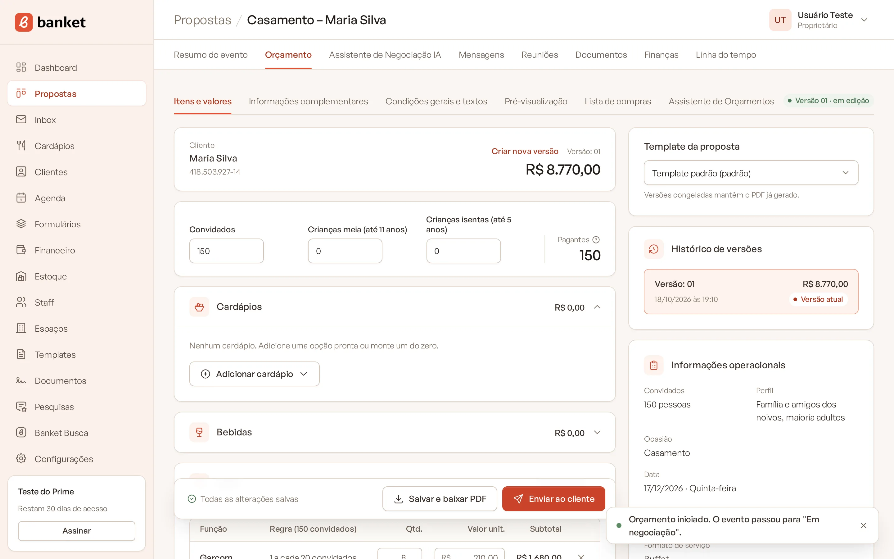
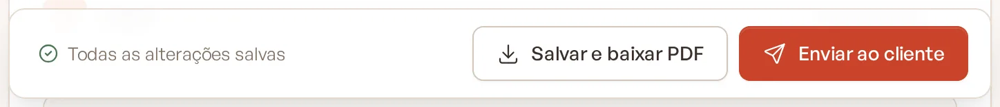
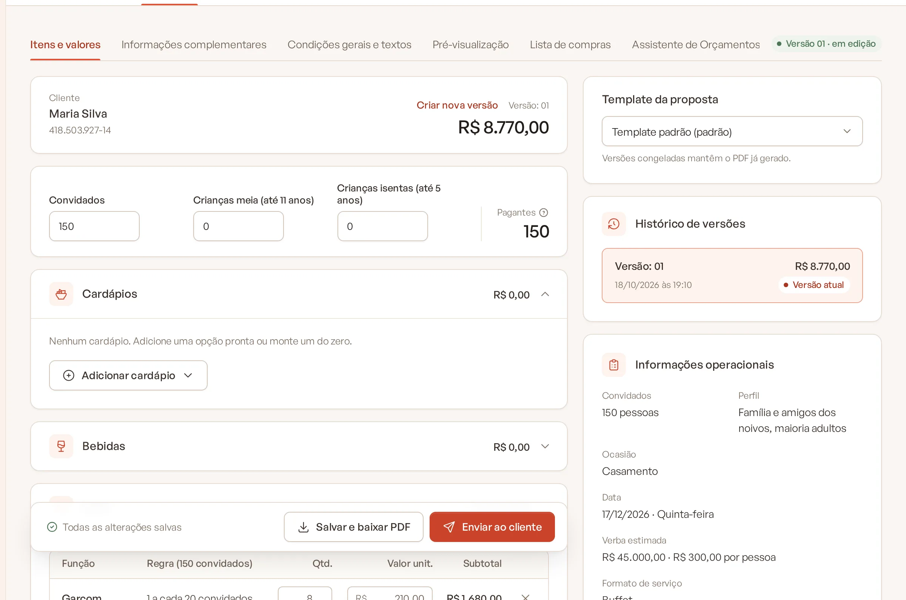

# Criar o orçamento do evento

O orçamento é onde você monta a proposta do evento: cardápios, bebidas, staff, locação do espaço e extras. Cada evento
tem um orçamento, que pode ter várias versões ao longo da negociação.

> **Disponível em:** planos Essencial, Profissional, Prime e Master · **Quem pode usar:** todos os usuários

## Antes de começar

- O evento precisa estar cadastrado (veja [Criar um evento](../03-propostas-e-eventos/02-criar-evento.md)).
- Confira o **número de convidados** e o **espaço** do evento: eles definem o staff e a locação calculados.
- Para o orçamento já nascer completo, deixe o catálogo pronto: opções de cardápio, itens com preço e funções de staff.

## Passo a passo

1. No menu lateral, clique em **Propostas** e abra o card do evento no **Painel de Propostas**.
2. Clique na aba **Orçamento**.
3. Na mensagem "Este evento ainda não tem orçamento", clique em **Criar orçamento**.

   

4. Pronto: a **versão 01** abre na sub-aba **Itens e valores**, já com o cálculo inicial.

   

## O que já vem preenchido

| Parte | Como começa |
|---|---|
| **Convidados** | O número de convidados do briefing do evento. Crianças meia e isentas começam em zero. |
| **Staff** | As funções marcadas em **Staff › Serviços e custos** com **Incluir automaticamente em novos orçamentos**, já dimensionadas para o número de convidados. |
| **Locação** | Ligada quando o evento é num espaço próprio (valor pela faixa de convidados) ou num espaço de terceiro com valor de referência. |
| **Informações complementares** | Blocos de logística e cronograma (com os horários do evento), restrições alimentares, dinâmica de serviço (com o formato de serviço) e dimensionamento da equipe. |
| **Condições gerais** | Forma de pagamento do briefing, prazo de validade da proposta (de Configurações › Empresa) e uma política de cancelamento de exemplo, que você pode editar. |
| **Textos da proposta** | Os blocos de informação marcados como ativos por padrão em **Templates › Blocos de informação**. |
| **Template** | O template padrão da empresa. |

Cardápios e bebidas começam vazios: é você quem escolhe o que entra.

## O que acontece depois

- Se o evento estava na etapa de entrada (novos pedidos), ele passa sozinho para a primeira etapa de negociação. A
  mensagem "Orçamento iniciado. O evento passou para..." confirma a mudança.
- A linha do tempo do evento registra "Orçamento iniciado (versão 01)".
- O orçamento salva sozinho a cada alteração. O estado aparece na barra no rodapé: **Todas as alterações salvas**,
  **Alterações pendentes…**, **Salvando…** ou **Erro ao salvar**.

## As sub-abas do orçamento

No topo do orçamento ficam as sub-abas e um selo com a versão que você está vendo (por exemplo, "Versão 01 · em edição"):

- **Itens e valores**: cardápios, bebidas, staff, locação, extras e o resumo do valor.
- **Informações complementares**: blocos de informação impressos na proposta.
- **Condições gerais e textos**: condições comerciais e os textos da proposta.
- **Pré-visualização**: a proposta como o cliente vai receber.
- **Lista de compras**: quantidades para comprar (uso interno).
- **Assistente de Orçamentos IA**: margem projetada e sugestões da IA (planos Profissional, Prime e Master).

## Perguntas frequentes

### Posso ter mais de um orçamento no mesmo evento?
Não. Cada evento tem um orçamento. Para propor alternativas, use as versões (veja
[Versões do orçamento](08-versoes-do-orcamento.md)) ou inclua mais de um cardápio na mesma versão.

### Mudei o número de convidados do evento. O orçamento acompanha?
A versão em edição acompanha os dados atuais do evento (cabeçalho, convidados e espaço) quando é salva. Versões
congeladas guardam o que foi proposto e não mudam.

### O staff não apareceu no orçamento novo. Por quê?
Só entram as funções ativas marcadas para inclusão automática em **Staff › Serviços e custos**. Você também pode
adicionar uma função manualmente (veja [Staff no orçamento](04-staff-no-orcamento.md)).

## Artigos relacionados
- [Adicionar cardápios](02-adicionar-cardapios.md)
- [Como o valor é calculado](13-como-o-valor-e-calculado.md)
- [Versões do orçamento](08-versoes-do-orcamento.md)
- [Resumo do evento](../03-propostas-e-eventos/06-resumo-do-evento.md)
- [Serviços e funções do staff](../13-staff/01-servicos-e-funcoes.md)
