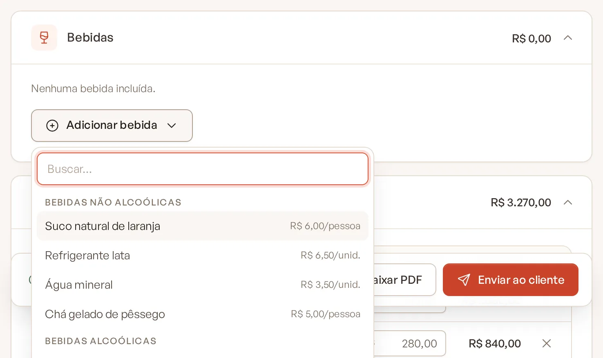
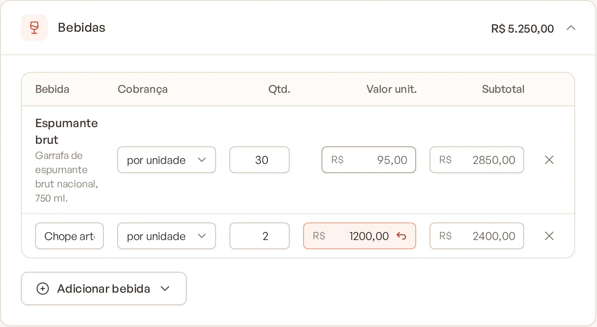

# Adicionar bebidas ao orçamento

A seção **Bebidas** reúne o que será servido para beber, cobrado por pessoa (pacote) ou por unidade (garrafas, barris,
caixas).

> **Disponível em:** planos Essencial, Profissional, Prime e Master · **Quem pode usar:** todos os usuários

## Antes de começar

As opções de bebida vêm das seções do cardápio cujos itens têm a categoria principal **Bebida**. Cadastre-as em
**Cardápios** (veja [Categorias de item](../07-cardapios/04-categorias-de-item.md)).

- Seção de bebida **com preço** aparece como **Pacote** (ex.: "Pacote Bebidas não alcoólicas").
- Seção de bebida **sem preço** mostra cada item separadamente.

## Passo a passo

1. Abra o evento, clique na aba **Orçamento** e vá até a seção **Bebidas**.
2. Clique em **Adicionar bebida** e escolha:
   - um pacote ou item do catálogo; ou
   - **Bebida avulsa (valor manual)**, para algo que não está cadastrado. Digite o nome na linha criada.

   

3. Na coluna **Cobrança**, escolha **por pessoa** ou **por unidade**.
4. Se for por unidade, informe a quantidade em **Qtd.**
5. Ajuste o **Valor unit.** ou o **Subtotal** se precisar.

## Entenda as colunas

| Coluna | O que significa |
|---|---|
| **Bebida** | Nome e, nos pacotes, a lista dos itens da seção. |
| **Cobrança** | **por pessoa**: multiplica pelos pagantes. **por unidade**: multiplica pela quantidade. |
| **Qtd.** | Na cobrança por pessoa mostra os pagantes (não editável). Na cobrança por unidade, você informa. |
| **Valor unit.** | Preço do catálogo. Digite para ajustar. |
| **Subtotal** | Valor unitário × pagantes ou × quantidade. Digite para substituir. |

Para remover uma bebida, clique no **x** da linha. O aviso traz **Desfazer**.

## Perguntas frequentes

### A quantidade de bebidas por unidade entra na lista de compras?
Sim. Bebida por unidade entra na lista com a quantidade do orçamento. Bebida por pessoa usa a porção por pessoa do
cadastro do item (se houver) × convidados.

### Posso cobrar um pacote de bebidas por unidade?
Sim. Troque a cobrança na linha para **por unidade** e informe a quantidade.

### Onde as bebidas aparecem na proposta?
Na parte de bebidas do PDF, com o nome e a descrição de cada uma.

## Artigos relacionados
- [Adicionar cardápios](02-adicionar-cardapios.md)
- [Como o valor é calculado](13-como-o-valor-e-calculado.md)
- [Lista de compras](12-lista-de-compras.md)
- [Cadastrar itens](../07-cardapios/02-cadastrar-itens.md)
