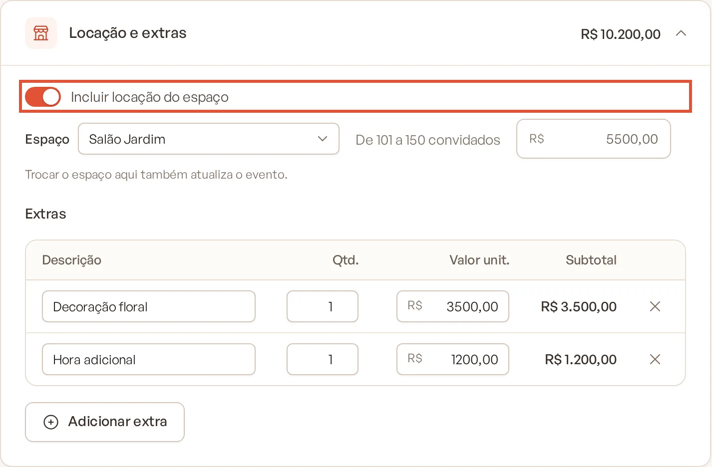

# Locação do espaço e extras

A seção **Locação e extras** cobra o uso do espaço do evento e reúne as taxas e serviços avulsos (hora adicional, taxa
de rolha, serviço externo…).

> **Disponível em:** planos Essencial, Profissional, Prime e Master · **Quem pode usar:** todos os usuários

## Antes de começar

- Cadastre seus espaços em **Espaços** (veja [Cadastrar espaço](../14-espacos/01-cadastrar-espaco.md)).
- Para espaços próprios, cadastre as [faixas de locação](../14-espacos/02-faixas-de-locacao.md) por número de
  convidados. Para espaços de terceiros, informe o valor de referência da locação.

## Incluir a locação

1. Abra o evento, clique na aba **Orçamento** e vá até a seção **Locação e extras**.
2. Ligue **Incluir locação do espaço**.
3. No campo **Espaço**, escolha:
   - um item de **Nossos espaços** (espaços próprios);
   - um item de **Espaços de terceiros**; ou
   - **Outro local (sem espaço cadastrado)**.
4. Confira o valor calculado. Se precisar, digite outro valor no campo da locação.

   

## Como o valor da locação é calculado

| Espaço escolhido | Valor |
|---|---|
| **Espaço próprio** | O valor da faixa de locação que contém o número de convidados. Sem faixa compatível, aparece "Nenhuma faixa de locação para este número de convidados" e o valor fica zero. |
| **Espaço de terceiro** | O valor de referência do espaço ("Valor de referência do espaço"). Sem valor cadastrado, aparece "Sem valor de referência cadastrado". |
| **Outro local** | Zero. Aparece "Informe o valor da locação" para você digitar. |

A locação só entra no total quando **Incluir locação do espaço** está ligado.

> **Atenção:** trocar o espaço aqui também atualiza o espaço do evento. A mudança fica registrada na linha do tempo.

## Lançar extras

1. Na mesma seção, em **Extras**, clique em **Adicionar extra**.
2. Na nova linha, digite a **Descrição**. A lista sugere: Hora adicional, Taxa de rolha, Taxa de serviço de chope, Taxa
   de cerimônia no local e Taxa de serviço externo.
3. Informe a **Qtd.** e o **Valor unit.**. O **Subtotal** é calculado sozinho.
4. Para tirar um extra, clique no **x** da linha. O aviso traz **Desfazer**.

## Na proposta

- A locação aparece em **Informações complementares** como "Locação do espaço — nome do espaço", com o valor.
- Os extras aparecem como **Adicionais**, com a quantidade quando for diferente de 1.

## Perguntas frequentes

### Por que a locação veio ligada no orçamento novo?
Quando o evento é num espaço próprio, ou num espaço de terceiro com valor de referência, a locação já começa incluída.
Desligue a chave se não quiser cobrar.

### Mudei o número de convidados e a locação mudou de valor. Está certo?
Sim. No espaço próprio, o valor segue a faixa de convidados. Se quiser manter um valor fixo, digite-o no campo da
locação.

### A locação muda numa versão já enviada?
Não. Versões congeladas guardam o valor que foi proposto, mesmo que as faixas do espaço mudem depois.

## Artigos relacionados
- [Faixas de locação](../14-espacos/02-faixas-de-locacao.md)
- [Como o valor é calculado](13-como-o-valor-e-calculado.md)
- [Versões do orçamento](08-versoes-do-orcamento.md)
- [Editar o briefing do evento](../03-propostas-e-eventos/03-editar-briefing-do-evento.md)
