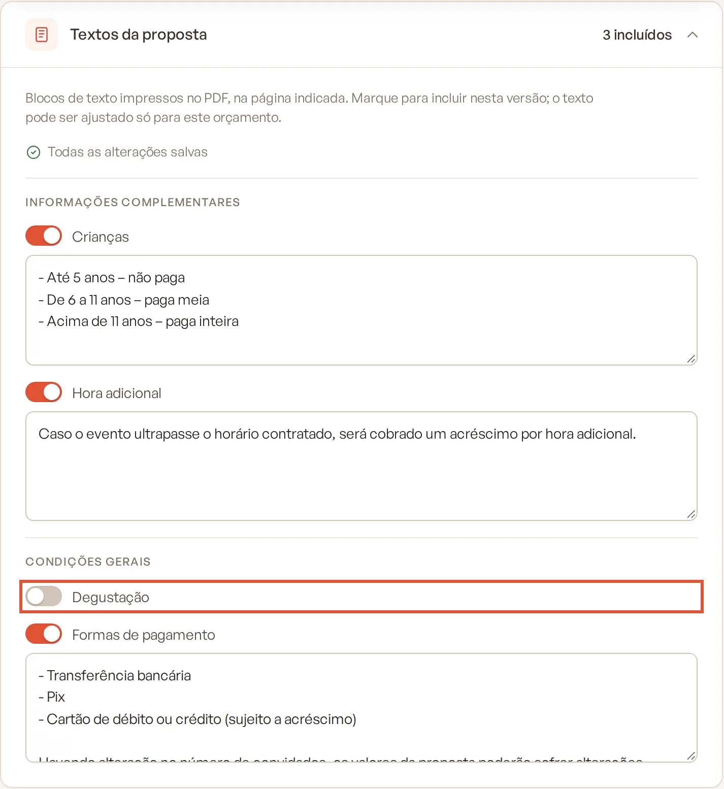
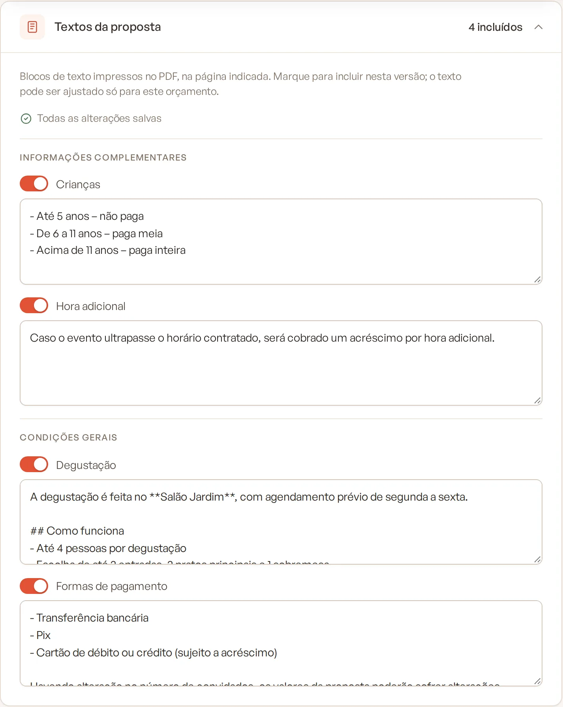

# Textos da proposta

Os textos da proposta são blocos de texto livre (regras para crianças, hora adicional, formas de pagamento…) impressos
no PDF, numa página definida. Eles vêm do cadastro em **Templates › Blocos de informação** e você escolhe, em cada
versão do orçamento, quais entram.

> **Disponível em:** planos Essencial, Profissional, Prime e Master · **Quem pode usar:** todos os usuários

## Antes de começar

Cadastre os blocos em **Templates › Blocos de informação** (veja
[Blocos de informação](../15-templates/04-blocos-de-informacao.md)). Os blocos marcados como ativos por padrão já entram
em todo orçamento novo.

## Passo a passo

1. Abra o evento, clique na aba **Orçamento** e depois na sub-aba **Condições gerais e textos**.
2. Desça até **Textos da proposta**. O cabeçalho mostra quantos blocos estão incluídos.
3. Os blocos aparecem agrupados pela página em que são impressos:
   - **Cardápio (após os cardápios)**
   - **Bebidas**
   - **Staff**
   - **Informações complementares**
   - **Condições gerais**
4. Ligue a chave do bloco para incluí-lo nesta versão. Desligue para retirá-lo.

   

5. Com o bloco ligado, o texto aparece numa caixa: ajuste o que precisar só para este orçamento.

   

As alterações salvam sozinhas.

## Regras importantes

- **Cada bloco incluído é uma cópia.** Editar o texto aqui não muda o cadastro em Templates, e mudar o cadastro depois
  não altera os orçamentos que já têm o bloco.
- Para pegar o texto atualizado do cadastro, desligue e ligue o bloco de novo (o texto ajustado nesta versão se perde).
- Se um bloco for excluído do cadastro, ele continua na versão com a indicação **(removido do cadastro)**. Desligue a
  chave para tirá-lo.
- O texto aceita a marcação simples do cadastro de blocos: `## Subtítulo`, `- item de lista`, `**negrito**` e uma
  linha em branco para separar parágrafos.

## Perguntas frequentes

### Qual a diferença entre os textos da proposta e as condições gerais?
As condições gerais são linhas "rótulo → valor" (ex.: "Forma de pagamento acordada → 30% de sinal"). Os textos da
proposta são parágrafos livres, reaproveitados de um cadastro.

### O bloco que criei em Templates não aparece. Por quê?
Confira se ele está ativo no cadastro. Blocos novos aparecem na lista para você ligar; só os marcados como ativos por
padrão entram sozinhos nos orçamentos criados depois.

### Consigo mudar os textos de uma versão já enviada?
Não. Versões congeladas são somente leitura. Edite na versão em edição.

## Artigos relacionados
- [Blocos de informação](../15-templates/04-blocos-de-informacao.md)
- [Informações complementares e condições gerais](06-informacoes-complementares-e-condicoes-gerais.md)
- [Prévia e PDF da proposta](09-previa-e-pdf-da-proposta.md)
