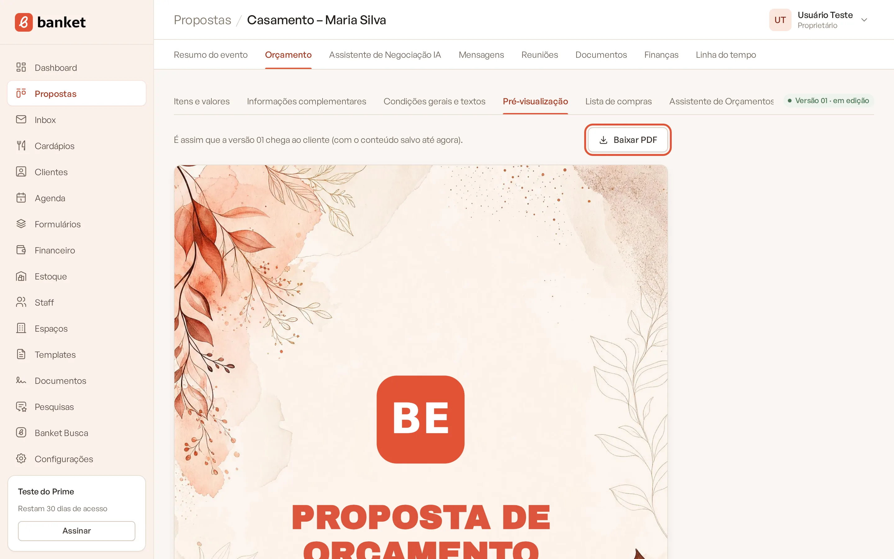
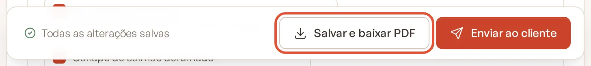
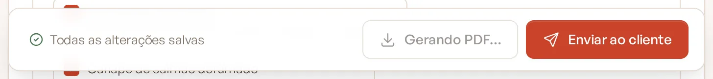
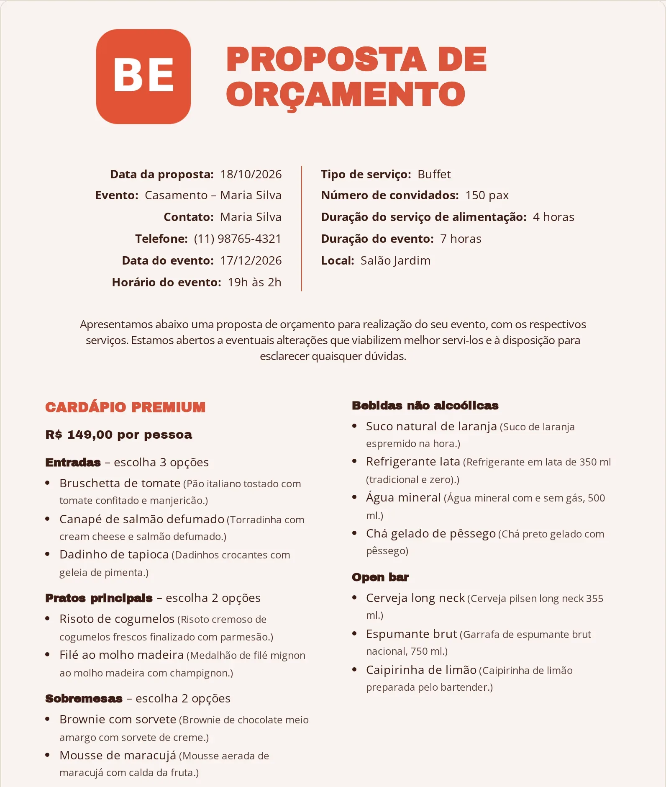
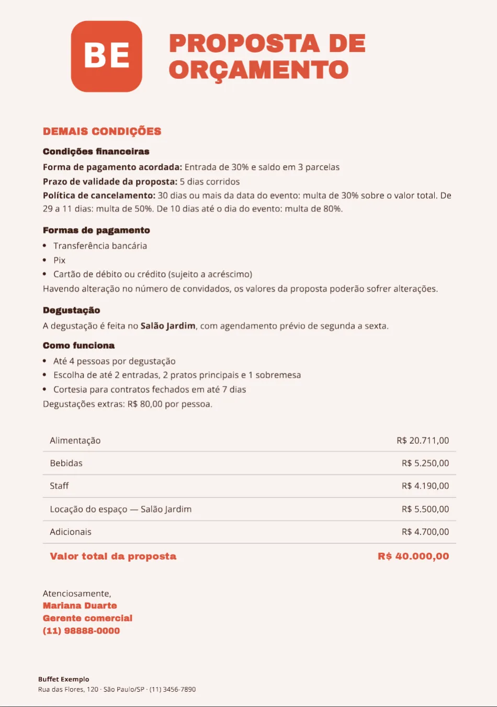
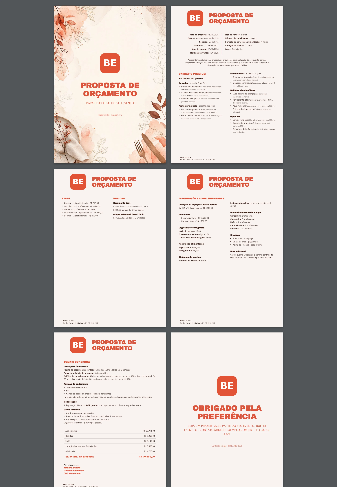

# Prévia e PDF da proposta

O Banket transforma o orçamento numa proposta em PDF com a identidade visual do seu buffet (o template). Você pode
conferir a proposta na tela antes de baixar ou enviar.

> **Disponível em:** planos Essencial, Profissional, Prime e Master · **Quem pode usar:** todos os usuários

## Ver a prévia

1. Abra o evento, clique na aba **Orçamento** e depois na sub-aba **Pré-visualização**.
2. As páginas aparecem em miniatura, iguais às do PDF: capa, conteúdo e contracapa (capa e contracapa só quando estão
   ativas no template).

   

3. A prévia mostra o conteúdo salvo até agora. Se acabou de editar, espere o aviso **Todas as alterações salvas**.

## Baixar o PDF

Você pode baixar de dois lugares:

- Na sub-aba **Itens e valores**, clique em **Salvar e baixar PDF** na barra do rodapé. O Banket salva o que estiver
  pendente antes de gerar. Numa versão congelada, o botão se chama **Baixar PDF**.
- Na sub-aba **Pré-visualização**, clique em **Baixar PDF**.

Gerar o PDF leva alguns segundos; o botão mostra **Gerando PDF…** enquanto isso. Para baixar o PDF de uma versão antiga,
acesse a versão pelo **Histórico de versões** antes.

## O que vai na proposta

| Parte | Conteúdo |
|---|---|
| **Capa** | Título e texto da capa do template (se ativa). |
| **Cardápios** | Cada cardápio com suas seções e itens marcados, e os textos da página de cardápio. |
| **Staff e Bebidas** | Funções com quantidade e valor; bebidas com preço por pessoa ou por unidade. |
| **Informações complementares** | Locação do espaço, adicionais (extras) e os blocos de informação. |
| **Demais condições** | Condições gerais e textos da página de condições. |
| **Resumo** | Alimentação, bebidas, staff, locação, adicionais e o **Valor total da proposta** (se estiver visível). |
| **Assinatura** | Nome, cargo e telefone de Configurações › Empresa (ou o nome da empresa). |
| **Contracapa** | Título e texto da contracapa do template (se ativa). |

**Não vão para a proposta:** as observações internas, a lista de compras, a margem e os custos.

## Esconder o valor total

No fim da sub-aba **Itens e valores**, desligue **Mostrar o valor total na proposta**. O resumo de valores some do PDF;
os preços de cada parte continuam.

## Perguntas frequentes

### O PDF fica salvo em algum lugar?
Sim. O PDF de cada versão fica guardado e é anexado quando você envia a proposta. A geração também aparece na linha do
tempo do evento.

### Mudei o template e o PDF da versão antiga não mudou. Por quê?
Versões congeladas reaproveitam o PDF já gerado para manter o que o cliente recebeu. A versão em edição sempre usa o
template atual.

### Apareceu "Não foi possível baixar o PDF". O que fazer?
Tente de novo depois de alguns segundos. Se persistir, abra um chamado em **Suporte**.

## Artigos relacionados
- [Escolher o template da proposta](10-escolher-template-da-proposta.md)
- [Enviar a proposta por e-mail](11-enviar-proposta-por-email.md)
- [Textos da proposta](07-textos-da-proposta.md)
- [Criar template](../15-templates/01-criar-template.md)
