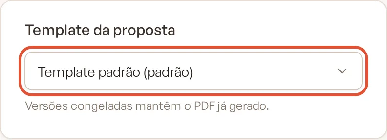
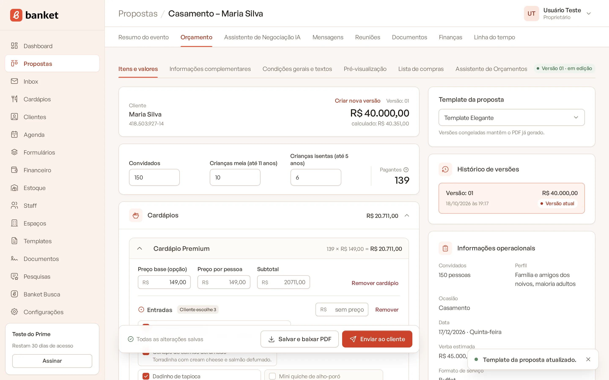
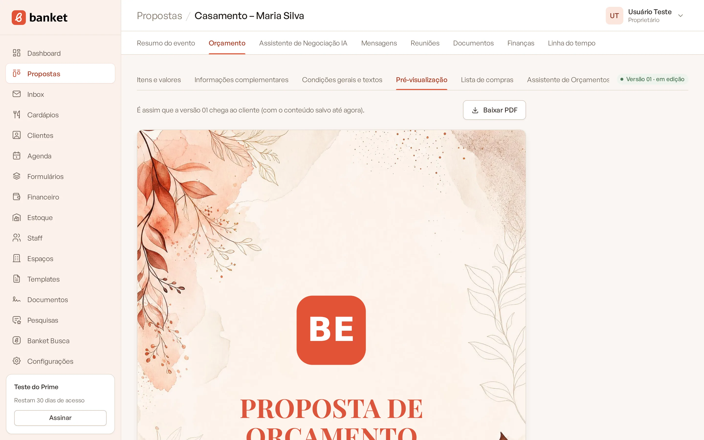

# Escolher o template da proposta

O template define o visual do PDF: fontes, cores, logotipo, imagens e textos de capa e contracapa. Todo orçamento usa o
template padrão da empresa, mas você pode escolher outro para um evento específico (por exemplo, um template para
eventos corporativos e outro para casamentos).

> **Disponível em:** planos Essencial, Profissional, Prime e Master · **Quem pode usar:** todos os usuários

## Antes de começar

Os templates são criados em **Templates** (veja [Criar template](../15-templates/01-criar-template.md)). Sem outros
templates, a lista mostra só o padrão.

## Passo a passo

1. Abra o evento e clique na aba **Orçamento**.
2. Na coluna da direita, no card **Template da proposta**, abra a lista.

   

3. Escolha o template. O que tem **(padrão)** no nome é o template padrão da empresa.
4. A troca é salva na hora e aparece o aviso "Template da proposta atualizado."

   

5. Confira o resultado na sub-aba **Pré-visualização**.

   

## Regras importantes

- O template vale para o orçamento do evento, não para uma versão específica.
- **Versões congeladas mantêm o PDF já gerado.** Trocar o template muda os próximos PDFs da versão em edição, não o que
  já foi enviado ao cliente.
- Escolher a opção **(padrão)** faz o orçamento acompanhar o template padrão da empresa: se o padrão mudar em
  Templates, este orçamento também muda.

## Limites do plano

| Plano | Templates |
|---|---|
| Essencial | 1 |
| Profissional | 3 |
| Prime | 10 |
| Master | sem limite |

## Perguntas frequentes

### Como mudo o template de todos os orçamentos de uma vez?
Defina outro template como padrão em **Templates**. Os orçamentos que usam o padrão passam a usar o novo.

### Posso ter uma capa diferente só para um cliente?
Sim: crie (ou duplique) um template com a capa desejada e escolha-o neste orçamento.

## Artigos relacionados
- [Criar template](../15-templates/01-criar-template.md)
- [PDF de exemplo e template padrão](../15-templates/05-pdf-de-exemplo-e-template-padrao.md)
- [Prévia e PDF da proposta](09-previa-e-pdf-da-proposta.md)
