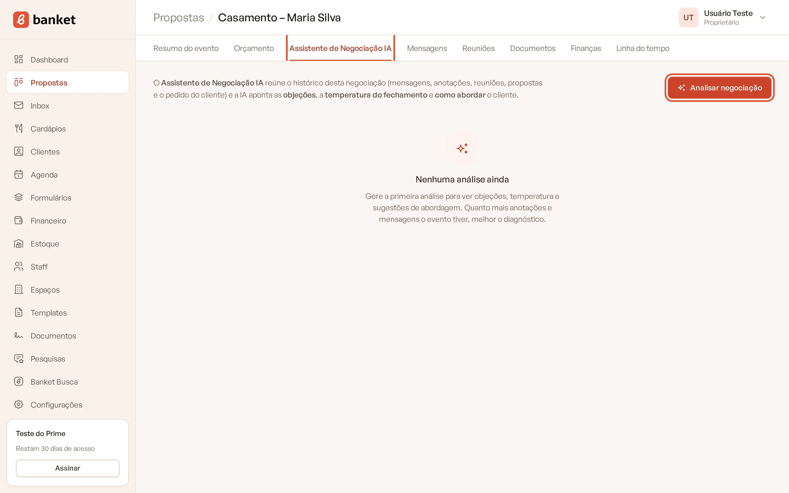
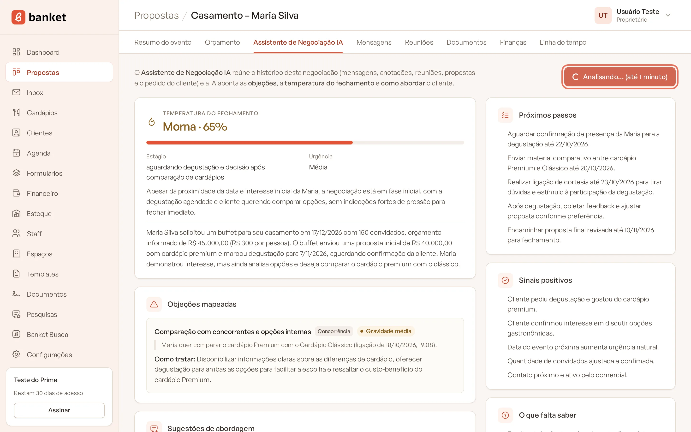
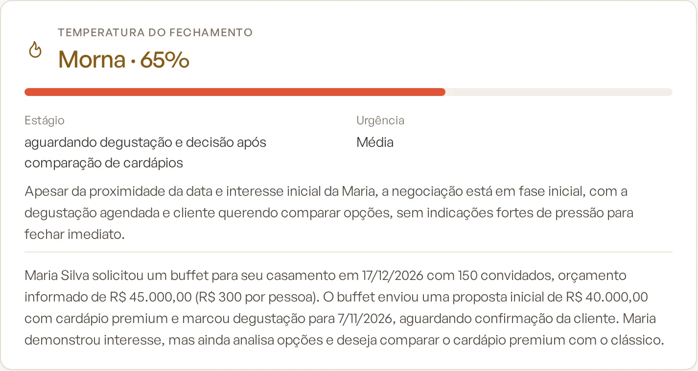
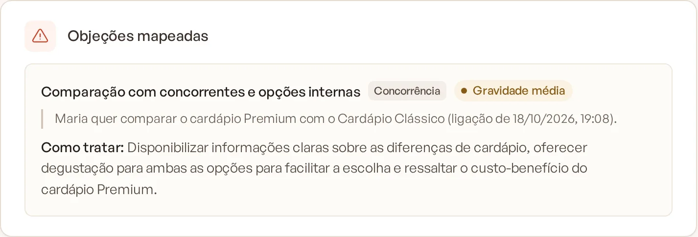
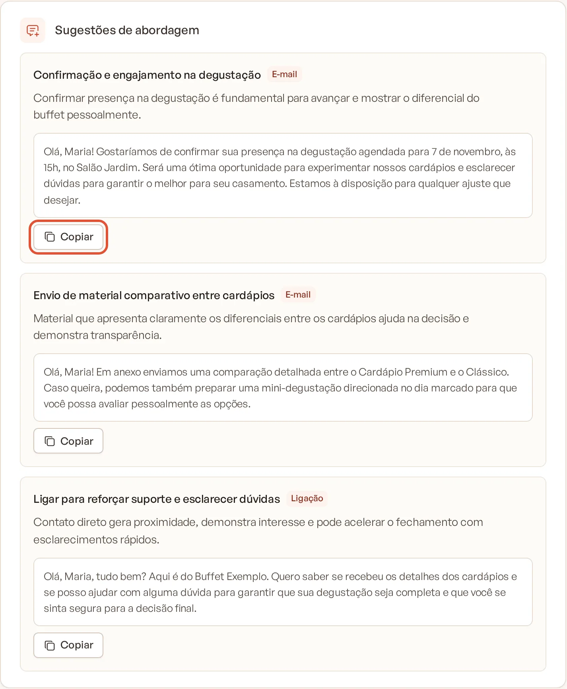
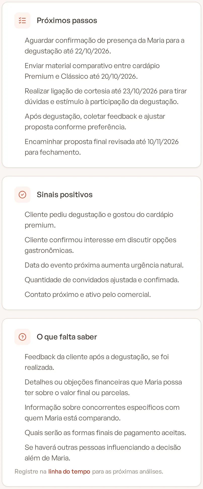
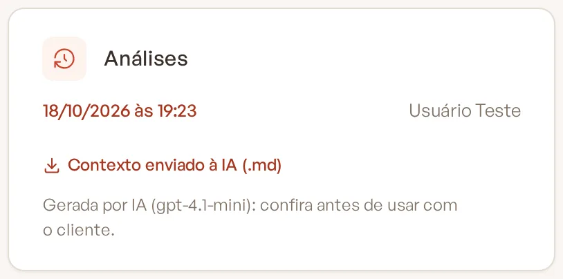

# Assistente de Negociação IA

O Assistente de Negociação IA lê o histórico de um evento (pedido, propostas, mensagens, reuniões e anotações) e devolve
um diagnóstico da negociação: a chance de fechamento, as objeções do cliente, sugestões de abordagem com texto pronto e
os próximos passos.

> **Disponível em:** planos Profissional, Prime e Master · **Quem pode usar:** todos os usuários

## Antes de começar

Quanto mais informação o evento tiver, melhor o diagnóstico. A análise considera:

- os dados do evento e do cliente e o comentário do cliente no pedido;
- as versões da proposta (valores e envios);
- as reuniões, visitas e degustações agendadas;
- a linha do tempo (anotações da equipe, retornos combinados, mudanças de etapa);
- os e-mails trocados no Inbox;
- as respostas do formulário de pedido.

Registre as conversas por telefone ou WhatsApp como anotações na
[linha do tempo](../03-propostas-e-eventos/08-linha-do-tempo-e-anotacoes.md): elas entram na análise.

## Passo a passo

1. No menu lateral, clique em **Propostas** e abra o evento.
2. Clique na aba **Assistente de Negociação IA**.
3. Clique em **Analisar negociação**. A análise leva até 1 minuto (o botão mostra **Analisando… (até 1 minuto)**).

   

   

4. Leia o resultado. Para refazer depois de novas conversas, clique em **Atualizar análise**.

## Entenda o resultado

| Parte | O que mostra |
|---|---|
| **Temperatura do fechamento** | **Fria**, **Morna** ou **Quente**, com a chance de fechamento em %, o **Estágio** da decisão (ex.: comparando fornecedores), a **Urgência** e a justificativa, além de um resumo da negociação. |
| **Objeções mapeadas** | Cada objeção com a categoria (Preço, Forma de pagamento, Concorrência, Logística e horário, Cardápio, Data, Confiança, Decisão / aprovação ou Outro), a gravidade, o trecho do histórico que a evidencia e **Como tratar**. |
| **Sugestões de abordagem** | Argumentos com o canal indicado (WhatsApp, E-mail, Ligação ou Reunião) e um roteiro pronto. Clique em **Copiar** para levar o texto. |
| **Próximos passos** | Lista do que fazer em seguida. |
| **Sinais positivos** | O que indica interesse do cliente. |
| **O que falta saber** | Informações que a IA não encontrou. Registre-as na linha do tempo para as próximas análises. |
| **Análises** | Histórico das análises do evento, com data e autor. Clique numa data para rever uma análise anterior. |

## Regras importantes

- **Confira antes de usar com o cliente.** O texto é gerado por inteligência artificial e pode errar. A tela lembra
  disso abaixo do histórico.
- A IA trata o conteúdo dos e-mails e formulários do cliente como informação a analisar, nunca como instrução.
- Quem tem o papel **Usuário** só leva para a análise as conversas do Inbox que são dele, como no próprio Inbox.
  Proprietários e administradores levam todas as conversas do evento.
- Em **Contexto enviado à IA (.md)** você baixa exatamente o que foi enviado para a análise.

## Limites do plano

As análises de IA são contadas por mês e somam as do Assistente de Negociação e as do Assistente de Orçamentos:

| Plano | Análises de IA por mês |
|---|---|
| Profissional | 30 |
| Prime | 100 |
| Master | sem limite |

Além disso, há um limite de 20 análises a cada 10 minutos por empresa. Ao passar dele, aparece "Muitas análises de IA em
pouco tempo. Aguarde alguns minutos e tente de novo."

## Perguntas frequentes

### A análise muda a etapa do evento ou envia algo ao cliente?
Não. Ela só mostra o diagnóstico. Nada é enviado nem alterado no evento.

### O botão aparece desativado. Por quê?
A integração com IA não está disponível no momento. Se o aviso continuar, abra um chamado em **Suporte**.

### No meu plano a aba aparece com cadeado. O que faço?
Os assistentes de IA estão nos planos Profissional, Prime e Master. Ao clicar, o Banket mostra a oferta para mudar de
plano (veja [Trocar de plano](../20-planos-e-assinatura/05-trocar-de-plano.md)).

## Artigos relacionados
- [Assistente de Orçamentos IA](02-assistente-de-orcamentos.md)
- [Linha do tempo e anotações](../03-propostas-e-eventos/08-linha-do-tempo-e-anotacoes.md)
- [Conhecer o Inbox](../06-inbox/01-conhecer-o-inbox.md)
- [Limites do plano](../20-planos-e-assinatura/09-limites-do-plano.md)
