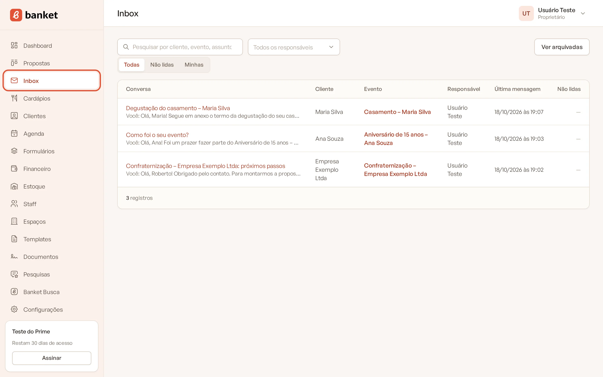
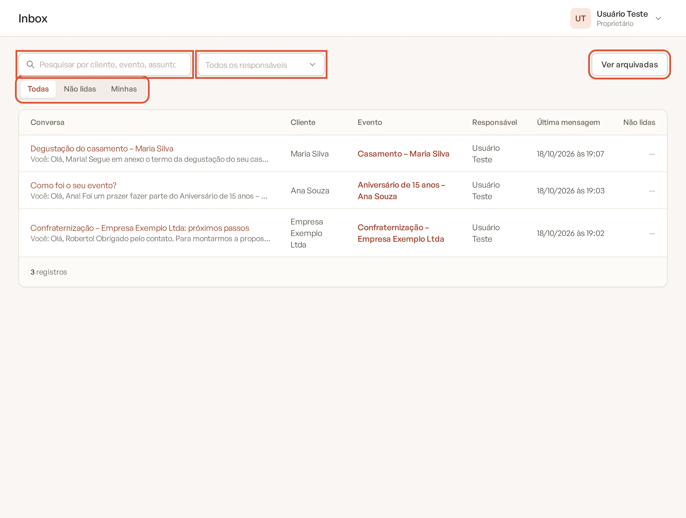
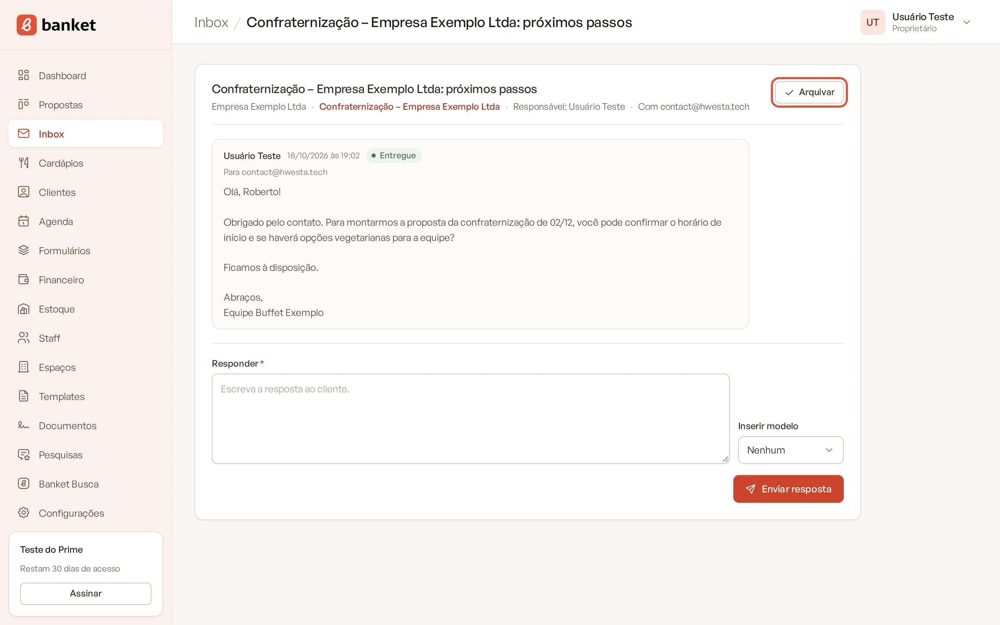
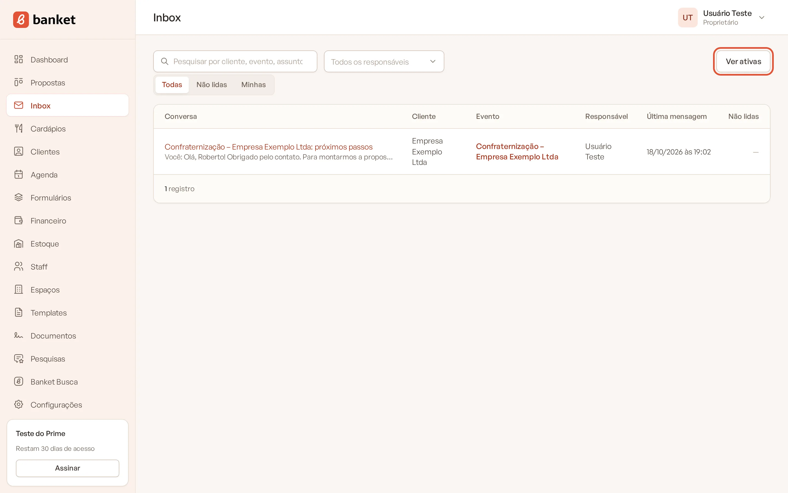

# Conhecer o Inbox

O **Inbox** reúne num só lugar as conversas por e-mail com os seus clientes. Quando você envia uma proposta ou uma
mensagem pelo Banket, a resposta do cliente volta para o próprio sistema, ligada ao evento certo. Ninguém precisa
procurar e-mail perdido na caixa pessoal.

> **Disponível em:** planos Profissional, Prime e Master · **Quem pode usar:** todos os usuários (cada usuário vê as
> próprias conversas; Proprietário e Administrador veem todas)

## Como as conversas nascem

Toda conversa está ligada a um evento. Ela começa quando você:

- envia a proposta pelo orçamento do evento;
- envia um documento (como um contrato) ou a pesquisa de satisfação do evento;
- escreve uma **Nova mensagem** na aba **Mensagens** do evento.

Cada usuário tem uma conversa por evento. Se você enviar a proposta e depois uma mensagem avulsa no mesmo evento, tudo
fica na mesma conversa.

O cliente recebe o e-mail com o seu nome e o nome da empresa como remetente (por exemplo, "Maria Silva · Buffet
Exemplo"). Quando ele clica em responder, a resposta chega no Inbox.

## Abrir o Inbox

No menu lateral, clique em **Inbox**. O número ao lado do item mostra quantas mensagens recebidas ainda não foram lidas.

A lista mostra:

| Coluna | O que é |
|---|---|
| **Conversa** | O assunto e um trecho da última mensagem, com **Cliente:** ou **Você:** na frente. Conversas com mensagens não lidas aparecem em destaque, com um ponto |
| **Cliente** | Nome do cliente do evento |
| **Evento** | Link para o evento |
| **Responsável** | Usuário dono da conversa (só proprietários e administradores veem esta coluna) |
| **Última mensagem** | Data e hora |
| **Não lidas** | Quantidade de mensagens recebidas ainda não lidas |

Clique no assunto para abrir a conversa. Ao abrir, as mensagens são marcadas como lidas.

## Quem vê cada conversa

- **Usuário**: vê e responde só as conversas que ele mesmo começou.
- **Proprietário e Administrador**: veem e respondem todas as conversas da empresa.

## Pesquisar e filtrar

- **Pesquisar por cliente, evento, assunto ou e-mail**: campo no topo da lista.
- **Todas** / **Não lidas**: mostra todas as conversas ou só as que têm mensagens novas.
- **Minhas** (proprietários e administradores): só as conversas em que você é o responsável.
- **Todos os responsáveis** (proprietários e administradores): escolha um usuário para ver só as conversas dele.

## Arquivar conversas

Quando uma negociação termina, arquive a conversa para limpar a lista:

1. Abra a conversa.
2. Clique em **Arquivar**, no canto do cabeçalho.

   

Para ver as arquivadas, clique em **Ver arquivadas** no topo do Inbox (e em **Ver ativas** para voltar). Para trazer uma
conversa de volta, abra-a e clique em **Reabrir**.

Se o cliente responder ou se você enviar uma nova mensagem numa conversa arquivada, ela volta sozinha para a lista de
ativas. Conversas arquivadas não entram no contador de não lidas do menu.

## Avisos de novas respostas

Se a sua empresa ativou os avisos no WhatsApp, o Banket pode avisar no celular quando um cliente responder. A
configuração fica em **Configurações › Empresa** (proprietários e administradores).

## Perguntas frequentes

### O cliente respondeu e a mensagem não apareceu no Inbox.
Confira se ele respondeu ao e-mail enviado pelo Banket (e não escreveu um e-mail novo para o endereço pessoal de alguém da
equipe). Respostas enviadas direto para o seu e-mail pessoal não chegam ao sistema.

### Posso escrever para um cliente sem evento?
Não. Toda conversa é ligada a um evento. Cadastre o evento primeiro e use a aba **Mensagens**.

### Meu plano não tem o Inbox. Consigo mandar e-mails?
Sim. No plano Essencial, a aba **Mensagens** do evento continua disponível para enviar mensagens e ver as respostas do
cliente. O que fica de fora é a caixa geral com todas as conversas no menu.

## Artigos relacionados
- [Responder uma mensagem](02-responder-mensagem.md)
- [Nova mensagem pelo evento](03-nova-mensagem-pelo-evento.md)
- [Status de entrega e anexos](04-status-de-entrega-e-anexos.md)
- [Enviar a proposta por e-mail](../04-orcamento/11-enviar-proposta-por-email.md)
- [Avisos no WhatsApp](../19-configuracoes/04-avisos-no-whatsapp.md)
