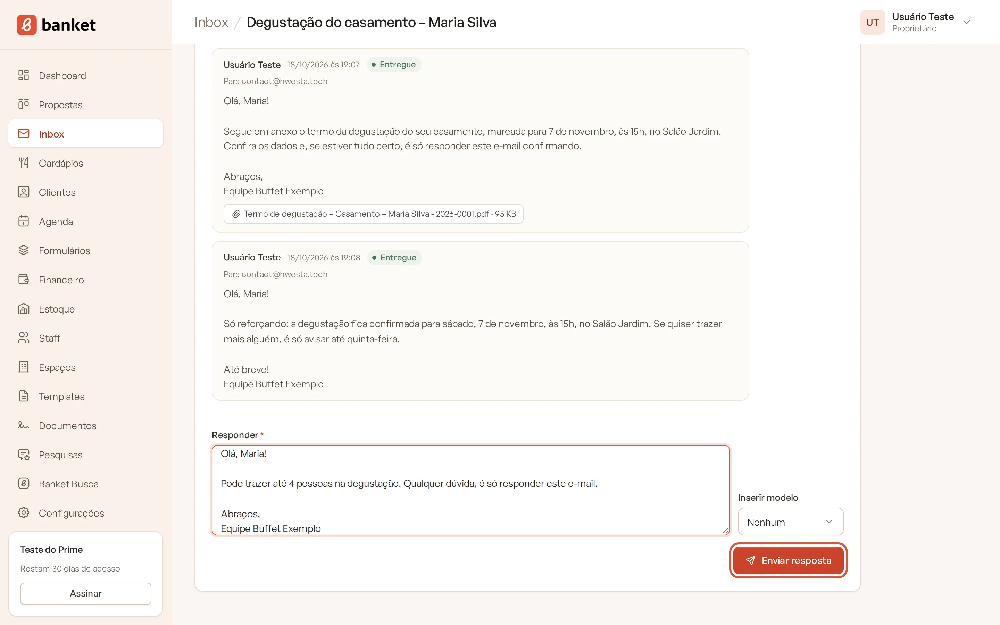
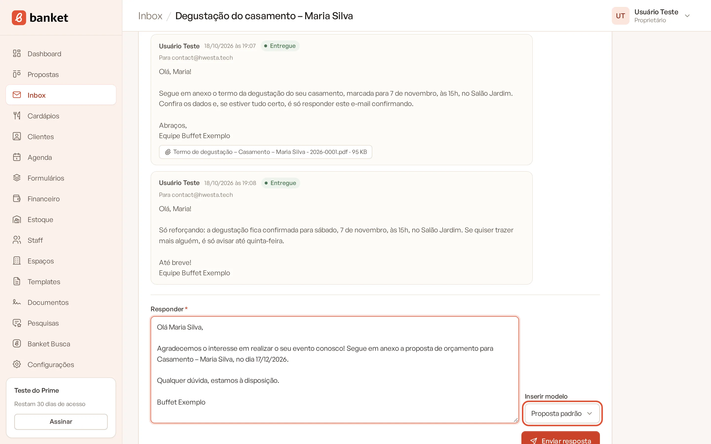
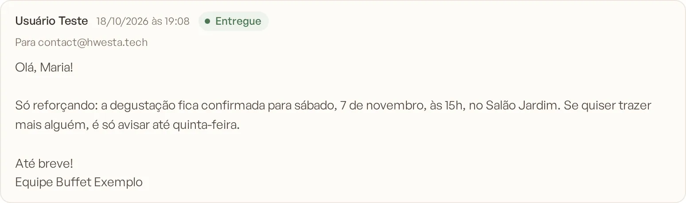

# Responder uma mensagem

Você responde o cliente direto pelo Banket, sem sair da conversa. A resposta segue como e-mail e continua no mesmo fio
de mensagens, tanto para você quanto para o cliente.

> **Disponível em:** planos Profissional, Prime e Master (pelo Inbox); a aba Mensagens do evento também está no
> Essencial · **Quem pode usar:** o responsável pela conversa, além de Proprietário e Administrador

## Passo a passo

1. Abra a conversa:
   - no menu lateral, clique em **Inbox** e depois no assunto da conversa; ou
   - abra o evento e clique na aba **Mensagens**.
2. Leia as mensagens. As suas ficam de um lado, as do cliente do outro, com data e hora.
3. No campo **Responder**, escreva a resposta (até 10.000 caracteres).

   

4. Se quiser partir de um texto pronto, escolha um modelo em **Inserir modelo**. O texto do modelo entra no campo, com
   os dados do evento já preenchidos (nome do cliente, evento, data, valor). Revise e ajuste antes de enviar.

   

5. Clique em **Enviar resposta**.

A mensagem "Resposta enviada." confirma o envio, e a resposta aparece na conversa com o status de entrega.

## Para quem a resposta vai

- Se o cliente já respondeu alguma vez, a resposta vai para quem enviou a última mensagem recebida.
- Se ainda não houve resposta do cliente, vai para os destinatários da conversa.

O assunto ganha "Re:" na frente, e o e-mail sai com o seu nome e o nome da empresa como remetente, com o rodapé
"Mensagem enviada por" seguido do seu nome.

## O que acontece depois

- A resposta é registrada na **Linha do tempo** do evento ("Resposta enviada para …").
- Se a conversa estava arquivada, ela volta para as ativas.
- Quando o cliente responder de novo, a mensagem cai na mesma conversa.

## Dicas

- Os modelos de e-mail são cadastrados em **Configurações › Modelos de e-mail**. Só os modelos ativos aparecem em
  **Inserir modelo**.
- Para ver um e-mail do cliente com a formatação original (cores, imagens, tabelas), clique em **Ver e-mail
  formatado**, abaixo da mensagem.

## Perguntas frequentes

### Posso anexar arquivos na resposta?
Não pela resposta. Para mandar a proposta, use o envio pelo orçamento; para contratos, use o envio na aba
**Documentos** do evento. Esses envios entram na mesma conversa, com o PDF anexado.

### Um administrador pode responder uma conversa minha?
Sim. Proprietários e administradores veem e respondem todas as conversas. A resposta sai com o nome de quem escreveu.

### Apareceu "Resposta registrada (sem envio real…)". O que significa?
A resposta foi gravada no Banket, mas o e-mail não saiu, porque o destinatário é um endereço de teste. Confira o e-mail do
cliente no evento.

## Artigos relacionados
- [Conhecer o Inbox](01-conhecer-o-inbox.md)
- [Nova mensagem pelo evento](03-nova-mensagem-pelo-evento.md)
- [Status de entrega e anexos](04-status-de-entrega-e-anexos.md)
- [Modelos de e-mail](../19-configuracoes/10-modelos-de-email.md)
