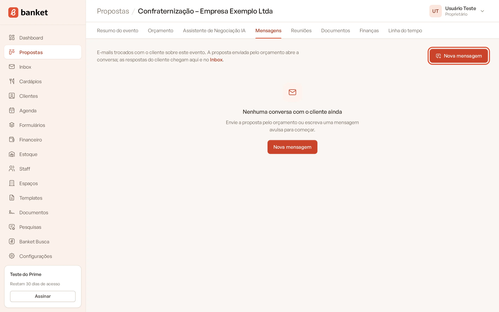
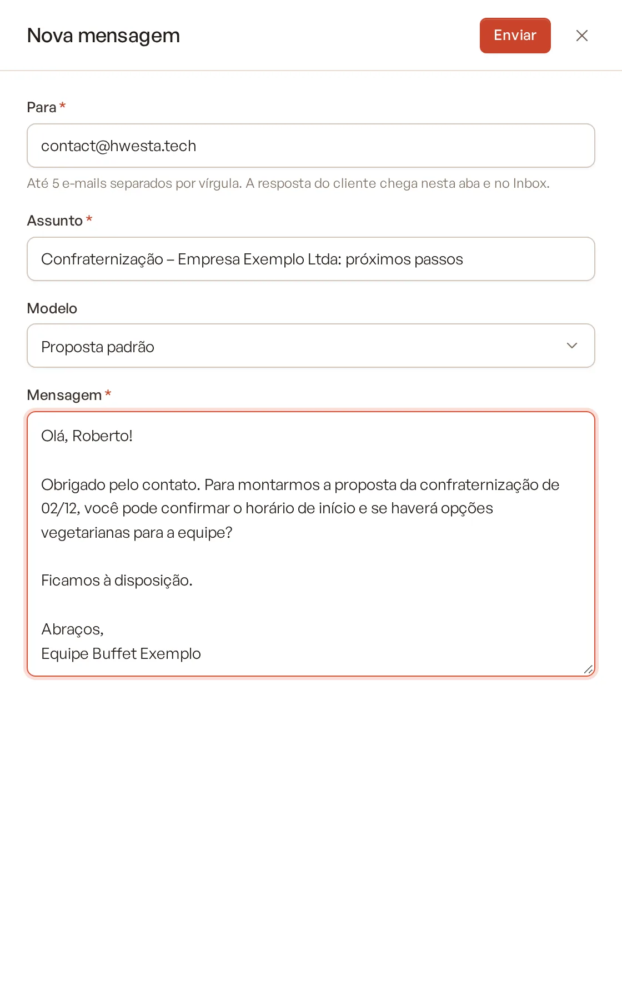
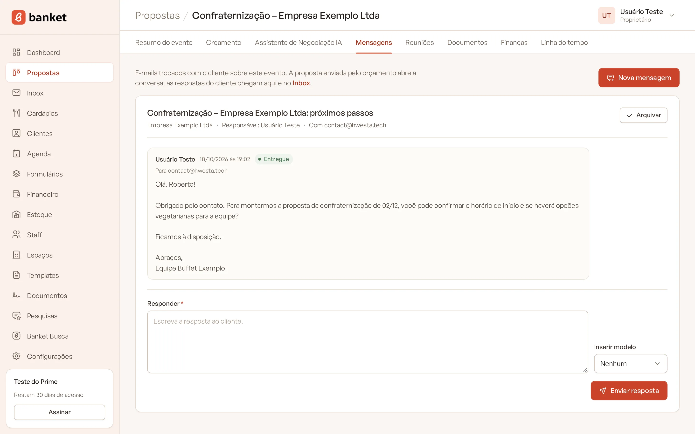

# Enviar uma nova mensagem pelo evento

Nem todo contato é o envio da proposta: às vezes você só quer confirmar a degustação ou pedir uma informação. A aba
**Mensagens** do evento permite escrever um e-mail avulso para o cliente, que fica guardado na conversa do evento.

> **Disponível em:** planos Essencial, Profissional, Prime e Master · **Quem pode usar:** todos os usuários

## Passo a passo

1. No menu **Propostas**, abra o evento.
2. Clique na aba **Mensagens**.
3. Clique em **Nova mensagem**.

   

4. Preencha a janela:
   - **Para**: já vem com o e-mail do responsável do evento (ou, sem ele, o e-mail do cliente). Você pode colocar até
     5 e-mails, separados por vírgula.
   - **Assunto**: já vem com o título do evento. Ajuste se quiser.
   - **Modelo** (opcional): escolha um modelo de e-mail para preencher o assunto e a mensagem com os dados do evento.
   - **Mensagem**: o texto do e-mail (até 10.000 caracteres).

   

5. Clique em **Enviar**.

A mensagem "Mensagem enviada para …" confirma o envio.

## O que acontece depois

- Se você ainda não tinha conversa neste evento, uma conversa nova é aberta com o assunto que você escreveu.
- Se já tinha (por exemplo, porque enviou a proposta), a mensagem entra na mesma conversa, com "Re:" no assunto.
- O envio é registrado na **Linha do tempo** do evento.
- A resposta do cliente chega na aba **Mensagens** do evento e no **Inbox** (planos Profissional, Prime e Master).

## Como a aba Mensagens mostra as conversas

- **Nenhuma conversa**: aparece o aviso "Nenhuma conversa com o cliente ainda" e o botão **Nova mensagem**.
- **Uma conversa**: as mensagens aparecem direto na aba, com o campo **Responder** no fim.
- **Mais de uma conversa** (quando mais de um usuário falou com o cliente): cada conversa aparece num card com o
  responsável, a data da última mensagem, o total de mensagens e as não lidas. Clique em **Abrir conversa** para ver as
  mensagens.

Usuários comuns veem só as próprias conversas; proprietários e administradores veem as de todos.

## Perguntas frequentes

### O cliente vai receber o e-mail do meu endereço pessoal?
O e-mail sai do endereço do Banket, com o seu nome e o nome da empresa como remetente. Quando o cliente responde, a
resposta volta para a conversa no Banket.

### Posso mandar a mesma mensagem para o cliente e para o responsável?
Sim. Coloque os dois e-mails no campo **Para**, separados por vírgula (até 5 endereços).

### Por que não aparece o campo Modelo?
Ele só aparece quando a empresa tem pelo menos um modelo de e-mail ativo, cadastrado em **Configurações › Modelos de
e-mail**.

## Artigos relacionados
- [Conhecer o Inbox](01-conhecer-o-inbox.md)
- [Responder uma mensagem](02-responder-mensagem.md)
- [Enviar a proposta por e-mail](../04-orcamento/11-enviar-proposta-por-email.md)
- [Resumo do evento](../03-propostas-e-eventos/06-resumo-do-evento.md)
