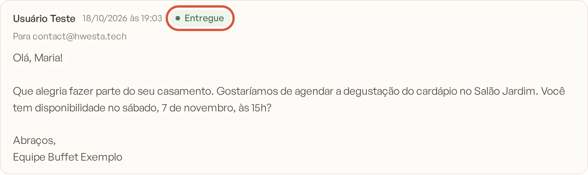
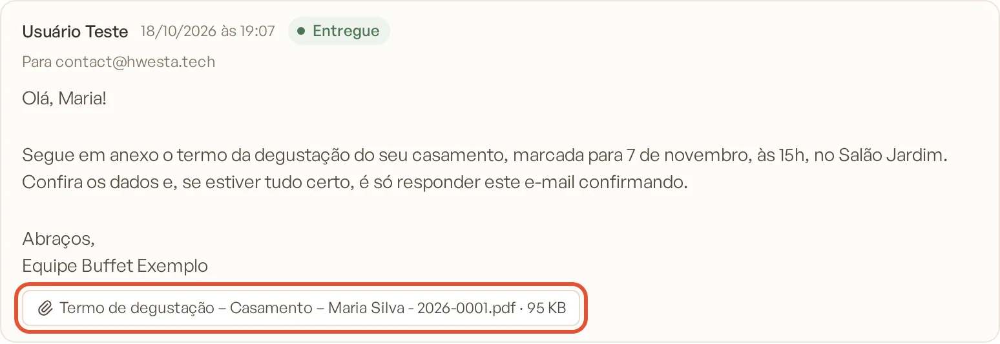

# Status de entrega e anexos

Cada e-mail enviado pelo Banket mostra se chegou ao cliente. E os arquivos que o cliente manda junto com a resposta
ficam guardados na conversa, prontos para baixar.

> **Disponível em:** planos Profissional, Prime e Master (pelo Inbox); a aba Mensagens do evento também está no
> Essencial · **Quem pode usar:** o responsável pela conversa, além de Proprietário e Administrador

## Status das mensagens enviadas

Ao lado do nome de quem enviou, cada mensagem sua mostra uma etiqueta:

| Status | O que significa |
|---|---|
| **Enviada** | O e-mail saiu do Banket e está a caminho do cliente |
| **Entregue** | O servidor de e-mail do cliente aceitou a mensagem |
| **Devolvida** | O e-mail voltou (endereço inexistente, caixa cheia) ou o cliente marcou a mensagem como spam |
| **Falhou** | Não foi possível enviar o e-mail |

Quando há um detalhe, ele aparece abaixo da mensagem, por exemplo "E-mail devolvido pelo servidor do destinatário",
"Marcado como spam pelo destinatário" ou "Entrega atrasada; o servidor do destinatário ainda não aceitou". Passe o mouse
sobre a etiqueta para ver o mesmo detalhe.

Abaixo de cada mensagem enviada aparece também **Para**, com os destinatários.

### O que fazer se a mensagem foi devolvida
1. Confira o e-mail do cliente e do responsável no evento (botão **Editar evento**, no Resumo do evento).
2. Corrija o endereço e envie de novo: pela aba **Mensagens** (**Nova mensagem**) ou, no caso da proposta, pelo
   orçamento.
3. Se o motivo for "Marcado como spam", fale com o cliente por telefone ou WhatsApp antes de reenviar.

## Mensagens recebidas

As respostas do cliente aparecem como texto simples, para leitura rápida. Se o e-mail original tinha formatação (cores,
imagens, assinatura), clique em **Ver e-mail formatado** para vê-lo como o cliente escreveu. Por segurança, links e
conteúdos ativos do e-mail ficam desativados nessa visualização.

## Anexos

Os anexos aparecem abaixo da mensagem, com o nome e o tamanho do arquivo:

- **Nas mensagens enviadas**: o PDF da proposta ou do documento que você mandou.
- **Nas mensagens recebidas**: os arquivos que o cliente anexou.

Clique no nome do anexo para baixar o arquivo. Os anexos sempre são baixados (não abrem direto no navegador) e só
pessoas logadas na sua empresa conseguem acessá-los.

### Limites dos anexos recebidos
- Até 10 anexos por e-mail recebido.
- Até 10 MB por arquivo.

Arquivo maior que o limite aparece com **(não guardado)** ao lado do nome. Nesse caso, peça ao cliente que mande o
arquivo por outro meio (um link de compartilhamento, por exemplo).

## Perguntas frequentes

### A mensagem está como "Enviada" há muito tempo. É problema?
Normalmente o status muda para **Entregue** em poucos minutos. Se continuar como **Enviada** e houver o detalhe
"Entrega atrasada", o servidor do cliente ainda não aceitou a mensagem. Aguarde e, se o status não mudar, confirme
o e-mail com o cliente.

### "Entregue" quer dizer que o cliente leu?
Não. **Entregue** quer dizer que o e-mail chegou ao servidor do cliente. O Banket não mostra se a mensagem foi aberta.

### Onde ficam os anexos depois que a conversa é arquivada?
Continuam na conversa. Clique em **Ver arquivadas** no Inbox, abra a conversa e baixe o arquivo.

## Artigos relacionados
- [Conhecer o Inbox](01-conhecer-o-inbox.md)
- [Responder uma mensagem](02-responder-mensagem.md)
- [Enviar a proposta por e-mail](../04-orcamento/11-enviar-proposta-por-email.md)
- [Baixar e enviar documento](../16-documentos/04-baixar-e-enviar-documento.md)
