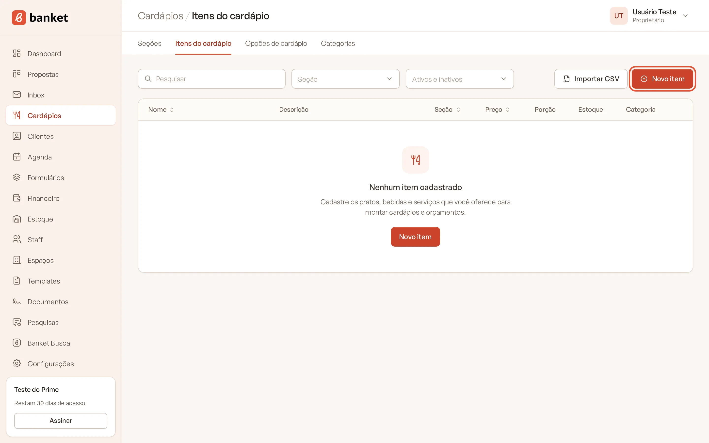
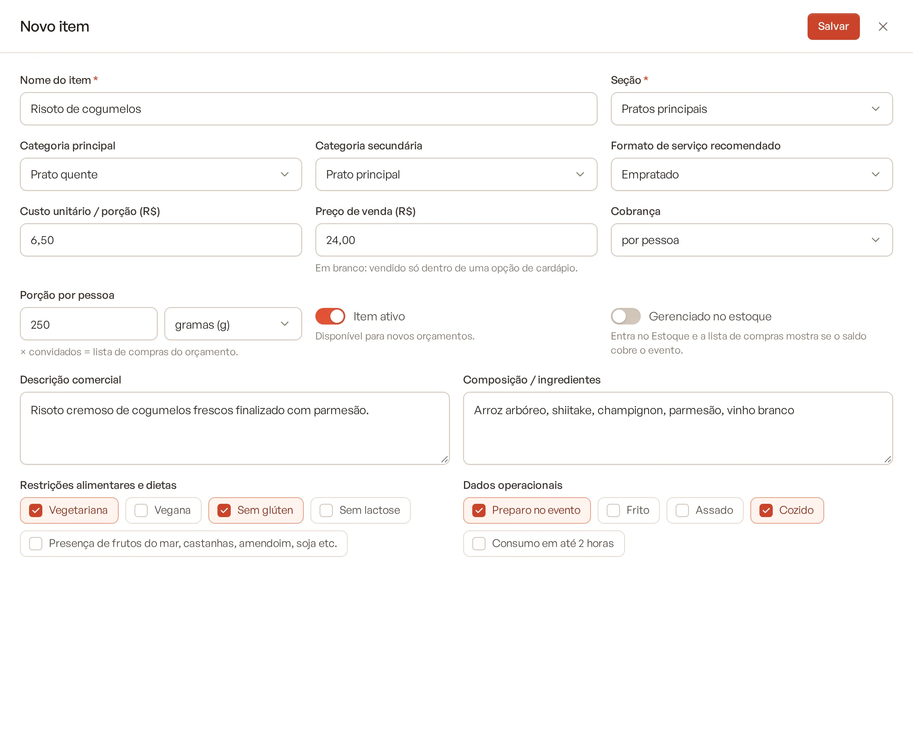
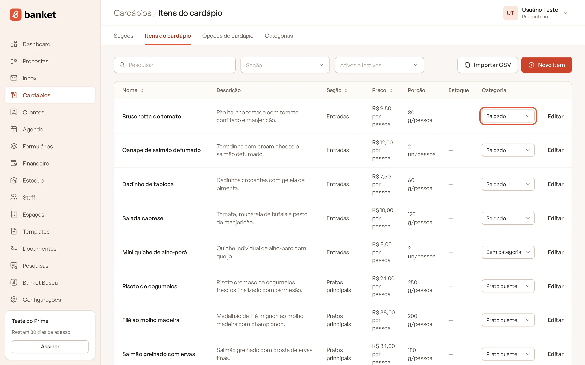
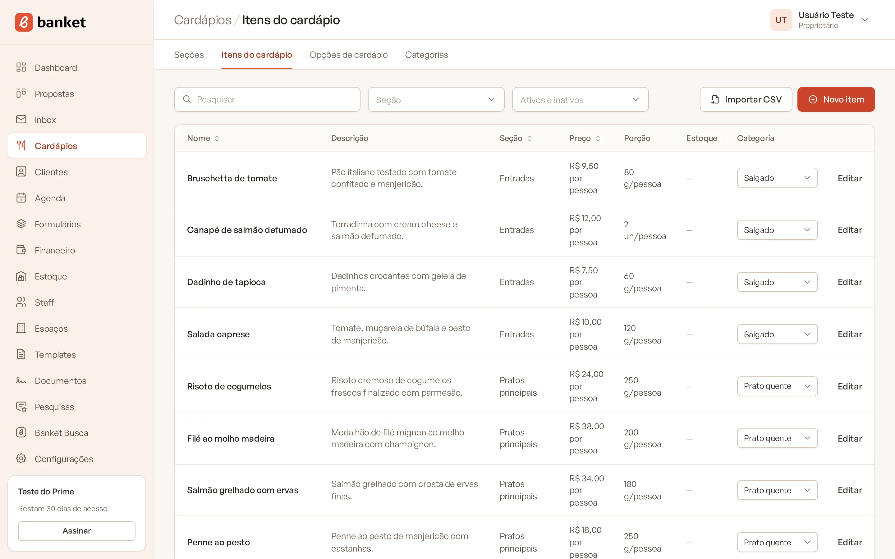
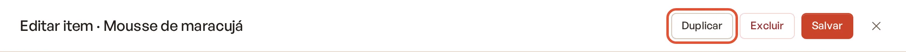

# Cadastrar itens do cardápio

Os itens são os pratos, bebidas e serviços que você oferece. Eles são usados para montar as opções prontas de
cardápio, os orçamentos, a lista de compras e o cálculo de margem.

> **Disponível em:** planos Essencial, Profissional, Prime e Master · **Quem pode usar:** todos os usuários

## Antes de começar

Crie pelo menos uma seção do cardápio. Todo item pertence a uma seção. Veja
[Organizar o cardápio em seções](01-secoes-do-cardapio.md).

## Passo a passo

1. No menu lateral, clique em **Cardápios** e depois em **Itens do cardápio**.
2. Clique em **Novo item**.

   

3. Preencha o **Nome do item** e escolha a **Seção** (os dois são obrigatórios).
4. Preencha os demais campos que fizerem sentido (veja a tabela abaixo).

   

5. Clique em **Salvar**.

Dica: se você filtrar a lista por uma seção antes de clicar em **Novo item**, o item já vem com essa seção escolhida.

## Entenda os campos

| Campo | O que preencher |
|---|---|
| **Nome do item** | Nome do prato ou bebida. Ex.: Coxinha de frango. Não pode repetir dentro da mesma seção. |
| **Seção** | Grupo do cardápio ao qual o item pertence. |
| **Categoria principal** | Tipo do alimento: Salgado, Doce, Bebida… Itens com "Bebida" vão para a aba Bebidas do orçamento. |
| **Categoria secundária** | Momento do serviço: Recepção, Entrada, Prato principal, Sobremesa… |
| **Formato de serviço recomendado** | Formato em que o item costuma ser servido (Buffet, Empratado, Coquetel…). |
| **Custo unitário / porção (R$)** | Quanto custa para você produzir uma porção. Base da margem projetada do orçamento. |
| **Preço de venda (R$)** | Preço cobrado do cliente. Em branco, o item é vendido só dentro de uma opção de cardápio. |
| **Cobrança** | **por pessoa** ou **por unidade**. |
| **Porção por pessoa** | Quantidade e unidade (gramas, quilos, mililitros, litros ou unidades) servida por convidado. |
| **Item ativo** | Ligado, o item fica disponível para novos orçamentos. |
| **Gerenciado no estoque** | Ligado, o item entra no Estoque e a lista de compras mostra se o saldo cobre o evento. |
| **Descrição comercial** | Texto exibido na proposta. |
| **Composição / ingredientes** | Ingredientes ou detalhes de preparo. |
| **Restrições alimentares e dietas** | Marque: Vegetariana, Vegana, Sem glúten, Sem lactose ou Presença de frutos do mar, castanhas, amendoim, soja etc. |
| **Dados operacionais** | Marque: Preparo no evento, Frito, Assado, Cozido, Consumo em até 2 horas. |

### Para que serve a porção por pessoa
A lista de compras do orçamento multiplica a **porção por pessoa** pelo número de convidados. Exemplo: um item com
porção de 150 g num evento de 100 convidados entra na lista com 15 kg. Itens sem porção aparecem na lista com um aviso.

### Para que serve o custo
O custo por porção é usado para calcular a margem projetada do orçamento e pelo Assistente de Orçamentos IA. Sem custo,
a margem não é calculada.

## A lista de itens

A tabela mostra **Nome**, **Descrição**, **Seção**, **Preço**, **Porção**, **Estoque** (saldo atual, para itens
gerenciados no estoque) e **Categoria**.

- Você pode trocar a **Categoria** principal direto na lista, pelo seletor da linha, sem abrir o item.

  

- Use os filtros de **Seção** e de situação (**Só ativos** / **Só inativos**) e o campo de busca.
- Clique no título das colunas **Nome**, **Seção** ou **Preço** para ordenar.
- Itens desativados aparecem com a etiqueta **Inativo**.

## Duplicar um item

1. Clique em **Editar** na linha do item.
2. Clique em **Duplicar** no topo do painel.

A cópia é criada na mesma seção com o nome "Nome do item (cópia)".

## Desativar ou excluir um item

- Para tirar um item dos novos orçamentos sem perder o histórico, desligue **Item ativo** e salve.
- Para excluir, abra o item e clique em **Excluir**. Um item que faz parte de alguma opção pronta de cardápio não pode
  ser excluído: remova-o das opções ou desative-o.

## Perguntas frequentes

### Mudar o preço de um item altera orçamentos já feitos?
Não. O orçamento guarda o preço do momento em que o item foi incluído. O novo preço vale para os próximos orçamentos.

### Preciso informar preço de venda em todos os itens?
Não. Se o item só é vendido dentro de um pacote (opção pronta de cardápio), deixe o preço em branco.

### Posso cadastrar muitos itens de uma vez?
Sim, por planilha. Veja [Importar itens por CSV](05-importar-itens-por-csv.md).

## Artigos relacionados
- [Organizar o cardápio em seções](01-secoes-do-cardapio.md)
- [Categorias de item](04-categorias-de-item.md)
- [Importar itens por CSV](05-importar-itens-por-csv.md)
- [Itens do cardápio no estoque](../12-estoque/05-itens-do-cardapio-no-estoque.md)
- [Lista de compras](../04-orcamento/12-lista-de-compras.md)
- [Assistente de Orçamentos IA](../05-assistentes-de-ia/02-assistente-de-orcamentos.md)
