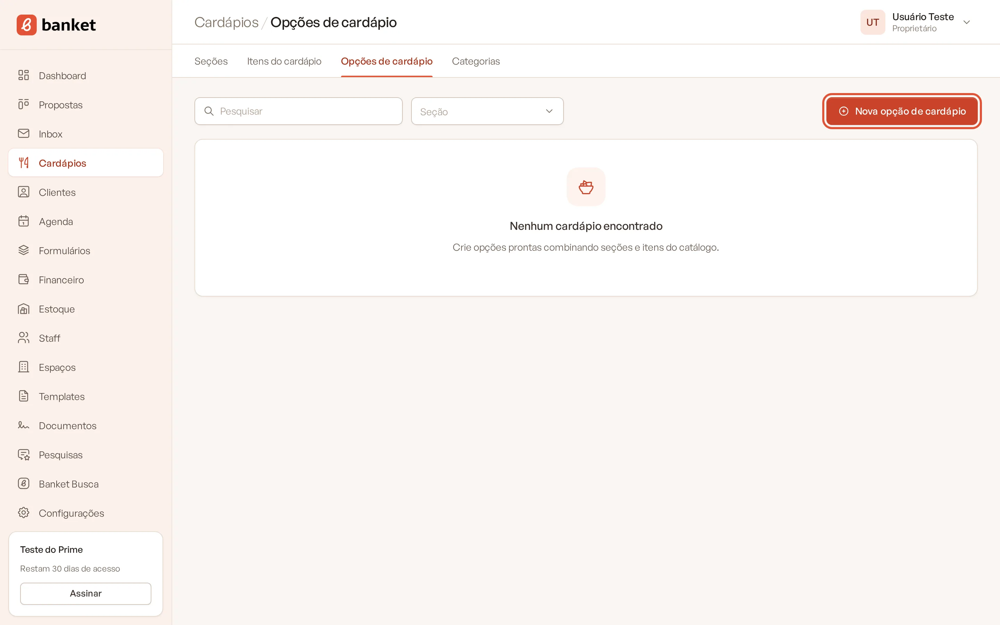
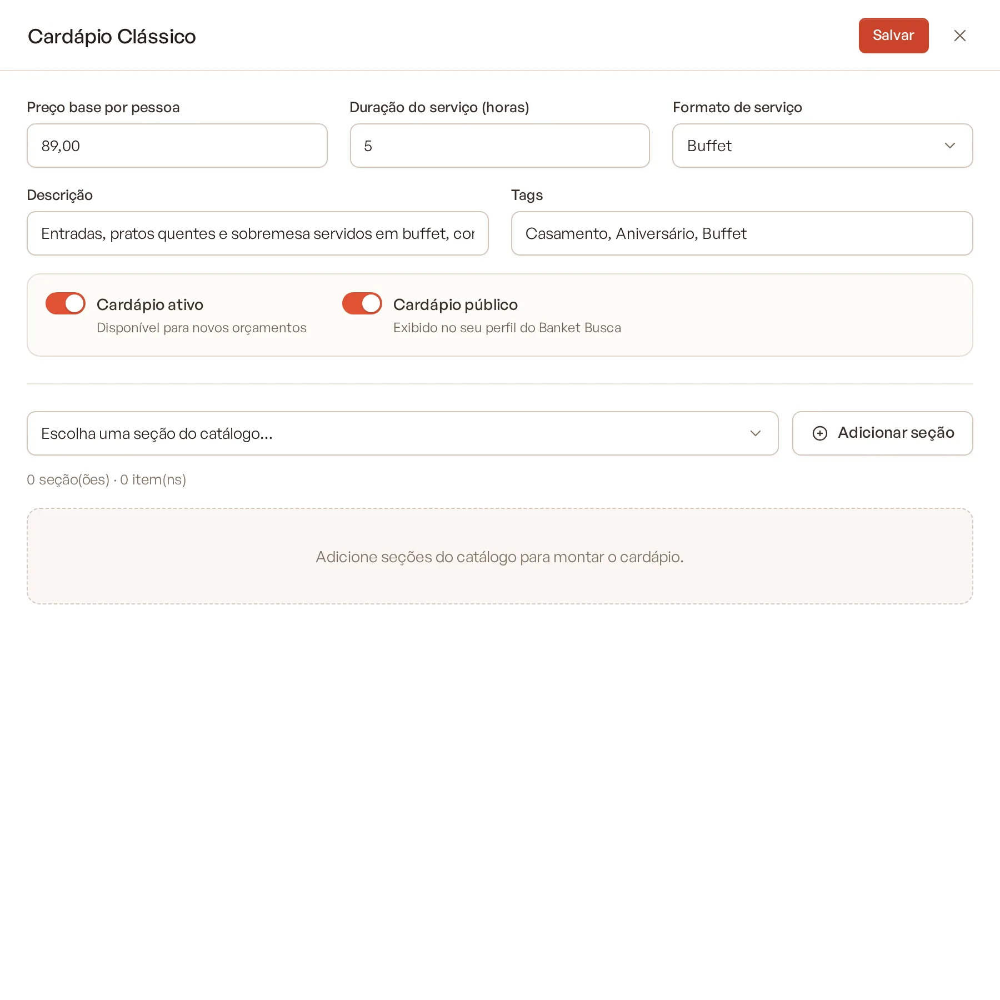
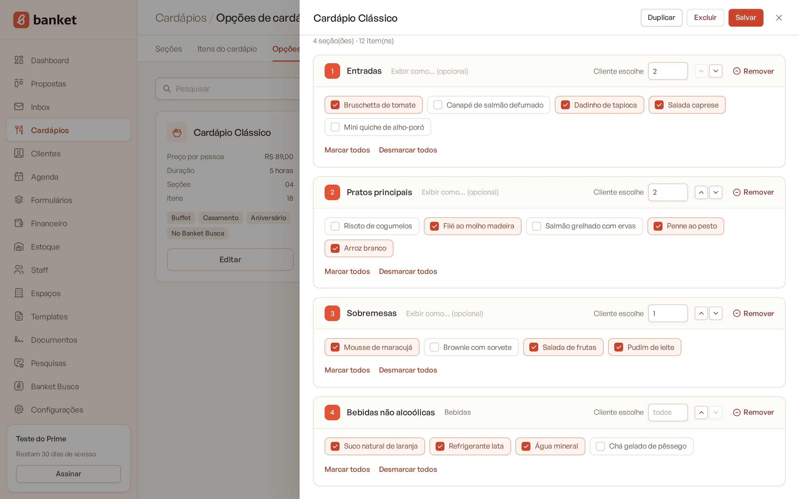
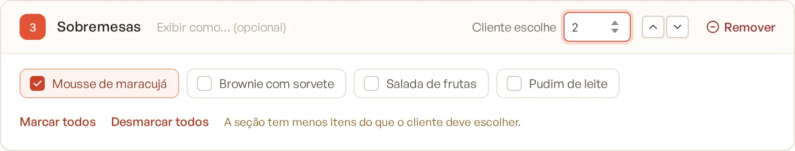
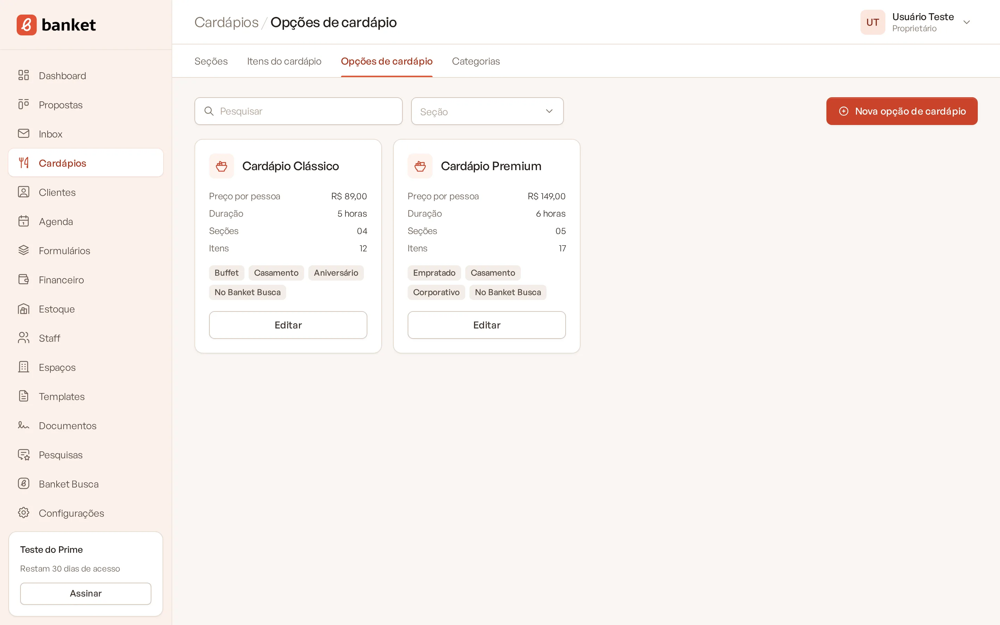

# Opções prontas de cardápio

As opções de cardápio são os seus pacotes prontos, como "Coquetel volante" ou "Buffet completo". Cada opção junta
seções e itens do catálogo, com um preço base por pessoa. No orçamento, você inclui a opção inteira de uma vez e ajusta
o que precisar.

> **Disponível em:** planos Essencial, Profissional, Prime e Master · **Quem pode usar:** todos os usuários

## Antes de começar

Cadastre as seções e os itens do cardápio. A opção é montada a partir deles. Veja
[Cadastrar itens do cardápio](02-cadastrar-itens.md).

## Passo a passo

1. No menu lateral, clique em **Cardápios** e depois em **Opções de cardápio**.
2. Clique em **Nova opção de cardápio**.

   

3. No topo do painel, digite o nome do cardápio.
4. Preencha os dados gerais (veja abaixo).

   

5. Em **Escolha uma seção do catálogo…**, selecione uma seção e clique em **Adicionar seção**. Repita para cada seção.

   

6. Em cada seção adicionada, marque os itens que fazem parte da opção. Use **Marcar todos** ou **Desmarcar todos**
   para agilizar.

   

7. Clique em **Salvar**.

## Entenda os campos

| Campo | O que preencher |
|---|---|
| **Nome do cardápio** | Nome do pacote, como aparece nos cards e no orçamento. |
| **Preço base por pessoa** | Valor por pessoa da opção. |
| **Duração do serviço (horas)** | Tempo de serviço previsto (até 48 horas). |
| **Formato de serviço** | Buffet, Empratado, Coquetel… |
| **Descrição** | Resumo exibido no card. |
| **Tags** | Palavras separadas por vírgula (ex.: Casamento, Buffet). |
| **Cardápio ativo** | Ligado, a opção fica disponível para novos orçamentos. |
| **Cardápio público** | Ligado, a opção aparece no seu perfil do Banket Busca (só quando também está ativa). |

### Ajustes de cada seção

- **Exibir como… (opcional)**: título alternativo da seção nesta opção. Ex.: a seção "Salgados fritos" pode aparecer
  como "Salgados" na proposta.
- **Cliente escolhe**: quantos itens o cliente escolhe na seção. Deixe em branco para "todos". Se você marcar menos
  itens do que o número de escolhas, o sistema avisa: "A seção tem menos itens do que o cliente deve escolher."

  

- Use as setas para mudar a ordem das seções e **Remover** para tirar uma seção da opção.

O resumo abaixo do seletor mostra quantas seções e itens a opção tem.

## Regras importantes

- A opção precisa ter pelo menos uma seção, e cada seção precisa de pelo menos um item marcado.
- Itens inativos aparecem com outra cor, mas podem ficar na opção.
- No orçamento, o preço por pessoa do cardápio é o **preço base** da opção mais o preço das seções incluídas.

## Duplicar ou excluir uma opção

Abra a opção pelo botão **Editar** do card e use:

- **Duplicar**: cria uma cópia com o nome "Nome (cópia)". A cópia não aparece no Banket Busca até você ligar
  **Cardápio público** nela.
- **Excluir**: apaga a opção, depois de confirmar. Orçamentos que já usaram a opção não são alterados.

## Limites do plano

O número de **opções de cardápio ativas** depende do plano:

| Plano | Opções ativas |
|---|---|
| Essencial | 3 |
| Profissional | 7 |
| Prime | 20 |
| Master | sem limite |

O limite vale para criar ou reativar uma opção. Opções inativas não contam. Se você atingir o limite, desative uma opção
ou faça upgrade do plano.

## Perguntas frequentes

### Alterar uma opção muda os orçamentos que já a usam?
Não. O orçamento guarda uma cópia do cardápio no momento da inclusão. As mudanças valem para os próximos orçamentos.

### Por que minha opção não aparece no Banket Busca?
Confira se **Cardápio ativo** e **Cardápio público** estão ligados. A seção de cardápios do perfil depende também do
seu plano. Veja [Cardápios no perfil](../18-banket-busca/10-cardapios-no-perfil.md).

### O que significa a etiqueta "No Banket Busca" no card?
Que a opção está ativa e marcada como pública, ou seja, aparece no seu perfil do Banket Busca.

## Artigos relacionados
- [Cadastrar itens do cardápio](02-cadastrar-itens.md)
- [Organizar o cardápio em seções](01-secoes-do-cardapio.md)
- [Adicionar cardápios ao orçamento](../04-orcamento/02-adicionar-cardapios.md)
- [Cardápios no perfil do Banket Busca](../18-banket-busca/10-cardapios-no-perfil.md)
- [Limites do plano](../20-planos-e-assinatura/09-limites-do-plano.md)
