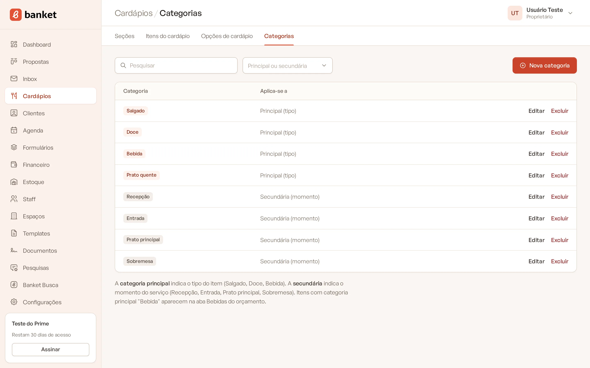
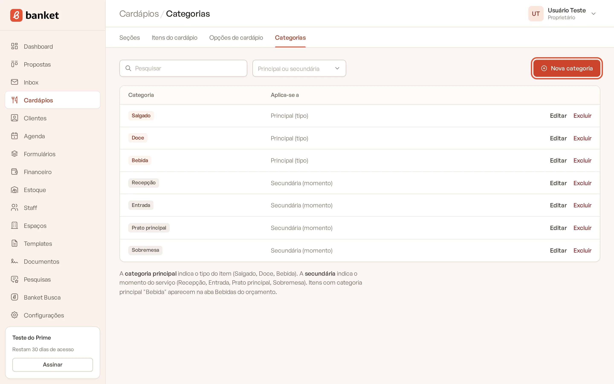
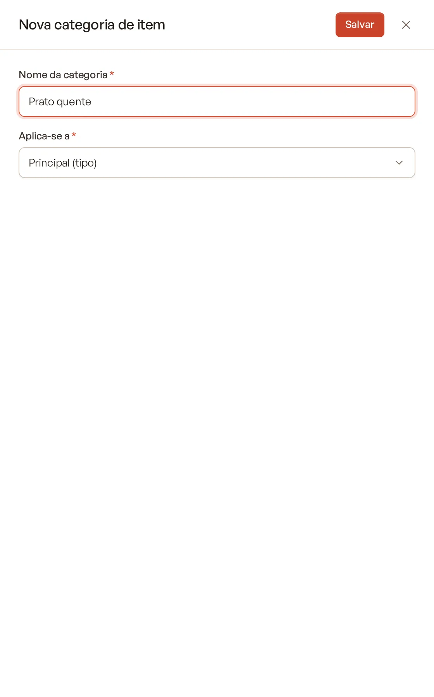

# Categorias de item

As categorias classificam os itens do cardápio de duas formas: pelo **tipo do alimento** (categoria principal) e pelo
**momento do serviço** (categoria secundária).

> **Disponível em:** planos Essencial, Profissional, Prime e Master · **Quem pode usar:** todos os usuários

## Os dois tipos de categoria

| Tipo | Para que serve | Exemplos |
|---|---|---|
| **Principal** | Indica o tipo do item | Salgado, Doce, Bebida |
| **Secundária** | Indica o momento do serviço | Recepção, Entrada, Prato principal, Sobremesa |

Itens com a categoria principal **"Bebida"** aparecem na aba **Bebidas** do orçamento.

## Passo a passo

### Criar uma categoria

1. No menu lateral, clique em **Cardápios** e depois em **Categorias**.
2. Clique em **Nova categoria**.

   

3. Preencha o **Nome da categoria**.
4. Em **Aplica-se a**, escolha se ela é principal ou secundária.

   

5. Clique em **Salvar**.

### Editar ou excluir

- Clique no nome da categoria ou em **Editar** para alterar.
- Clique em **Excluir** na linha e confirme para apagar.

Use o filtro **Principal ou secundária** para ver só um tipo. As categorias principais aparecem destacadas em
terracota.

### Aplicar a categoria nos itens

No cadastro do item (**Cardápios › Itens do cardápio**), escolha a **Categoria principal** e a **Categoria
secundária**. Na lista de itens, você também pode trocar a categoria principal direto na coluna **Categoria**.

## Perguntas frequentes

### O que acontece com os itens se eu excluir uma categoria?
Os itens continuam cadastrados, apenas ficam sem essa categoria.

### Minhas bebidas não aparecem na aba Bebidas do orçamento. Por quê?
Confira se os itens da seção de bebidas estão com a categoria principal "Bebida".

### As categorias são as mesmas para toda a equipe?
Sim. As categorias são da empresa e valem para todos os usuários.

## Artigos relacionados
- [Cadastrar itens do cardápio](02-cadastrar-itens.md)
- [Adicionar bebidas ao orçamento](../04-orcamento/03-adicionar-bebidas.md)
- [Organizar o cardápio em seções](01-secoes-do-cardapio.md)
