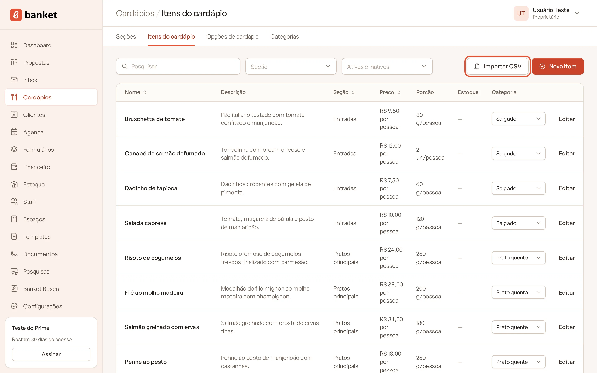
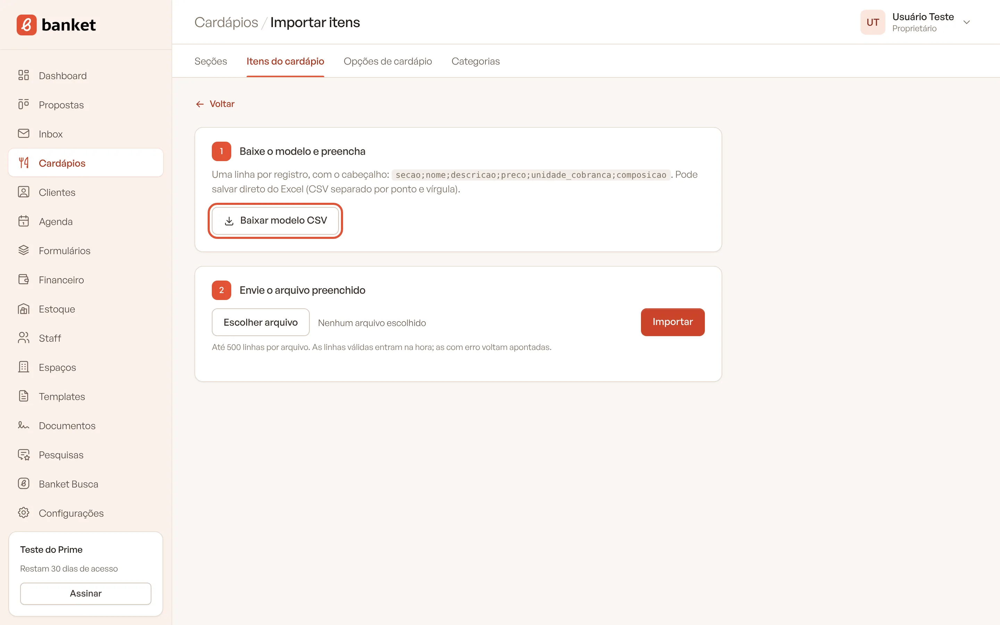
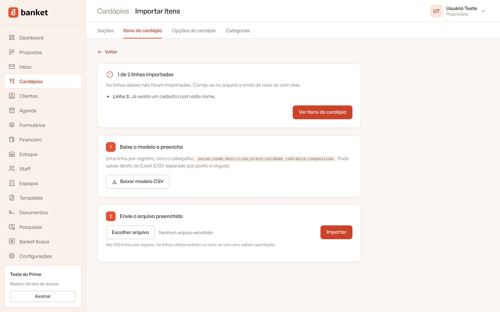

# Importar itens por CSV

Se você já tem o cardápio numa planilha, pode cadastrar vários itens de uma vez com um arquivo CSV, em vez de digitar
um por um.

> **Disponível em:** planos Essencial, Profissional, Prime e Master · **Quem pode usar:** todos os usuários

## Passo a passo

1. No menu lateral, clique em **Cardápios** e depois em **Itens do cardápio**.
2. Clique em **Importar CSV**.

   

3. No passo 1, clique em **Baixar modelo CSV**.

   

4. Abra o modelo no Excel (ou outro editor de planilhas) e preencha **uma linha por item**, mantendo o cabeçalho.
5. Salve o arquivo como CSV separado por ponto e vírgula.
6. No passo 2, escolha o arquivo preenchido e clique em **Importar**.

   

7. Confira o resultado: a tela mostra quantas linhas foram importadas e, se houver, as linhas com erro e o motivo.

   

8. Clique em **Ver itens do cardápio** para voltar à lista.

## Colunas do arquivo

| Coluna | O que preencher |
|---|---|
| `secao` | **Obrigatória.** Nome da seção. Se não existir, a seção é criada com esse nome. |
| `nome` | **Obrigatória.** Nome do item. |
| `descricao` | Descrição comercial (texto da proposta). |
| `preco` | Preço de venda, no formato brasileiro (ex.: 9,50). |
| `unidade_cobranca` | `pessoa` ou `unidade`. Em branco, vale `pessoa`. |
| `porcao` | Porção por pessoa (só o número, ex.: 80). |
| `porcao_unidade` | `g`, `kg`, `ml`, `l` ou `un`. |
| `composicao` | Ingredientes ou detalhes de preparo. |

Exemplo de linha: `Coquetel;Bruschetta de tomate;Tomate confitado com manjericão;9,50;pessoa;80;g;`

## Regras da importação

- Até **500 linhas** por arquivo.
- As seções são encontradas pelo nome, sem diferenciar maiúsculas e minúsculas. Nomes novos viram seções novas.
- Cada linha é conferida com as mesmas regras do cadastro manual. As válidas entram na hora; as com erro ficam de fora
  e aparecem no relatório com o número da linha.
- Todos os itens importados entram como **ativos**.
- Categorias, formato de serviço, custo, restrições e dados operacionais não vêm pelo modelo: complete-os depois,
  editando cada item.

## Corrigir linhas com erro

Corrija as linhas apontadas no arquivo e envie de novo **só com elas**. Se reenviar o arquivo inteiro, as linhas que já
entraram serão recusadas por nome repetido na mesma seção.

## Perguntas frequentes

### Por que uma linha deu "nome repetido"?
Já existe um item com o mesmo nome na mesma seção. Mude o nome ou a seção do item no arquivo.

### Posso usar vírgula como separador?
Use o modelo baixado e salve como CSV separado por ponto e vírgula, o padrão do Excel em português.

### A importação atualiza itens que já existem?
Não. Ela só cria itens novos. Para alterar um item existente, edite-o na lista.

## Artigos relacionados
- [Cadastrar itens do cardápio](02-cadastrar-itens.md)
- [Organizar o cardápio em seções](01-secoes-do-cardapio.md)
- [Importar clientes por CSV](../08-clientes/03-importar-clientes-por-csv.md)
