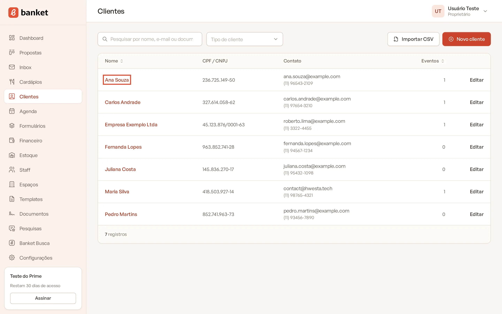
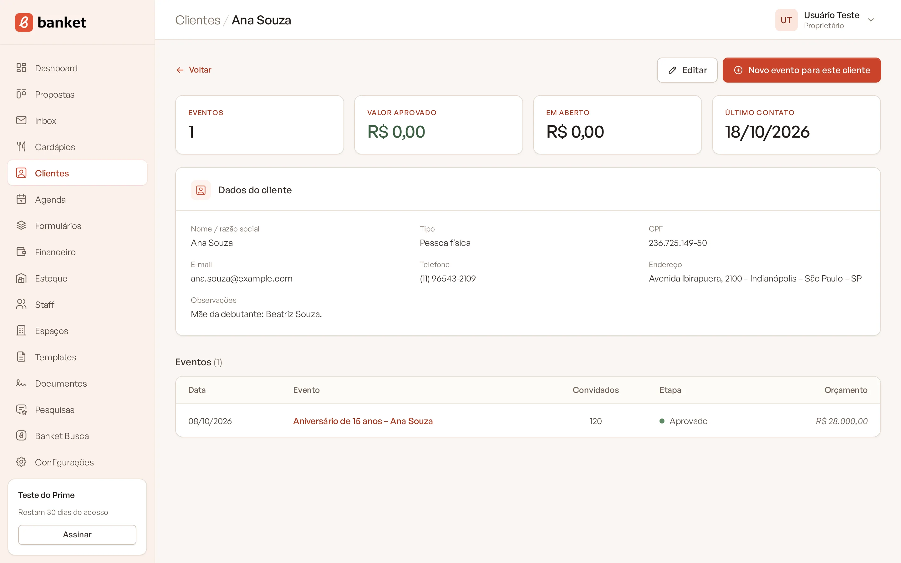
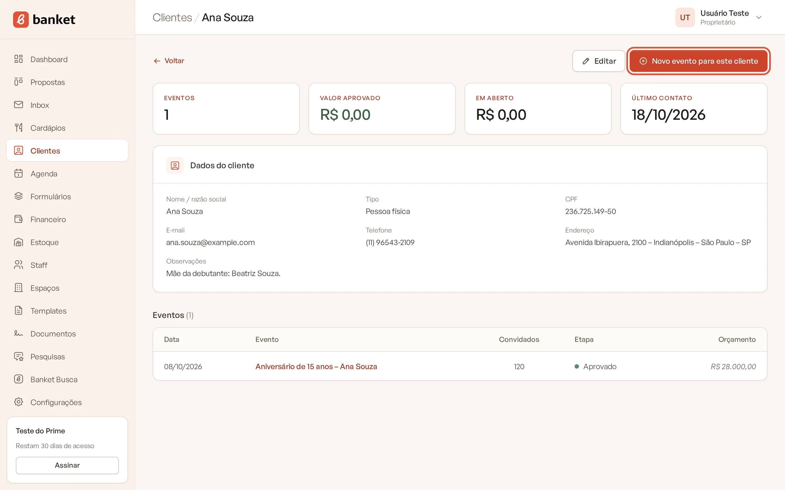
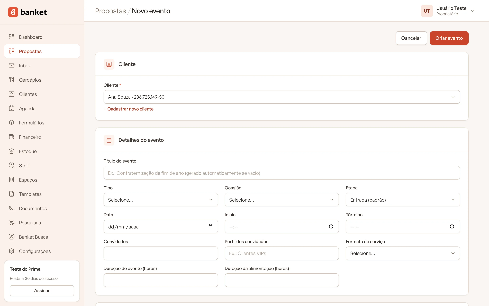

# Detalhe e histórico do cliente

A página de um cliente reúne o resumo comercial, os dados de contato e todos os eventos que ele já fez ou está
negociando com o seu buffet. Dela você também cria um novo evento já ligado ao cliente.

> **Disponível em:** planos Essencial, Profissional, Prime e Master · **Quem pode usar:** todos os usuários

## Como abrir

1. No menu lateral, clique em **Clientes**.
2. Clique no nome do cliente.

   

## O que aparece na página

### Resumo do cliente

No topo, quatro indicadores:

| Indicador | O que mostra |
|---|---|
| **Eventos** | Quantos eventos o cliente tem, em qualquer etapa. |
| **Valor aprovado** | Soma dos orçamentos dos eventos em etapas de aprovado. |
| **Em aberto** | Soma dos orçamentos dos eventos em etapas de entrada ou de negociação. |
| **Último contato** | Data do registro mais recente na linha do tempo de qualquer evento do cliente. |

### Dados do cliente

O cartão **Dados do cliente** mostra **Nome / razão social**, **Tipo**, **CPF** ou **CNPJ**, **E-mail**, **Telefone**,
**Endereço** e, se houver, **Observações**. Campos vazios aparecem com **—**.

### Eventos

A tabela **Eventos** lista todos os eventos do cliente, do mais recente para o mais antigo pela data do evento, com:

- **Data** do evento;
- **Evento**: clique no nome para abrir;
- **Convidados**;
- **Etapa**, com a cor da etapa do funil;
- **Orçamento**: o valor do orçamento. Se o evento ainda não tem orçamento, aparece a verba estimada informada pelo
  cliente, quando houver.

## Criar um evento para o cliente

1. Na página do cliente, clique em **Novo evento para este cliente**.

   

2. O formulário de evento abre com o cliente já selecionado.

   

3. Preencha o briefing e salve.

## Editar ou excluir

- Clique em **Editar** para abrir os dados do cliente e alterá-los. Depois, clique em **Salvar**.
- Para excluir, abra a edição e clique em **Excluir**. Clientes com eventos não podem ser excluídos.
- Use **Voltar** para retornar à lista de clientes.

## Perguntas frequentes

### O Último contato não mudou depois que liguei para o cliente.

O indicador usa os registros da linha do tempo dos eventos. Registre uma anotação na linha do tempo do evento para que o
contato conte.

### Por que o valor de um evento aparece diferente na tabela?

Quando o evento ainda não tem orçamento, a coluna **Orçamento** mostra a verba estimada pelo cliente no pedido. Depois
que o orçamento é criado, passa a mostrar o valor dele.

### Os eventos recusados entram no resumo?

Eles contam em **Eventos**, mas não entram em **Valor aprovado** nem em **Em aberto**.

## Artigos relacionados

- [Cadastrar cliente](01-cadastrar-cliente.md)
- [Criar um evento](../03-propostas-e-eventos/02-criar-evento.md)
- [Linha do tempo e anotações](../03-propostas-e-eventos/08-linha-do-tempo-e-anotacoes.md)
- [Resumo do evento](../03-propostas-e-eventos/06-resumo-do-evento.md)
