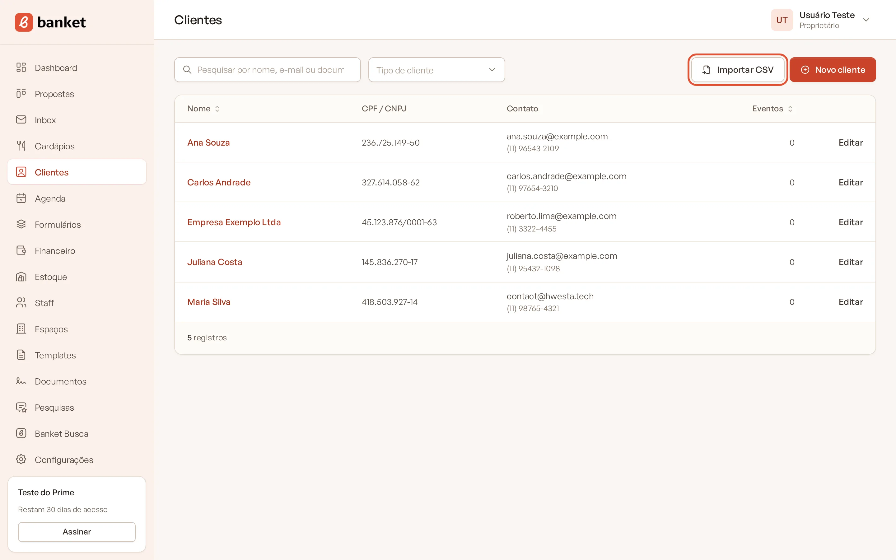
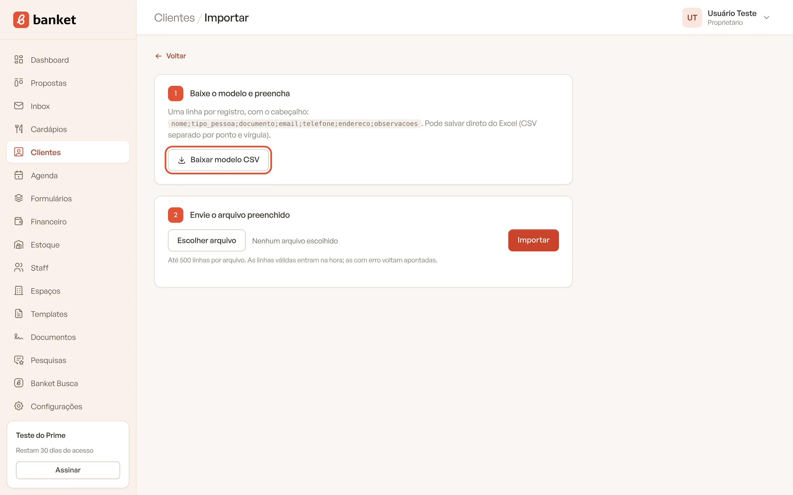
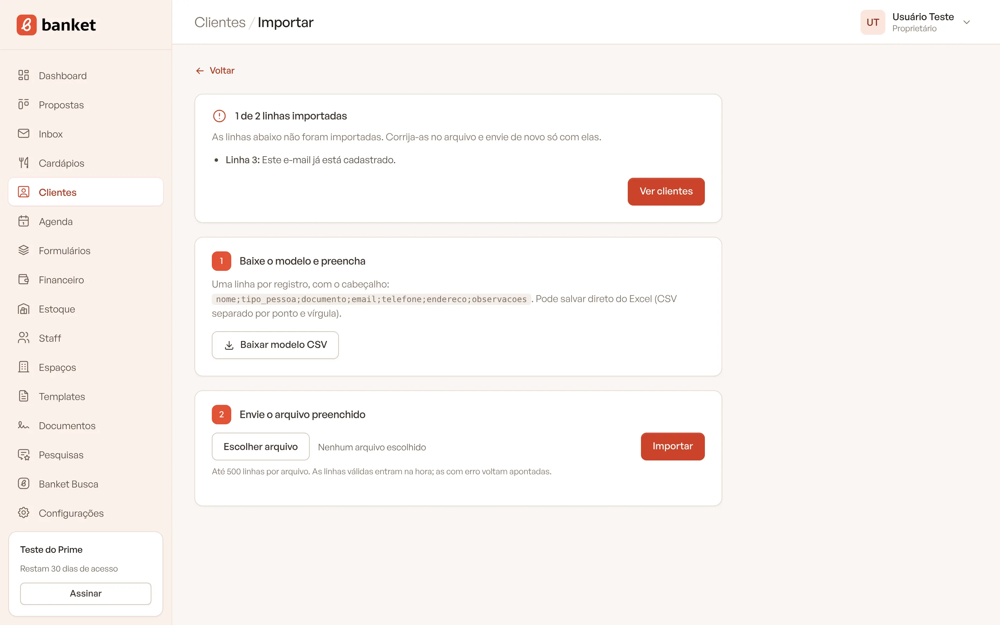

# Importar clientes por CSV

Se você já tem a lista de clientes numa planilha, pode importá-la para o Banket de uma vez, sem cadastrar um por um. O
Banket confere cada linha com as mesmas regras do cadastro manual: as linhas certas entram na hora e as linhas com erro
voltam apontadas, com o motivo.

> **Disponível em:** planos Essencial, Profissional, Prime e Master · **Quem pode usar:** todos os usuários

## Passo a passo

1. No menu lateral, clique em **Clientes**.
2. Clique em **Importar CSV**.

   

3. Em **1 Baixe o modelo e preencha**, clique em **Baixar modelo CSV**.

   

4. Abra o modelo no Excel (ou outro programa de planilhas) e preencha uma linha por cliente, mantendo a primeira linha
   (o cabeçalho). Apague as duas linhas de exemplo.
5. Salve o arquivo no formato CSV.
6. Em **2 Envie o arquivo preenchido**, escolha o arquivo e clique em **Importar**.

   

7. Confira o resultado (veja abaixo) e clique em **Ver clientes**.

## Colunas do arquivo

O cabeçalho do modelo é: `nome;tipo_pessoa;documento;email;telefone;endereco;observacoes`

| Coluna | O que preencher |
|---|---|
| `nome` | Obrigatória. Nome da pessoa ou razão social. |
| `tipo_pessoa` | `PF` (pessoa física) ou `PJ` (pessoa jurídica). Se ficar vazia, o cliente entra como pessoa física. |
| `documento` | CPF ou CNPJ, com ou sem pontuação. Precisa ser válido e combinar com o tipo. |
| `email` | E-mail do cliente. |
| `telefone` | Telefone ou WhatsApp. |
| `endereco` | Endereço completo numa célula. |
| `observacoes` | Observações internas. |

Só a coluna `nome` é obrigatória no cabeçalho. As demais podem ficar vazias.

## Regras da importação

- Até **500 linhas** por arquivo. Para uma base maior, divida em vários arquivos.
- O arquivo pode ser separado por ponto e vírgula (o padrão do Excel em português) ou por vírgula.
- Os nomes das colunas não diferenciam maiúsculas, minúsculas nem acentos.
- A importação **só cria clientes novos**. Ela não atualiza clientes que já existem.
- Uma linha com e-mail ou CPF/CNPJ que já existe na empresa é recusada, e as demais linhas continuam sendo importadas.

## Entenda o resultado

Depois de importar, o Banket mostra quantas linhas entraram, por exemplo "48 de 50 linhas importadas". Se alguma linha
não entrou, aparece a lista com o número da linha no arquivo e o motivo, por exemplo:

- **Linha 7:** Este e-mail já está cadastrado.
- **Linha 12:** CPF/CNPJ inválido.

Corrija essas linhas no arquivo e envie de novo **só com elas**, para não tentar importar outra vez os clientes que já
entraram.

## Perguntas frequentes

### Apareceu "O cabeçalho precisa ter a coluna nome".

A primeira linha do arquivo precisa ser o cabeçalho, com a coluna `nome`. Baixe o modelo e copie seus dados para ele.

### Apareceu "O arquivo não tem linhas de dados".

O arquivo tem só o cabeçalho, ou está vazio. Preencha pelo menos uma linha de cliente abaixo do cabeçalho.

### Os acentos ficaram estranhos depois da importação.

Salve o arquivo no Excel como **CSV UTF-8** e importe de novo. Para corrigir os clientes que já entraram, edite-os na
lista.

### Posso importar os eventos dos clientes também?

Não. A importação traz só o cadastro dos clientes. Os eventos são cadastrados no Painel de Propostas.

## Artigos relacionados

- [Cadastrar cliente](01-cadastrar-cliente.md)
- [Detalhe e histórico do cliente](02-detalhe-e-historico-do-cliente.md)
- [Importar itens por CSV](../07-cardapios/05-importar-itens-por-csv.md)
