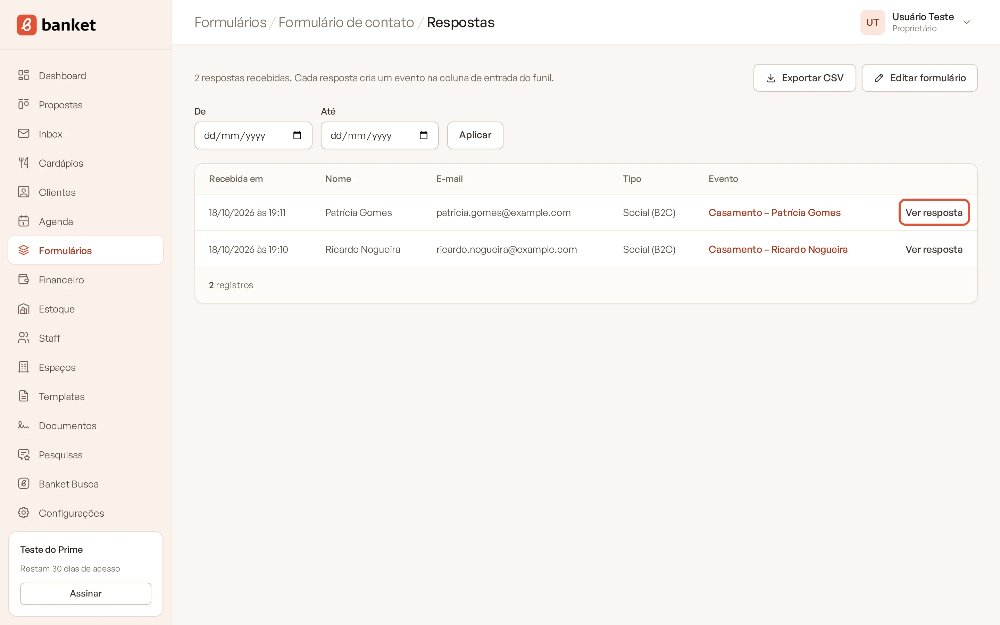
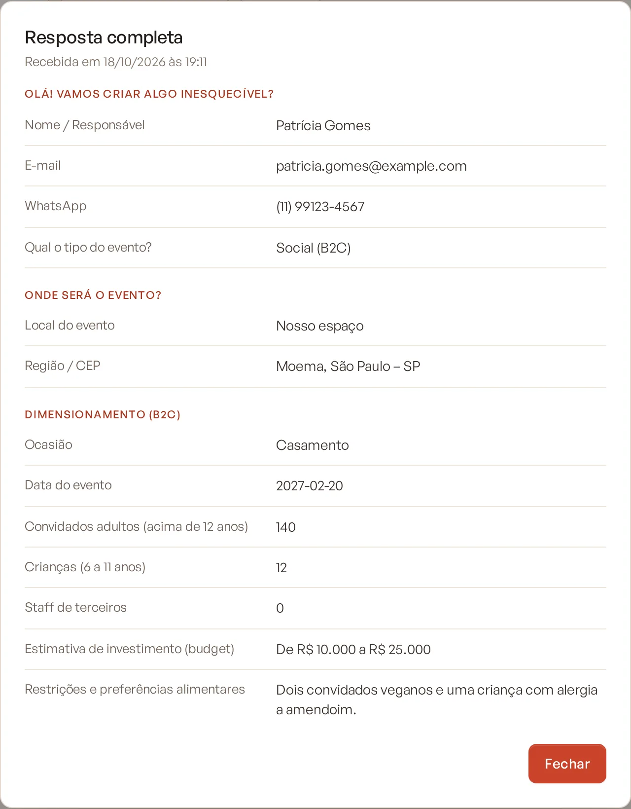
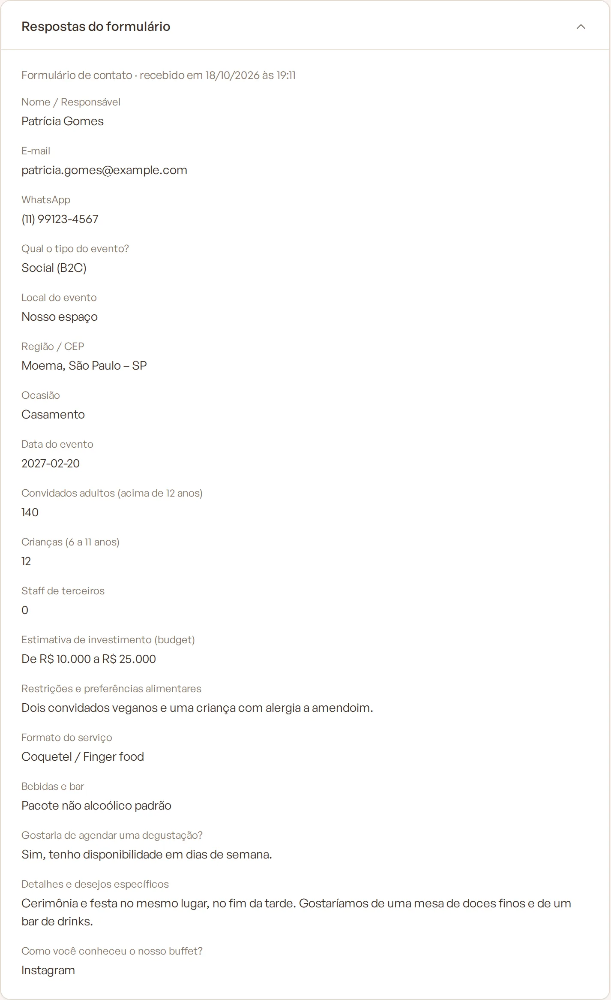

# Ver as respostas do formulário

Cada formulário guarda todas as respostas recebidas, exatamente como o cliente preencheu. Você pode ver o detalhe de
cada uma, filtrar por período e exportar para planilha.

> **Disponível em:** planos Essencial, Profissional, Prime e Master · **Quem pode usar:** todos os usuários

## Passo a passo

1. No menu lateral, clique em **Formulários**.
2. No card do formulário, clique em **Respostas**. (No editor do formulário, o botão **Respostas** fica na barra
   inferior.)
3. A lista mostra, das mais recentes para as mais antigas:
   - **Recebida em**: data e hora do envio;
   - **Nome** e **E-mail** de quem preencheu;
   - **Tipo**: Corporativo ou Social;
   - **Evento**: link para o evento criado a partir da resposta (ou "Evento removido", se ele foi excluído);
   - **Ações**: **Ver resposta**.

   

4. Clique em **Ver resposta** para abrir a **Resposta completa**, com todas as perguntas e respostas agrupadas por
   seção.

   

O card de cada formulário, na tela **Formulários**, também mostra o total de **Respostas** e a data da **Última
resposta**.

## Filtrar por período

1. Preencha **De** e/ou **Até**.
2. Clique em **Aplicar**.
3. Para voltar a ver tudo, clique em **Limpar**.

## Exportar em CSV

1. (Opcional) Filtre o período.
2. Clique em **Exportar CSV**.

O arquivo traz uma linha por resposta e uma coluna por pergunta, já no formato que o Excel em português abre
corretamente. Se você filtrou o período, só as respostas dele vão para o arquivo.

## Onde mais a resposta aparece

Na página do evento criado pelo formulário, o card **Respostas do formulário** mostra o nome do formulário, a data do
envio e todas as respostas, inclusive as das perguntas personalizadas que não têm campo próprio no briefing.

## Perguntas frequentes

### Excluí o evento. A resposta some?

Não. A resposta continua na lista do formulário, com a indicação "Evento removido".

### Alterei uma pergunta depois de receber respostas. O que muda?

As respostas antigas guardam o texto da pergunta como era no momento do envio. A exportação junta as colunas de todas
as versões da pergunta que aparecem no período.

### Posso apagar uma resposta?

Não pela lista de respostas. Se o pedido for inválido (um teste, por exemplo), exclua o evento criado por ele no
**Painel de Propostas**.

## Artigos relacionados

- [Como o pedido vira evento](04-como-o-pedido-vira-evento.md)
- [Criar e editar um formulário](01-criar-e-editar-formulario.md)
- [Resumo do evento](../03-propostas-e-eventos/06-resumo-do-evento.md)
- [Excluir evento](../03-propostas-e-eventos/09-excluir-evento.md)
