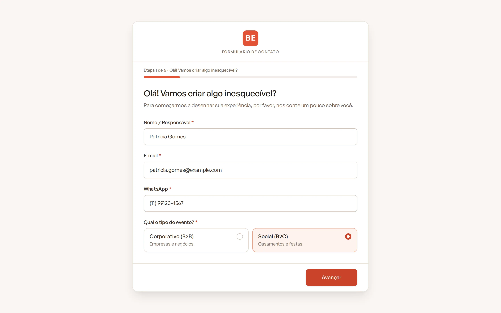
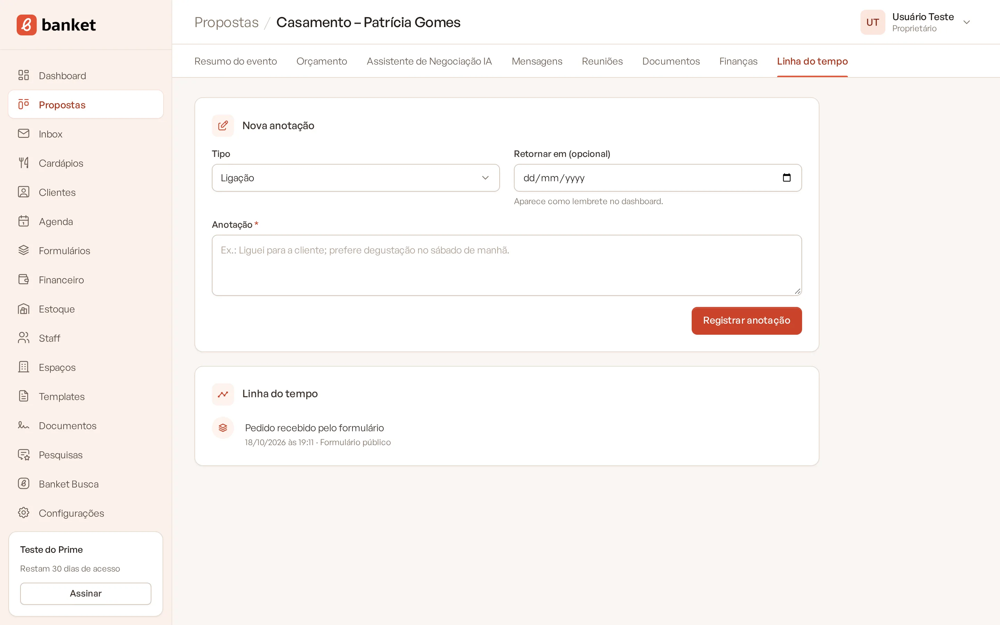
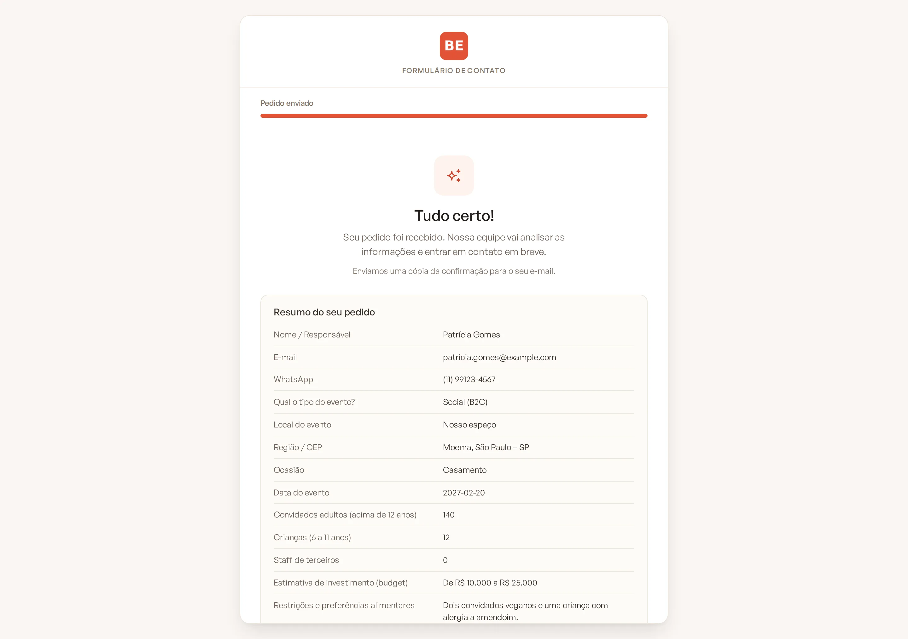
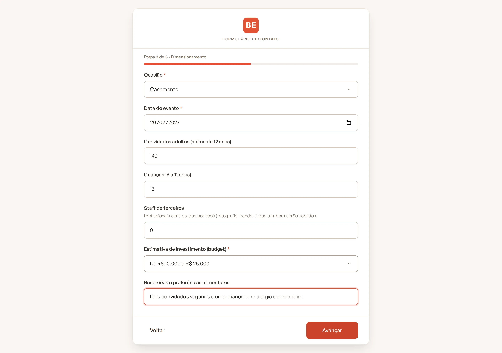
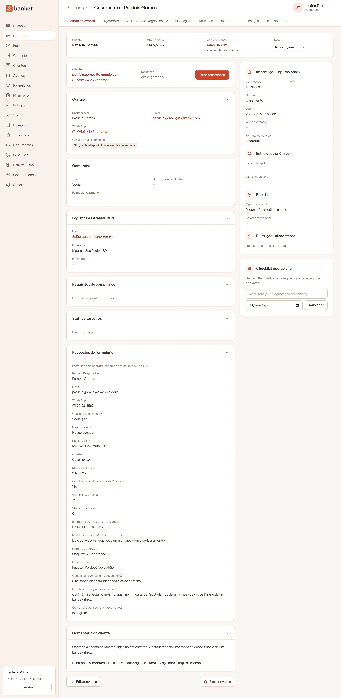
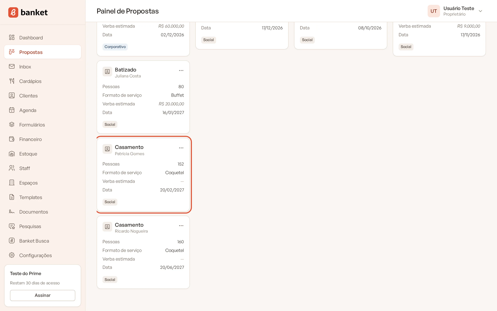

# Como o pedido vira evento

Quando o cliente envia o formulário, o Banket cria tudo sozinho: o cliente, o evento com o briefing preenchido e o card
na coluna de entrada do **Painel de Propostas**. Você só precisa abrir o pedido e começar o atendimento.

> **Disponível em:** planos Essencial, Profissional, Prime e Master · **Quem pode usar:** todos os usuários

## O que acontece no envio

1. **Cliente**: o Banket procura um cliente com o mesmo e-mail. Se encontrar, usa o cadastro existente. Se não,
   cria um cliente novo:
   - evento **Social**: pessoa física, com o nome, o e-mail e o WhatsApp informados;
   - evento **Corporativo** com empresa informada: pessoa jurídica com o nome da empresa, e o nome do contato fica nas
     observações.
2. **Evento**: é criado na primeira etapa do funil (a coluna de entrada de novos pedidos), com origem "formulário".
3. **Linha do tempo**: o evento recebe o registro "Pedido recebido pelo formulário".

   

4. **Respostas**: tudo o que o cliente preencheu fica guardado no evento (card **Respostas do formulário**) e na lista
   de respostas do formulário.
5. **Confirmação ao cliente**: quem preencheu recebe o e-mail "Recebemos o seu pedido!" em nome do seu buffet, e vê na
   tela a sua **Mensagem após o envio** com um resumo do pedido.

   

6. **Aviso no WhatsApp**: se a empresa ativou os avisos no WhatsApp para novos pedidos, a equipe recebe a mensagem.

## Como as respostas preenchem o briefing

| Resposta do formulário | Campo do evento |
|---|---|
| Tipo do evento (Corporativo ou Social) | **Tipo** |
| Ocasião | **Ocasião** |
| Formato do serviço (coquetel, ilhas, jantar completo) | **Formato de serviço**, quando existe um formato com nome equivalente |
| Data prevista / Data do evento | Data do evento |
| Participantes (corporativo) ou adultos + crianças (social) | Número de convidados |
| Perfil do público | Perfil dos convidados |
| Nosso espaço / Local externo | Local: **Nosso espaço** usa o espaço padrão da empresa; externo fica como local externo |
| Infraestrutura do local | Infraestrutura |
| Região / CEP | Endereço |
| Nome, e-mail e WhatsApp | Responsável pelo evento |
| Gostaria de agendar uma degustação? | Convite para experiência |
| Bebidas e bar | Bebidas alcoólicas |
| Requisitos de compliance | Compliance |
| Staff de terceiros | Staff de terceiros |
| Detalhes, restrições alimentares, processo de aprovação | Comentário do cliente |

Eventos corporativos com empresa informada ganham o título "Corporativo – nome da empresa". Nos demais, o título é
gerado a partir da ocasião e do cliente.

Respostas sem campo próprio (como a verba estimada e as perguntas personalizadas) não somem: ficam no card
**Respostas do formulário** do evento.

## Depois do pedido

1. Abra o **Painel de Propostas** e localize o card na coluna de entrada.

   

2. Confira o briefing e complete o que faltar.
3. Monte o orçamento: o evento passa para a etapa de negociação.

Responda rápido: o Banket mede o seu tempo de resposta aos pedidos, conforme configurado pela empresa.

## Perguntas frequentes

### O mesmo cliente enviou duas vezes. Ficou duplicado?

O cliente não duplica (é reconhecido pelo e-mail), mas cada envio cria um evento novo. Se for o mesmo pedido, exclua
o evento repetido.

### O formato de serviço não foi preenchido. Por quê?

O Banket liga a resposta a um formato de serviço com nome equivalente (Coquetel, Ilhas gastronômicas, Empratado). Se a
sua empresa usa outros nomes, preencha o formato manualmente no evento.

### O espaço do evento veio errado.

Quando o cliente escolhe **Nosso espaço**, o evento recebe o espaço padrão da empresa. Se o buffet tem mais de um
salão, ajuste o espaço no briefing do evento.

## Artigos relacionados

- [Painel de Propostas](../03-propostas-e-eventos/01-painel-de-propostas.md)
- [Editar o briefing do evento](../03-propostas-e-eventos/03-editar-briefing-do-evento.md)
- [Criar o orçamento](../04-orcamento/01-criar-orcamento.md)
- [Tempo de resposta aos pedidos](../19-configuracoes/03-tempo-de-resposta-aos-pedidos.md)
- [Avisos no WhatsApp](../19-configuracoes/04-avisos-no-whatsapp.md)
