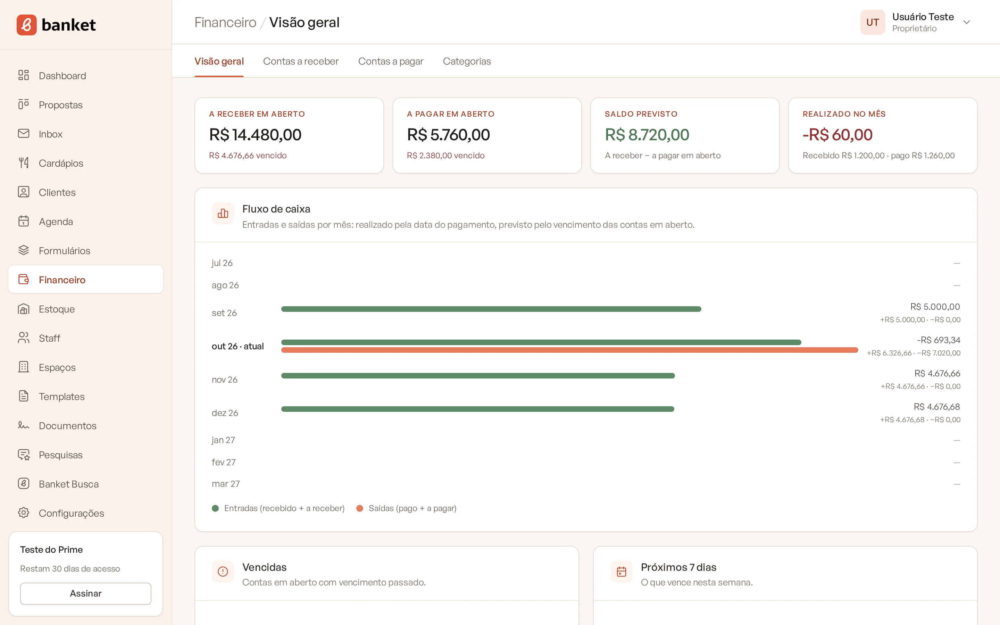
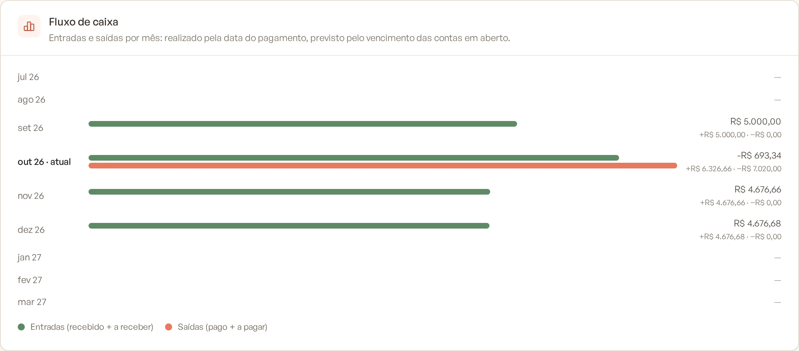
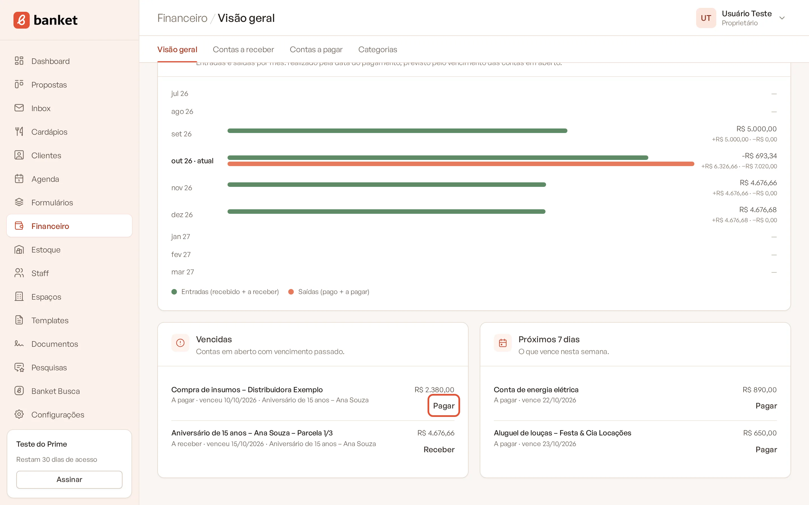

# Visão geral do financeiro

O menu **Financeiro** reúne as contas a receber e a pagar da empresa: as parcelas pagas pelos clientes, os custos dos
eventos e as despesas do dia a dia. A **Visão geral** mostra num só lugar quanto falta receber, quanto falta pagar, o
que já entrou e saiu no mês e o que vence nos próximos dias.

> **Disponível em:** planos Profissional, Prime e Master · **Quem pode usar:** Proprietário e Administrador

## Como acessar

1. No menu lateral, clique em **Financeiro**.
2. A página abre na aba **Visão geral**. As outras abas do submenu são **Contas a receber**, **Contas a pagar** e
   **Categorias**.

Se o seu plano não inclui o Financeiro, o item do menu aparece com um cadeado. Ao clicar, abre a oferta para mudar de
plano. Usuários com o papel Usuário não veem o menu Financeiro.

## Os quatro indicadores do topo

| Indicador | O que mostra |
|---|---|
| **A receber em aberto** | Soma das contas a receber ainda não recebidas. Abaixo, quanto disso já está vencido (ou "Nada vencido"). Clique para abrir **Contas a receber**. |
| **A pagar em aberto** | Soma das contas a pagar ainda não pagas, com o valor vencido. Clique para abrir **Contas a pagar**. |
| **Saldo previsto** | A receber em aberto menos a pagar em aberto. Fica verde quando positivo e vermelho quando negativo. |
| **Realizado no mês** | O que foi recebido menos o que foi pago desde o dia 1º do mês atual, pela data do pagamento. |

Contas canceladas não entram em nenhum total.

## Fluxo de caixa

O card **Fluxo de caixa** mostra uma linha por mês, de 3 meses atrás até 5 meses à frente (o mês atual vem marcado
com "· atual"). Para cada mês aparecem duas barras:

- **Entradas (recebido + a receber):** o que foi recebido naquele mês, pela data do recebimento, mais as contas a
  receber em aberto que vencem no mês.
- **Saídas (pago + a pagar):** o que foi pago no mês, pela data do pagamento, mais as contas a pagar em aberto que
  vencem no mês.

À direita fica o saldo do mês (entradas menos saídas) e, abaixo dele, os dois valores separados. Mês sem movimento
aparece com um travessão.

## Vencidas e próximos 7 dias

Na parte de baixo da página há duas listas:

- **Vencidas:** contas em aberto cujo vencimento já passou.
- **Próximos 7 dias:** contas em aberto que vencem de hoje até daqui a 7 dias.

Cada linha mostra a descrição, o tipo (A receber ou A pagar), a data e o evento, quando houver. O botão **Receber**
ou **Pagar** abre direto o registro do pagamento, sem precisar ir até a lista de contas. Veja
[Dar baixa, cancelar e reabrir uma conta](03-dar-baixa-cancelar-e-reabrir-conta.md).

## Entenda as situações de uma conta

- **Em aberto:** ainda não foi paga e o vencimento é hoje ou no futuro.
- **Vencida:** está em aberto e o vencimento já passou. Isso é calculado automaticamente: você não precisa marcar.
- **Paga** (ou **Recebida**, nas contas a receber): o pagamento foi registrado.
- **Cancelada:** saiu dos totais, mas continua no histórico.

## De onde vêm as contas

- **Lançadas por você** no menu Financeiro ou na aba **Finanças** de um evento.
- **Plano de pagamento do evento:** cada parcela vira uma conta a receber (marcada com a etiqueta **Plano**).
- **Estoque:** uma compra registrada no estoque pode gerar a conta a pagar (etiqueta **Estoque**).

## Perguntas frequentes

### Por que o saldo previsto é diferente do realizado no mês?
O saldo previsto considera tudo o que ainda está em aberto, de qualquer data. O realizado no mês considera só o que
já foi efetivamente recebido ou pago no mês atual.

### Uma conta vencida some da lista sozinha?
Não. Ela continua em **Vencidas** até você registrar o pagamento, editar o vencimento ou cancelar a conta.

### Um usuário da equipe consegue ver o financeiro?
Não. O menu Financeiro e a aba Finanças do evento são exclusivos de Proprietários e Administradores.

### Excluir um evento apaga as contas dele?
Não. As contas continuam no financeiro para preservar o histórico, apenas sem o vínculo com o evento.

## Artigos relacionados
- [Lançar uma conta a receber ou a pagar](02-lancar-conta-a-receber-ou-a-pagar.md)
- [Dar baixa, cancelar e reabrir uma conta](03-dar-baixa-cancelar-e-reabrir-conta.md)
- [Plano de pagamento do evento](04-plano-de-pagamento-do-evento.md)
- [Finanças do evento](05-financas-do-evento.md)
- [Filtrar e exportar contas](07-filtrar-e-exportar-contas.md)
- [Papéis e permissões](../19-configuracoes/06-papeis-e-permissoes.md)
