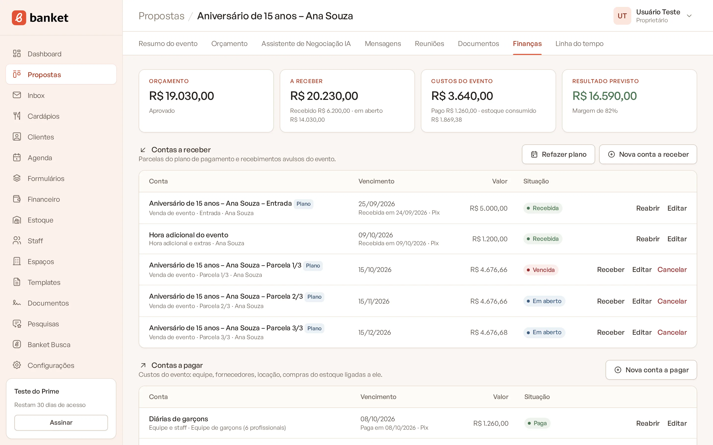
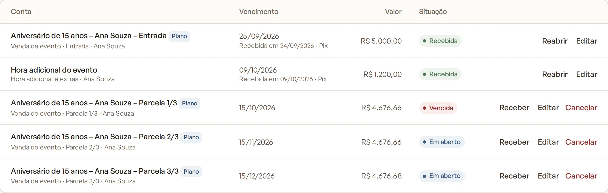
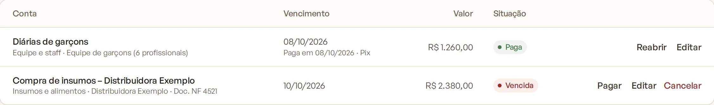

# Finanças do evento

A aba **Finanças** de cada evento reúne o que o cliente vai pagar e o que o evento custa, para você acompanhar o
resultado previsto e a margem antes e depois da festa.

> **Disponível em:** planos Profissional, Prime e Master · **Quem pode usar:** Proprietário e Administrador

## Como acessar

1. Abra o evento pelo **Painel de Propostas** (menu **Propostas**).
2. Clique na aba **Finanças**.

A aba só aparece para Proprietários e Administradores.

## Os indicadores do topo

| Indicador | O que mostra |
|---|---|
| **Orçamento** | Valor total da versão atual do orçamento e a etapa do evento. Mostra um travessão se ainda não há orçamento. |
| **A receber** | Total das contas a receber do evento (valor pago nas recebidas, valor da conta nas em aberto), com quanto já foi recebido e quanto está em aberto. |
| **Custos do evento** | Total das contas a pagar do evento, com quanto já foi pago. Quando há saídas do estoque para o evento, mostra também o "estoque consumido". |
| **Resultado previsto** | A receber menos os custos lançados, com a margem em porcentagem. Verde quando positivo, vermelho quando negativo. |

Contas canceladas não entram nos totais. O "estoque consumido" é o custo dos itens retirados do estoque para consumo
no evento ou para degustação, calculado pelo custo médio na saída. Ele aparece como informação e não entra no
resultado previsto: para que um custo entre no resultado, lance-o como conta a pagar.

## Contas a receber do evento

Lista as parcelas do plano de pagamento e os recebimentos avulsos.

- **Plano de pagamento** (ou **Refazer plano**, quando já existe): cadastra a entrada e as parcelas. Veja
  [Plano de pagamento do evento](04-plano-de-pagamento-do-evento.md).
- **Nova conta a receber:** lança um valor avulso, por exemplo uma hora adicional.

## Contas a pagar do evento

Lista os custos do evento: equipe, fornecedores, locação e compras do estoque ligadas a ele.

- **Nova conta a pagar:** lança um custo. O vencimento já vem com a data do evento.

As contas criadas nesta aba ficam ligadas ao evento automaticamente. Em cada linha você pode **Receber**/**Pagar**,
**Editar**, **Cancelar** ou **Reabrir**, como em [Dar baixa, cancelar e reabrir uma conta](03-dar-baixa-cancelar-e-reabrir-conta.md).

## Dicas

- Cadastre o plano de pagamento logo no fechamento: o sistema oferece isso ao mover o evento para a etapa de aprovado.
- Lance os custos à medida que contratar os fornecedores. Assim o resultado previsto fica próximo do real.
- Para ver todas as contas de vários eventos juntas, use **Financeiro › Contas a receber** ou **Contas a pagar**.

## Perguntas frequentes

### A margem daqui é a mesma do Assistente de Orçamentos?
Não. A margem do assistente é uma projeção do custo dos insumos do cardápio. A margem da aba Finanças usa as contas
efetivamente lançadas para o evento.

### Por que o resultado previsto está igual ao valor a receber?
Porque ainda não há contas a pagar lançadas para o evento. Lance os custos para ver o resultado real.

### Se eu excluir o evento, as contas somem?
Não. Elas ficam no menu Financeiro, sem o vínculo com o evento.

## Artigos relacionados
- [Plano de pagamento do evento](04-plano-de-pagamento-do-evento.md)
- [Lançar uma conta a receber ou a pagar](02-lancar-conta-a-receber-ou-a-pagar.md)
- [Resumo do evento](../03-propostas-e-eventos/06-resumo-do-evento.md)
- [Assistente de Orçamentos](../05-assistentes-de-ia/02-assistente-de-orcamentos.md)
- [Registrar movimentação](../12-estoque/02-registrar-movimentacao.md)
