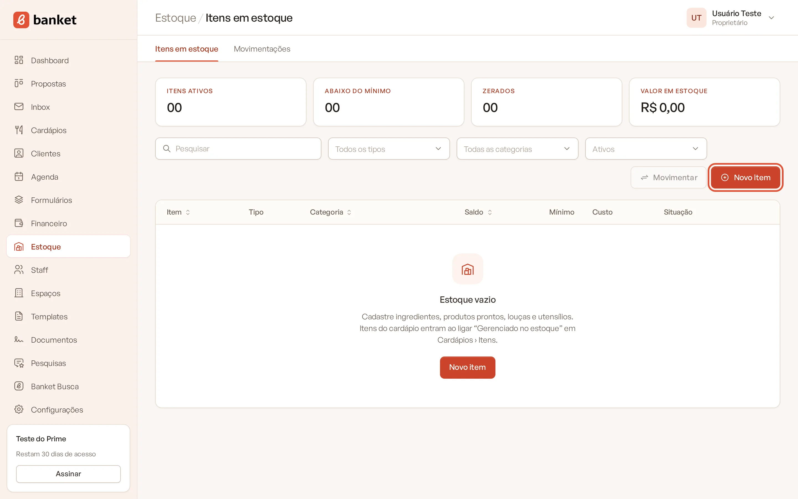
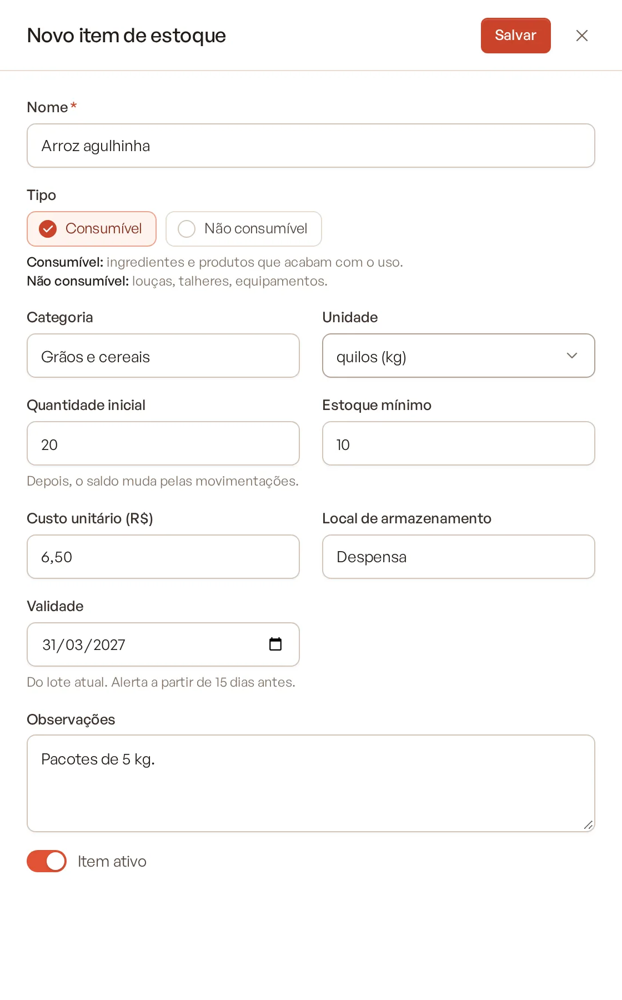
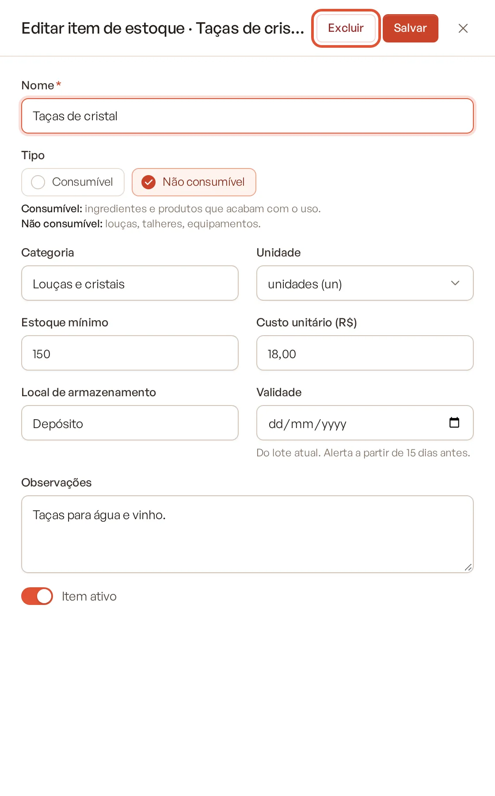
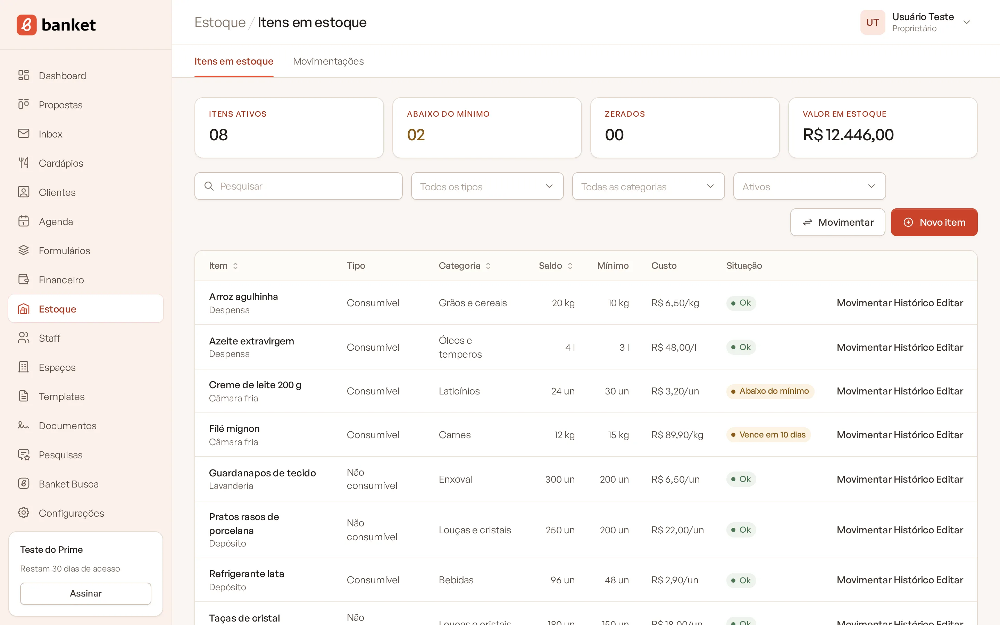
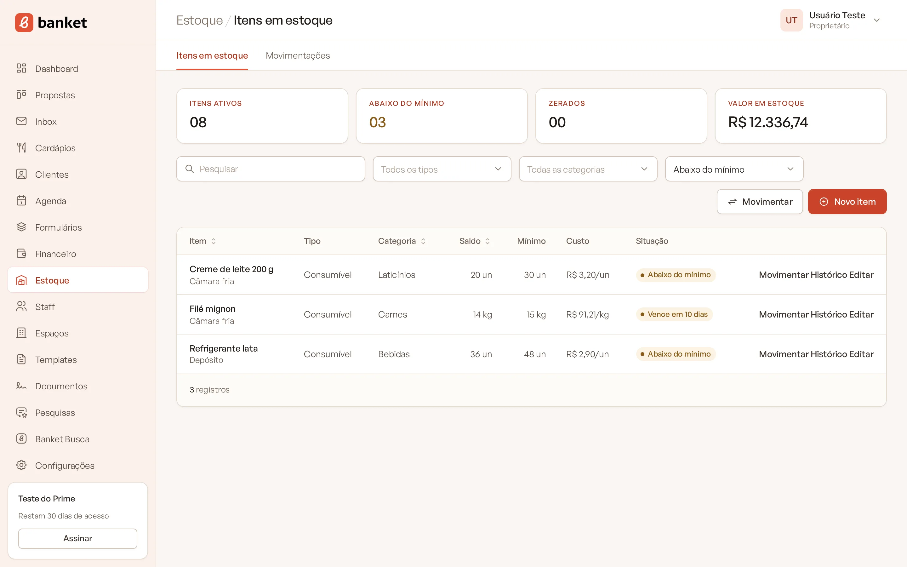

# Cadastrar item de estoque

O Estoque guarda tudo o que o buffet compra e usa: ingredientes, produtos prontos, louças, talheres e equipamentos.
Para cada item você acompanha o saldo, o estoque mínimo, o custo médio e a validade.

> **Disponível em:** planos Profissional, Prime e Master · **Quem pode usar:** todos os usuários

## Passo a passo

1. No menu lateral, clique em **Estoque**. A tela abre em **Itens em estoque**.
2. Clique em **Novo item**.

   

3. Preencha o **Nome** (obrigatório) e escolha o **Tipo**.
4. Preencha os demais campos (veja abaixo).

   

5. Clique em **Salvar**.

## Entenda os campos

| Campo | O que preencher |
|---|---|
| **Nome** | Ex.: Farinha de trigo, Prato raso, Croissant. |
| **Tipo** | **Consumível**: ingredientes e produtos que acabam com o uso. **Não consumível**: louças, talheres, equipamentos. |
| **Categoria** | Texto livre para agrupar (ex.: Laticínios, Louças). O campo sugere as categorias que você já usou. |
| **Unidade** | unidades (un), quilos (kg), gramas (g), litros (l) ou mililitros (ml). |
| **Quantidade inicial** | Saldo atual do item. Só aparece na criação. |
| **Estoque mínimo** | Opcional. Abaixo desse saldo o item fica com o alerta "Abaixo do mínimo". |
| **Custo unitário (R$)** | Custo por unidade de estoque (ex.: por kg). |
| **Local de armazenamento** | Ex.: Câmara fria, Depósito. |
| **Validade** | Do lote atual. O alerta aparece a partir de 15 dias antes. |
| **Observações** | Anotações livres. |
| **Item ativo** | Desligado, o item sai da lista principal e dos seletores. |

## Como o saldo funciona

- A **Quantidade inicial** é registrada como uma contagem chamada "Saldo inicial" no histórico.
- Depois disso, **o saldo só muda por movimentações** (entrada, saída ou contagem). Não dá para editar o saldo direto
  no cadastro. Veja [Registrar movimentação](02-registrar-movimentacao.md).
- Para trocar a **Unidade** de um item, o saldo precisa estar zerado. Registre uma contagem com 0 antes, ou mantenha a
  unidade atual.

## A tela de itens em estoque

No topo, quatro indicadores dos itens ativos:

- **Itens ativos**;
- **Abaixo do mínimo** (clique para filtrar);
- **Zerados** (clique para filtrar);
- **Valor em estoque**: soma de saldo × custo unitário.

A tabela mostra **Item**, **Tipo**, **Categoria**, **Saldo**, **Mínimo**, **Custo** e **Situação**:

| Situação | Quando aparece |
|---|---|
| **Ok** | Saldo acima do mínimo. |
| **Abaixo do mínimo** | Saldo menor que o estoque mínimo. |
| **Zerado** | Saldo igual a zero. |
| **Vence em X dias** / **Vence hoje** | Validade em até 15 dias, com saldo. |
| **Vencido** | Validade já passou, com saldo. |

Itens ligados ao cardápio mostram a etiqueta **Cardápio**. Em cada linha há as ações **Movimentar**, **Histórico** e
**Editar**.

### Filtros
Use os filtros de tipo, categoria e situação (**Abaixo do mínimo**, **Zerados**, **Vencendo em 15 dias** ou
**Inativos**) e a busca por nome, categoria ou local. Clique nas colunas **Item**, **Categoria** ou **Saldo** para
ordenar.

## Excluir um item

Abra o item em **Editar** e clique em **Excluir**. **O item e todo o histórico de movimentações dele são apagados.** Se
o item vier do cardápio, ele deixa de ser gerenciado no estoque (o item do cardápio continua). Para guardar o histórico,
prefira desligar **Item ativo**.

## Limites do plano

| Plano | Itens ativos no estoque |
|---|---|
| Profissional | 200 |
| Prime | 1.000 |
| Master | sem limite |

O limite vale para criar ou reativar itens. Itens inativos não contam.

## Perguntas frequentes

### Errei a quantidade inicial. Como corrijo?
Registre uma movimentação do tipo **Contagem** com a quantidade correta. O sistema registra a diferença.

### O custo unitário muda sozinho?
Sim. Nas compras e na produção interna com custo informado, o sistema recalcula o custo médio do item. Veja
[Motivos de movimentação](03-motivos-de-movimentacao.md).

### Como coloco os itens do meu cardápio no estoque?
Ligue **Gerenciado no estoque** no cadastro do item do cardápio. Veja
[Itens do cardápio no estoque](05-itens-do-cardapio-no-estoque.md).

## Artigos relacionados
- [Registrar movimentação](02-registrar-movimentacao.md)
- [Motivos de movimentação](03-motivos-de-movimentacao.md)
- [Histórico de movimentações](04-historico-de-movimentacoes.md)
- [Itens do cardápio no estoque](05-itens-do-cardapio-no-estoque.md)
- [Limites do plano](../20-planos-e-assinatura/09-limites-do-plano.md)
