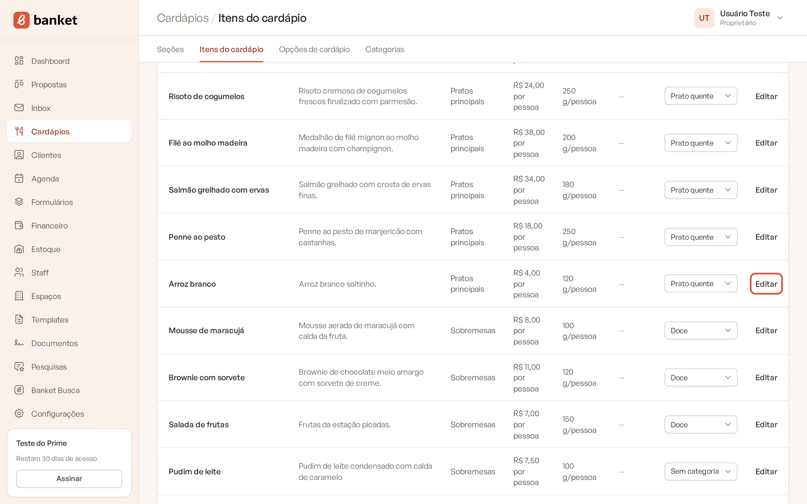
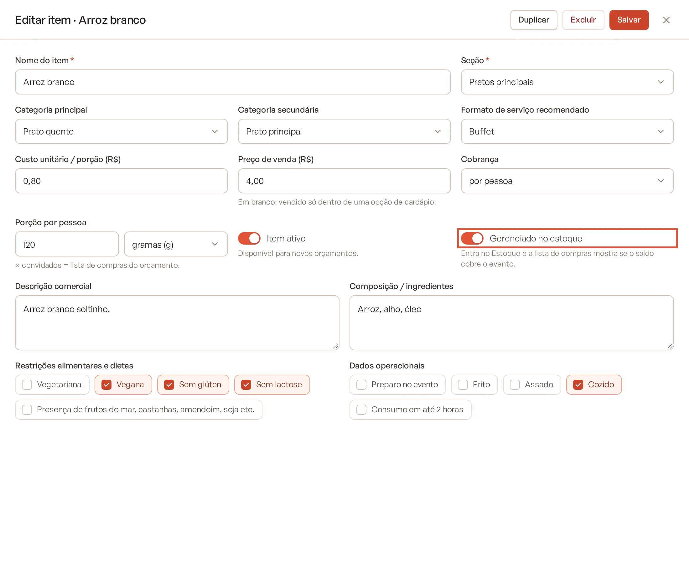
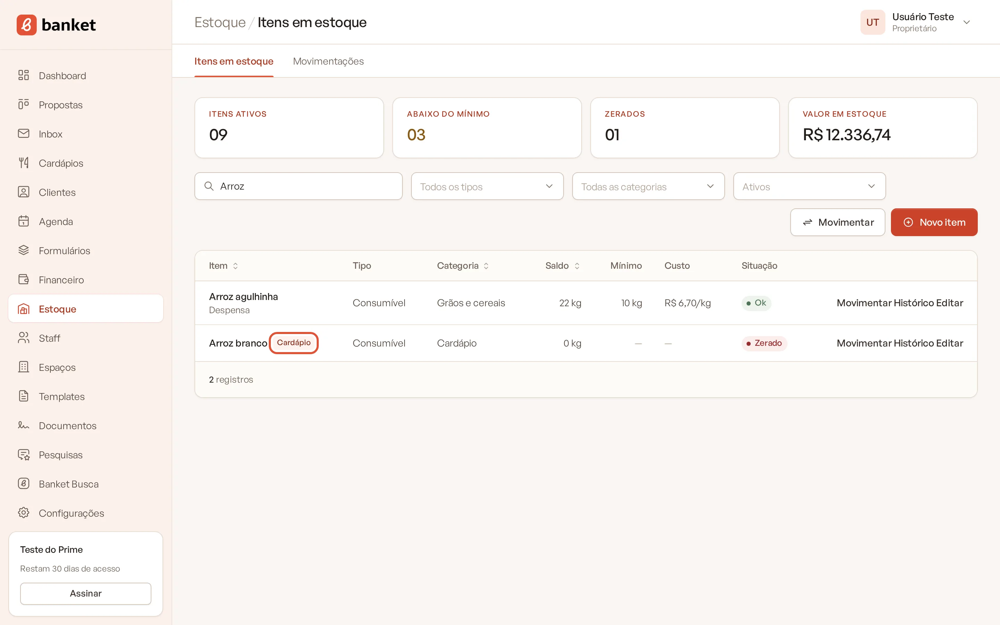
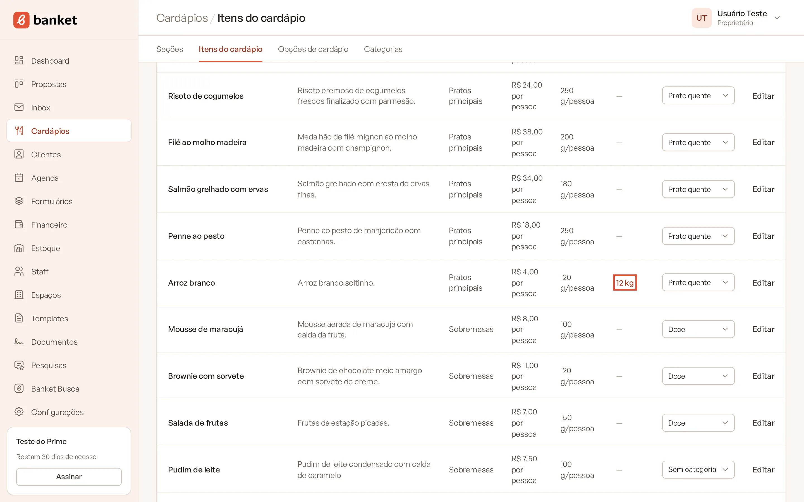

# Itens do cardápio no estoque

Itens do cardápio que você compra prontos ou guarda em estoque (croissants, bebidas, sobremesas congeladas) podem ser
**gerenciados no estoque**. Assim o saldo deles fica no Estoque e a lista de compras do orçamento mostra se ele cobre o
evento.

> **Disponível em:** planos Profissional, Prime e Master · **Quem pode usar:** todos os usuários

## Passo a passo

1. No menu lateral, clique em **Cardápios** e depois em **Itens do cardápio**.
2. Clique em **Editar** no item.

   

3. Ligue **Gerenciado no estoque**.

   

4. Clique em **Salvar**.

   

   

O item passa a aparecer em **Estoque › Itens em estoque** com a etiqueta **Cardápio**. Na lista de itens do cardápio, a
coluna **Estoque** mostra o saldo atual (clique para abrir o item no estoque).

## O que o sistema faz ao ligar

- Se já existe um item de estoque com o **mesmo nome** e sem ligação, ele é ligado ao item do cardápio (e reativado, se
  estava inativo). Assim você não duplica o que já cadastrou.
- Senão, um item de estoque novo é criado com:
  - tipo **Consumível** e categoria **Cardápio**;
  - unidade sugerida pela porção do item: porção em gramas vira **kg**, em mililitros vira **litros**, em unidades vira
    **unidades**;
  - saldo zero. Registre uma entrada ou contagem para informar o saldo.

Depois de criado, ajuste no estoque o que quiser (mínimo, custo, local, validade).

## O que acontece ao desligar

Desligar **Gerenciado no estoque** só **desativa** o item no estoque. O saldo e o histórico ficam guardados; se você
ligar de novo, o mesmo item volta a ser usado.

Se você **excluir** o item no Estoque, o item do cardápio continua cadastrado e deixa de ser gerenciado no estoque.

## Limites do plano

O item ligado conta como item ativo no estoque (Profissional: 200 · Prime: 1.000 · Master: sem limite). Se o limite
estiver cheio, não é possível ligar mais itens.

## Perguntas frequentes

### Preciso ligar todos os itens do cardápio?
Não. Ligue só os itens que você realmente controla em estoque. Ingredientes de receitas costumam ser cadastrados
direto no Estoque.

### Itens que não estão ligados aparecem na coluna Estoque da lista de compras?
Sim, se houver um item de estoque com o mesmo nome. Veja [Estoque na lista de compras](06-estoque-na-lista-de-compras.md).

### O custo do item do cardápio vai para o estoque?
Não. O custo do cardápio é por porção; o do estoque é por unidade de estoque (ex.: por kg). Informe o custo no estoque
ou registre uma compra com custo.

## Artigos relacionados
- [Cadastrar itens do cardápio](../07-cardapios/02-cadastrar-itens.md)
- [Cadastrar item de estoque](01-cadastrar-item-de-estoque.md)
- [Estoque na lista de compras](06-estoque-na-lista-de-compras.md)
- [Registrar movimentação](02-registrar-movimentacao.md)
