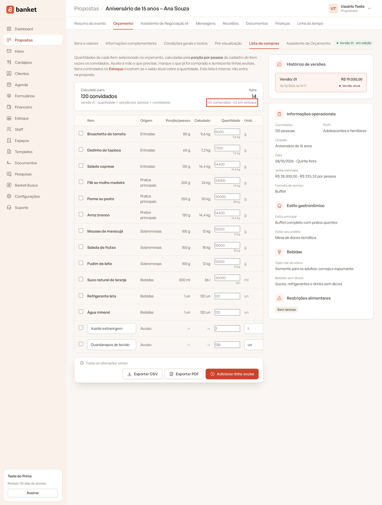
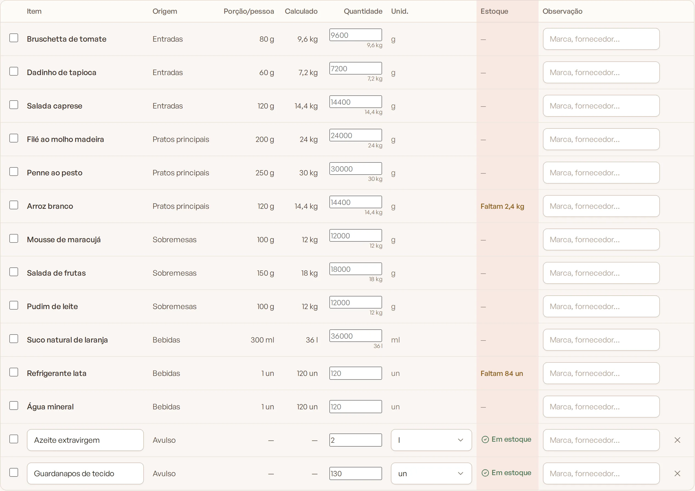

# Estoque na lista de compras

A lista de compras do orçamento tem uma coluna **Estoque** que compara a quantidade de cada linha com o saldo atual do
estoque. Assim você sabe o que já tem e o que precisa comprar para o evento.

> **Disponível em:** planos Profissional, Prime e Master · **Quem pode usar:** todos os usuários

## Onde ver

1. Abra o evento e vá até a aba **Orçamento**.
2. Clique na sub-aba **Lista de compras**.
3. Confira a coluna **Estoque** de cada linha. O resumo do topo mostra quantos itens já estão **em estoque**.

   

A mesma informação sai no CSV e no PDF da lista de compras.

## O que cada situação significa

| Situação | Significado |
|---|---|
| **Em estoque** (com check) | O saldo cobre toda a quantidade da linha. |
| **Faltam X** | O saldo cobre só parte. X é o que falta comprar. |
| **Sem estoque** | O item é controlado no estoque, mas o saldo está zerado. |
| **X no estoque** | O item está no estoque, mas numa unidade que não dá para comparar (ex.: lista em gramas, estoque em unidades). Mostra só o saldo. |
| **—** | O item não é controlado no estoque. |

## Como a linha encontra o item no estoque

1. Pelo item do cardápio ligado ao estoque (**Gerenciado no estoque**).
2. Sem ligação, por um item de estoque **ativo** com o **mesmo nome** (vale para linhas avulsas e bebidas).

## Como a comparação é feita

- A quantidade usada é a que você digitou na linha ou, se estiver em branco, a calculada (porção × convidados).
- Gramas e quilos são convertidos entre si, assim como mililitros e litros. Exemplo: linha de 15.000 g e saldo de 12 kg
  mostra **Faltam 3 kg**.
- O saldo considerado é o **saldo atual da empresa**. O sistema não reserva estoque por evento: se dois eventos
  usam o mesmo item, cada lista compara com o saldo inteiro.

## Perguntas frequentes

### Comprei o item. A lista atualiza sozinha?
Sim, depois que você registrar a entrada no estoque. Ao abrir a lista de novo, a coluna já usa o novo saldo.

### Por que um item aparece "—" mesmo estando no estoque?
O nome no estoque é diferente do nome na lista, ou o item de estoque está inativo. Ligue o item do cardápio ao estoque
para não depender do nome.

### Usar o estoque na lista dá baixa automática?
Não. A lista só compara. Quando o material sair para o evento, registre uma saída **Consumo em evento**.

## Artigos relacionados
- [Lista de compras](../04-orcamento/12-lista-de-compras.md)
- [Itens do cardápio no estoque](05-itens-do-cardapio-no-estoque.md)
- [Registrar movimentação](02-registrar-movimentacao.md)
