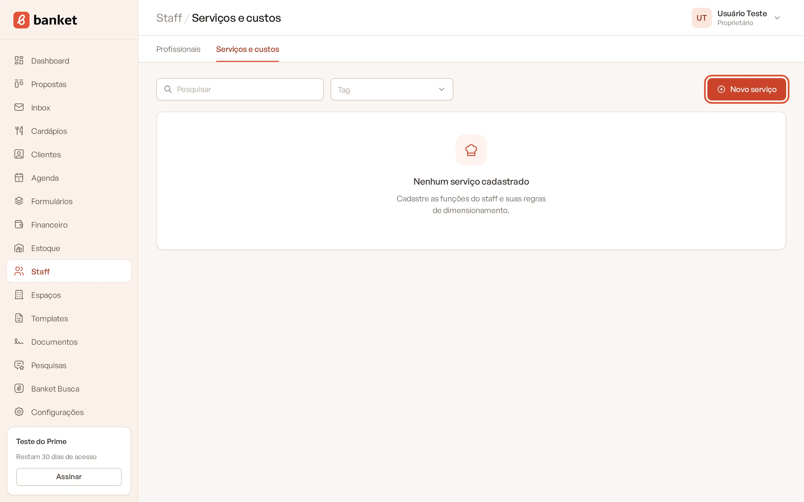
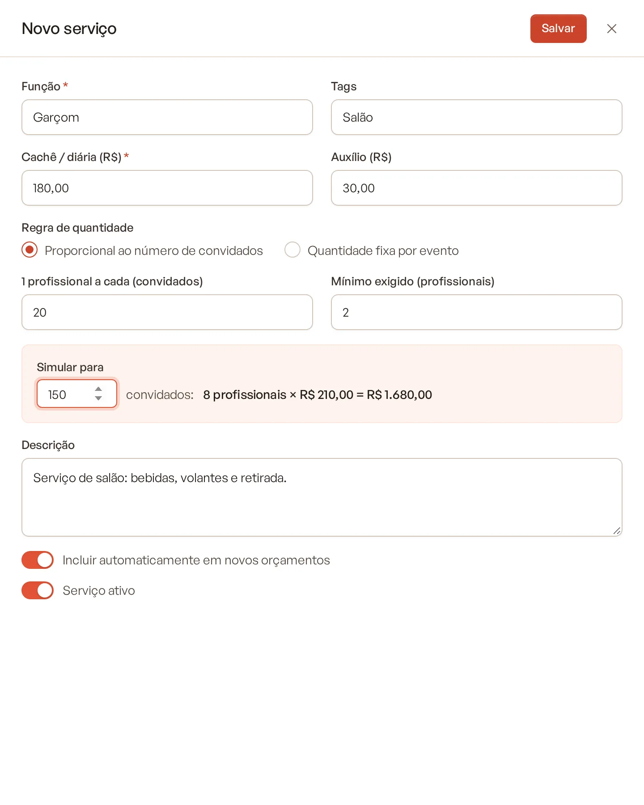
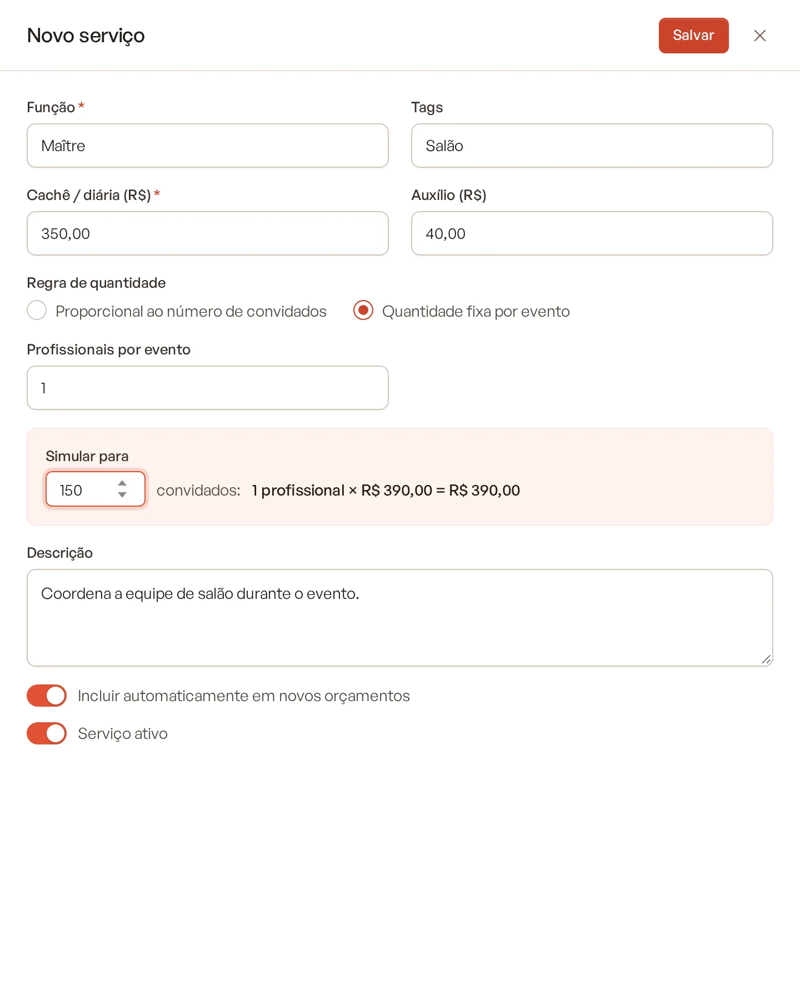
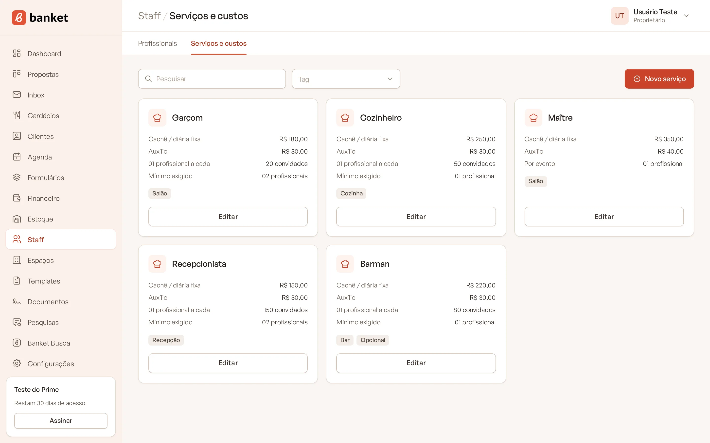

# Serviços e funções do staff

Em **Serviços e custos** você cadastra as funções da equipe (garçom, copeira, cozinheiro, barman…) com o custo de cada
profissional e a regra de quantidade. O orçamento usa essas regras para calcular sozinho quantos profissionais o evento
precisa e quanto isso custa.

> **Disponível em:** planos Essencial, Profissional, Prime e Master · **Quem pode usar:** todos os usuários

## Passo a passo

1. No menu lateral, clique em **Staff** e depois em **Serviços e custos**.
2. Clique em **Novo serviço**.

   

3. Preencha a **Função** e o **Cachê / diária (R$)** (os dois são obrigatórios).
4. Escolha a **Regra de quantidade** e preencha os campos dela (veja abaixo).
5. Confira o resultado no **Simular para**.

   

6. Clique em **Salvar**.

Para alterar um serviço, clique em **Editar** no card dele.

## Entenda os campos

| Campo | O que preencher |
|---|---|
| **Função** | Nome da função. Ex.: Garçom. |
| **Tags** | Palavras separadas por vírgula (ex.: Salão, Bar). Servem para filtrar a lista. |
| **Cachê / diária (R$)** | Valor pago a cada profissional por evento. |
| **Auxílio (R$)** | Transporte, alimentação etc., somado ao cachê. |
| **Regra de quantidade** | Como calcular quantos profissionais o evento precisa (veja abaixo). |
| **Descrição** | Observação sobre o serviço. Ex.: somente quando houver bar contratado. |
| **Incluir automaticamente em novos orçamentos** | Ligado, a função já entra no staff de todo orçamento novo. |
| **Serviço ativo** | Desligado, a função deixa de aparecer para novos orçamentos. |

## Regras de quantidade

### Proporcional ao número de convidados
Preencha **1 profissional a cada (convidados)** e, se quiser, o **Mínimo exigido (profissionais)**.

O sistema arredonda para cima e respeita o mínimo. Exemplo: 1 garçom a cada 15 convidados, mínimo de 2:

- 100 convidados → 100 ÷ 15 = 6,7 → **7 garçons**;
- 20 convidados → 2 pelo cálculo → **2 garçons**;
- 10 convidados → 1 pelo cálculo, mas o mínimo é 2 → **2 garçons**.

### Quantidade fixa por evento
Preencha **Profissionais por evento**. A quantidade é sempre a mesma, seja qual for o número de convidados. Exemplo:
1 maître por evento.

### Simular para
Digite um número de convidados e veja na hora o resultado: quantidade × custo unitário = total. Exemplo:
"7 profissionais × R$ 230,00 = R$ 1.610,00".

## Como o custo é calculado

- **Custo de um profissional** = cachê / diária + auxílio.
- **Custo da função no evento** = quantidade × custo de um profissional.

No orçamento, você pode ajustar a quantidade e o valor unitário de cada função em cada proposta.

## Os cards de serviço

Cada card mostra o **Cachê / diária fixa**, o **Auxílio**, a regra (**01 profissional a cada** X convidados ou **Por
evento**) e o **Mínimo exigido**, quando houver. As etiquetas indicam as tags, **Opcional** (não entra automaticamente
nos orçamentos) e **Inativo**. Use o filtro **Tag** para ver só um grupo.

## Excluir um serviço

Abra o serviço em **Editar** e clique em **Excluir**. Profissionais que tinham essa especialidade ficam sem
especialidade. Para manter o histórico, prefira desligar **Serviço ativo**.

## Perguntas frequentes

### O valor de hora extra entra no orçamento?
Não. O cálculo usa só cachê / diária e auxílio.

### Mudar o cachê altera orçamentos já feitos?
As propostas já criadas guardam a regra e os valores do momento em que a função foi incluída. As mudanças valem para
as próximas.

### Preciso cadastrar os profissionais para usar o staff no orçamento?
Não. O orçamento usa só os serviços. A base de profissionais é para organizar a sua equipe. Veja
[Cadastrar profissionais](02-cadastrar-profissionais.md).

## Artigos relacionados
- [Cadastrar profissionais](02-cadastrar-profissionais.md)
- [Staff no orçamento](../04-orcamento/04-staff-no-orcamento.md)
- [Como o valor é calculado](../04-orcamento/13-como-o-valor-e-calculado.md)
