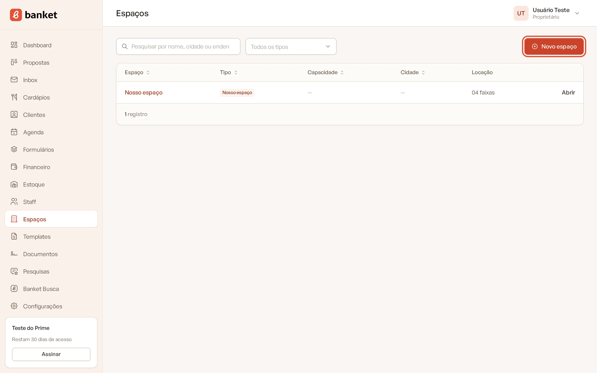
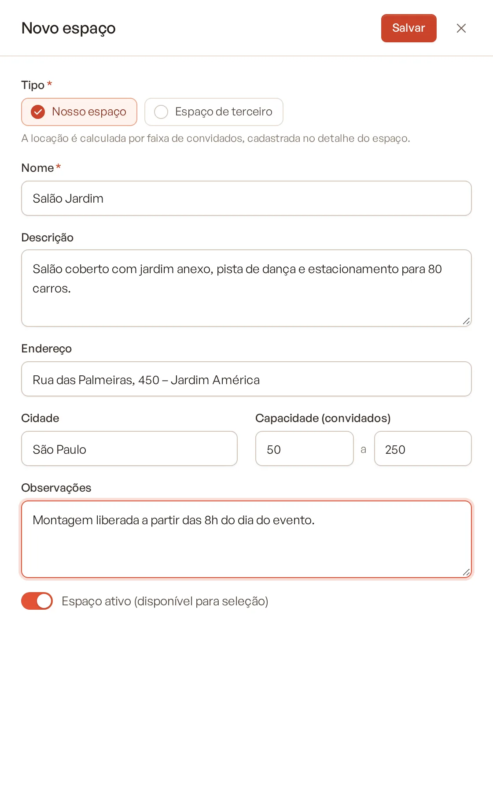
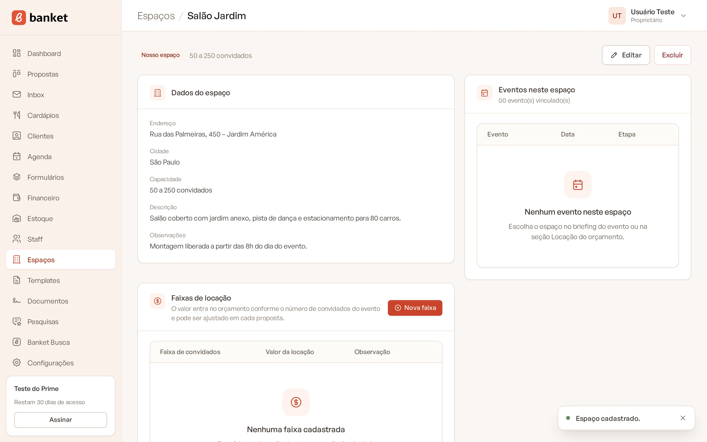
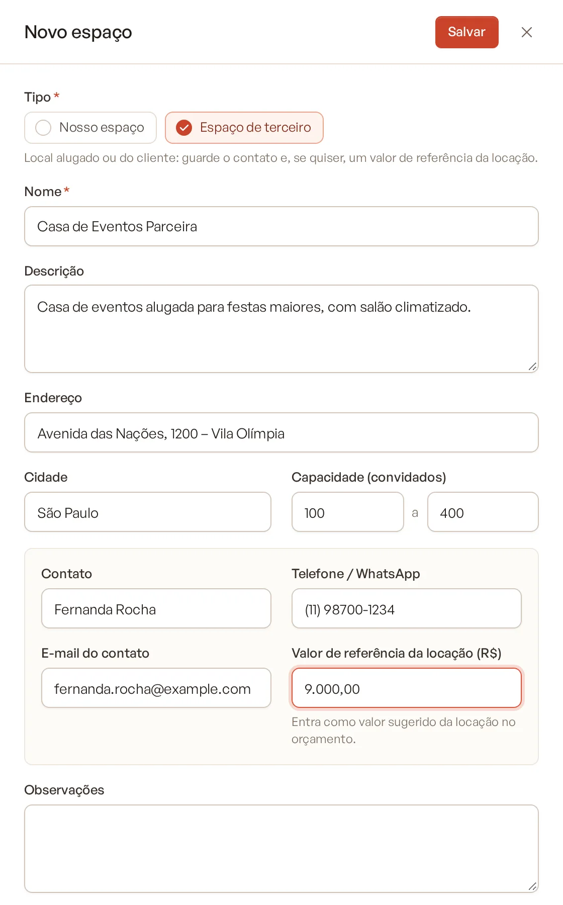
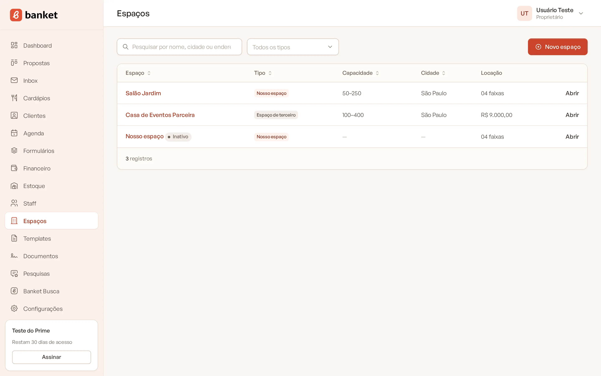
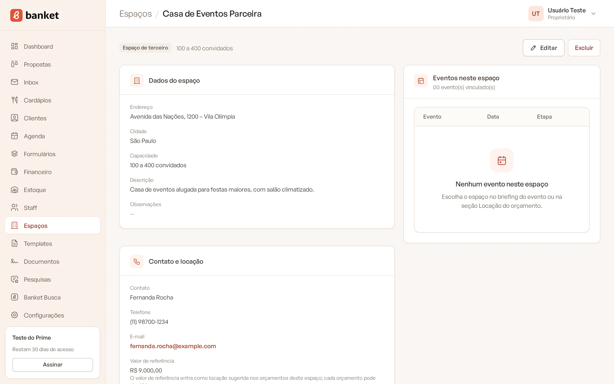
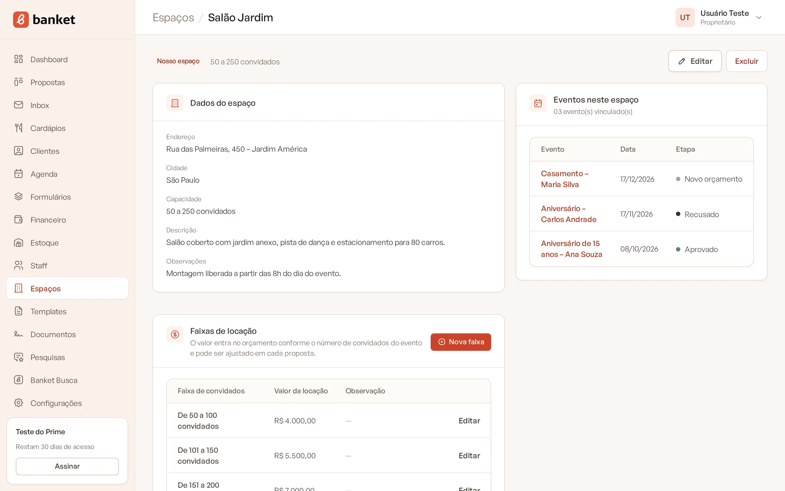

# Cadastrar um espaço

Em **Espaços** você cadastra os locais onde seus eventos acontecem. Há dois tipos:

- **Nosso espaço**: salão ou local do próprio buffet. A locação é calculada por faixas de convidados.
- **Espaço de terceiro**: local alugado ou do cliente (clube, sede da empresa, sítio). Guarda o contato e, se quiser,
  um valor de referência da locação.

Os espaços aparecem no briefing do evento, na seção Locação do orçamento e no espaço padrão da empresa.

> **Disponível em:** planos Essencial, Profissional, Prime e Master · **Quem pode usar:** todos os usuários

## Passo a passo

1. No menu lateral, clique em **Espaços**.
2. Clique em **Novo espaço**.

   

3. Escolha o **Tipo**: **Nosso espaço** ou **Espaço de terceiro**.
4. Preencha o **Nome** (obrigatório) e os demais campos.

   

5. Clique em **Salvar**.

   

Ao salvar um **Nosso espaço** novo, o sistema já abre o detalhe dele para você cadastrar as faixas de locação. Veja
[Faixas de locação](02-faixas-de-locacao.md).

## Entenda os campos

| Campo | O que preencher |
|---|---|
| **Tipo** | Nosso espaço ou Espaço de terceiro. |
| **Nome** | Ex.: Salão Jardim. Não pode repetir na empresa. |
| **Descrição** | Ex.: salão coberto com jardim anexo e estacionamento. |
| **Endereço** e **Cidade** | Localização do espaço. |
| **Capacidade (convidados)** | Mínimo e máximo de convidados. O máximo precisa ser maior ou igual ao mínimo. |
| **Observações** | Anotações livres. |
| **Espaço ativo (disponível para seleção)** | Desligado, o espaço deixa de aparecer nos seletores. |

Só para **Espaço de terceiro**:

| Campo | O que preencher |
|---|---|
| **Contato** | Nome de quem responde pelo espaço. |
| **Telefone / WhatsApp** | Telefone do contato. |
| **E-mail do contato** | E-mail do contato. |
| **Valor de referência da locação (R$)** | Entra como valor sugerido da locação no orçamento. |

## A lista de espaços

A tabela mostra **Espaço**, **Tipo**, **Capacidade**, **Cidade** e **Locação** (número de faixas, nos espaços próprios,
ou o valor de referência, nos de terceiros). Use a busca por nome, cidade ou endereço e o filtro **Nossos espaços** /
**Espaços de terceiros**. Clique em **Abrir** para ver o detalhe.

## O detalhe do espaço

Mostra os **Dados do espaço**, o card **Contato e locação** (terceiros) ou **Faixas de locação** (próprios) e os
**Eventos neste espaço**: os 10 mais recentes, com data e etapa. No topo, use **Editar** para alterar os dados.

## Como o espaço entra no orçamento

| Tipo | Valor da locação no orçamento |
|---|---|
| Nosso espaço | O valor da faixa que contém o número de convidados do evento. Sem faixa correspondente, a locação fica zerada. |
| Espaço de terceiro | O valor de referência. Sem valor, a locação fica zerada. |

Em qualquer caso, você pode digitar outro valor na seção Locação de cada orçamento.

## Espaço padrão

Em **Configurações › Empresa**, o campo **Espaço padrão dos eventos** define o espaço que já vem escolhido nos eventos novos e no
formulário de captação. Toda empresa começa com um espaço próprio chamado "Nosso espaço", que você pode renomear.

## Excluir ou desativar

No detalhe do espaço, clique em **Excluir** e confirme. As faixas de locação dele também são removidas.

**Um espaço usado em algum evento não pode ser excluído.** Nesse caso, edite o espaço e desligue **Espaço ativo** para
tirá-lo dos seletores sem perder o histórico.

## Limites do plano

| Plano | Espaços ativos |
|---|---|
| Essencial | 1 |
| Profissional | 3 |
| Prime | 10 |
| Master | sem limite |

O espaço que vem pronto com a empresa conta no limite. O limite vale para criar ou reativar espaços; espaços inativos
não contam.

## Perguntas frequentes

### O evento vai acontecer na casa do cliente. Preciso cadastrar um espaço?
Não é obrigatório. No briefing do evento, escolha "Outro local" e digite o nome e o endereço. Cadastre como espaço de
terceiro se for um local que se repete.

### Trocar o espaço no orçamento muda o evento?
Sim. Ao trocar o espaço na seção Locação do orçamento, o evento também é atualizado e a mudança vai para a linha do
tempo.

### Posso mudar um espaço de terceiro para próprio?
Sim, editando o **Tipo**. Depois cadastre as faixas de locação no detalhe.

## Artigos relacionados
- [Faixas de locação](02-faixas-de-locacao.md)
- [Locação e extras no orçamento](../04-orcamento/05-locacao-e-extras.md)
- [Criar um evento](../03-propostas-e-eventos/02-criar-evento.md)
- [Dados da empresa](../19-configuracoes/01-dados-da-empresa.md)
- [Limites do plano](../20-planos-e-assinatura/09-limites-do-plano.md)
