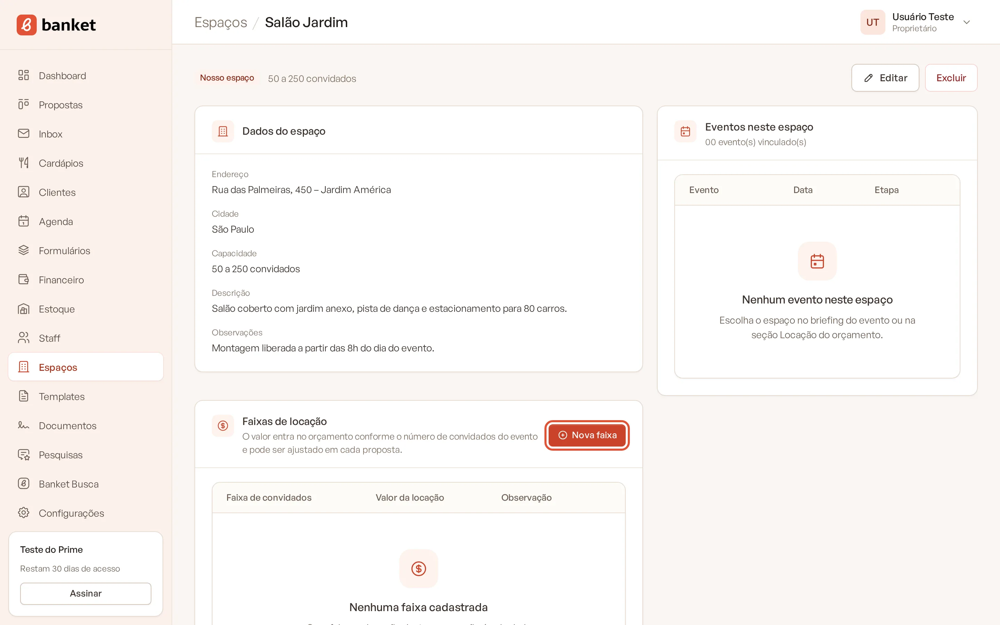
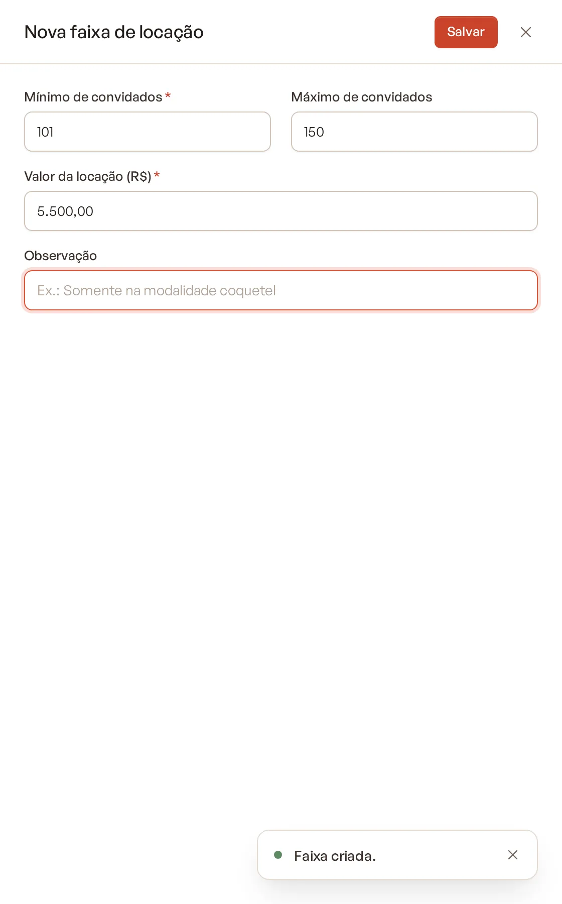
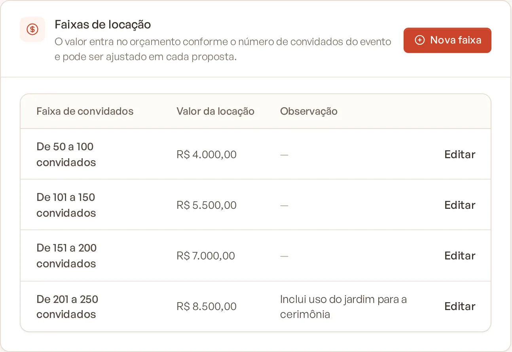
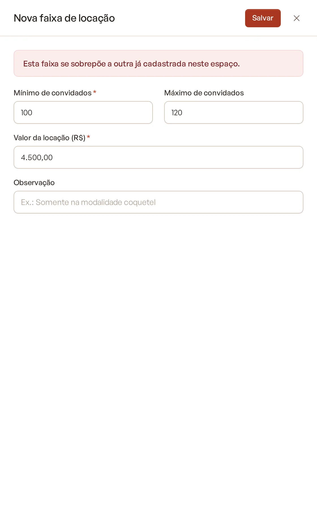

# Faixas de locação

Nos espaços próprios, o valor da locação depende do tamanho do evento. As faixas de locação dizem quanto cobrar para
cada intervalo de convidados, e o orçamento escolhe a faixa certa sozinho.

> **Disponível em:** planos Essencial, Profissional, Prime e Master · **Quem pode usar:** todos os usuários

## Antes de começar

Faixas existem só em espaços do tipo **Nosso espaço**. Espaços de terceiros usam o valor de referência. Veja
[Cadastrar um espaço](01-cadastrar-espaco.md).

## Passo a passo

1. No menu lateral, clique em **Espaços**.
2. Clique em **Abrir** no espaço próprio.
3. No card **Faixas de locação**, clique em **Nova faixa**.

   

4. Preencha os campos:
   - **Mínimo de convidados** (obrigatório);
   - **Máximo de convidados**: deixe em branco para "sem limite";
   - **Valor da locação (R$)** (obrigatório);
   - **Observação**: opcional. Ex.: Somente na modalidade coquetel.

   

5. Clique em **Salvar**.

Para alterar uma faixa, clique em **Editar** na linha dela, ajuste os valores e clique em **Salvar**.

## Exemplo

| Faixa de convidados | Valor da locação |
|---|---|
| Até 50 convidados | R$ 3.000,00 |
| De 51 a 100 convidados | R$ 5.000,00 |
| De 101 a 200 convidados | R$ 8.000,00 |
| A partir de 201 convidados | R$ 11.000,00 |

Um evento com 120 convidados nesse espaço recebe a locação de R$ 8.000,00.

## Regras

- As faixas de um mesmo espaço **não podem se sobrepor**. Se você tentar cadastrar uma faixa que cruza outra, o sistema
  avisa: "Esta faixa se sobrepõe a outra já cadastrada neste espaço." Os limites contam nas duas pontas: uma faixa até
  100 e outra a partir de 100 se sobrepõem; use 100 e 101.

  

- O **Máximo de convidados** precisa ser maior ou igual ao mínimo.
- A faixa é escolhida pelo **número total de convidados** do evento.
- Se nenhuma faixa contém o número de convidados (ou o espaço não tem faixas), a locação entra zerada no orçamento.

## No orçamento

Na seção Locação do orçamento, o valor da faixa aparece como valor calculado. Você pode digitar outro valor em cada
proposta. Quando o número de convidados do evento muda, a versão em edição do orçamento recalcula a faixa; as versões
já congeladas mantêm o valor que foi proposto.

## Perguntas frequentes

### Cadastrei as faixas, mas o orçamento mostra locação zerada. Por quê?
Confira se a seção Locação está incluída no orçamento, se o espaço do evento é esse e se o número de convidados está
dentro de alguma faixa.

### Mudar o valor de uma faixa altera propostas já enviadas?
Não. Versões congeladas guardam o valor da época. A mudança vale para a versão em edição e as próximas.

### Onde ficavam as faixas antes?
Antes elas ficavam em Configurações. Agora cada espaço próprio tem as suas, no detalhe do espaço.

## Artigos relacionados
- [Cadastrar um espaço](01-cadastrar-espaco.md)
- [Locação e extras no orçamento](../04-orcamento/05-locacao-e-extras.md)
- [Versões do orçamento](../04-orcamento/08-versoes-do-orcamento.md)
- [Como o valor é calculado](../04-orcamento/13-como-o-valor-e-calculado.md)
