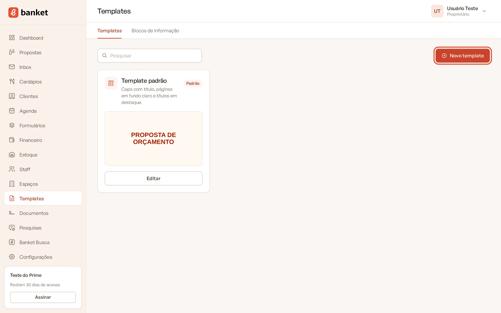
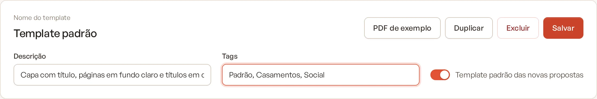
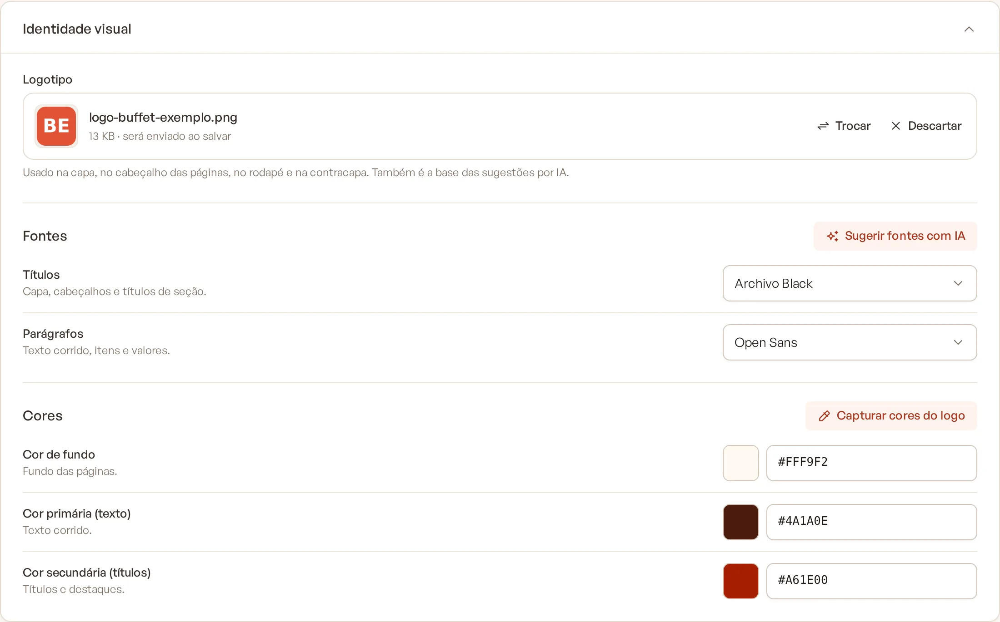
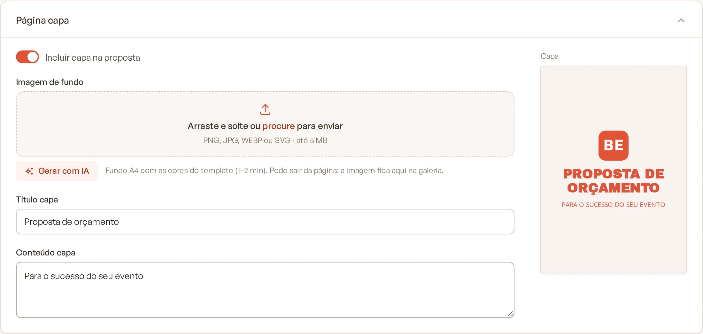
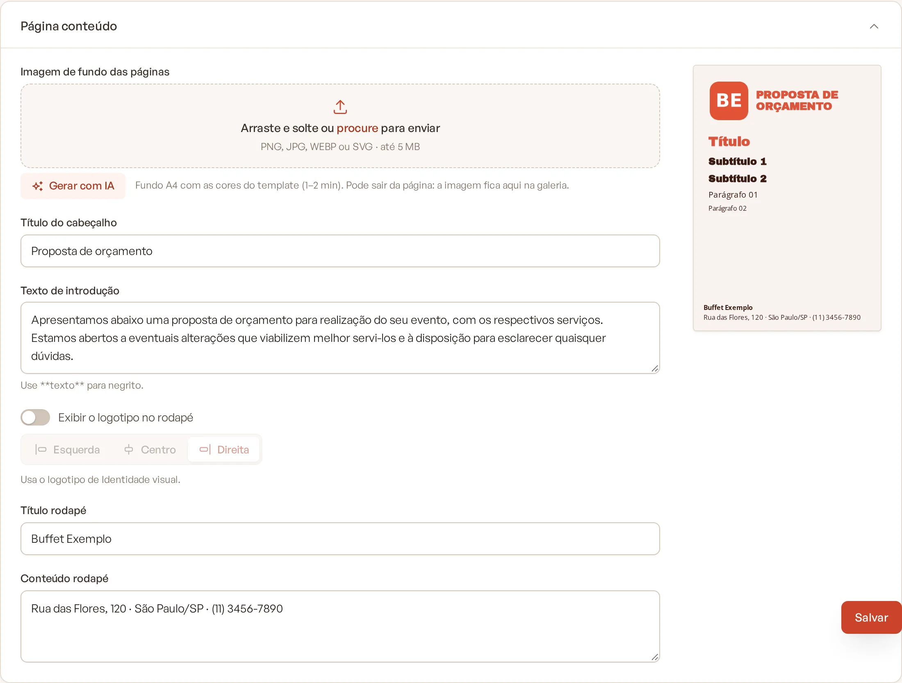
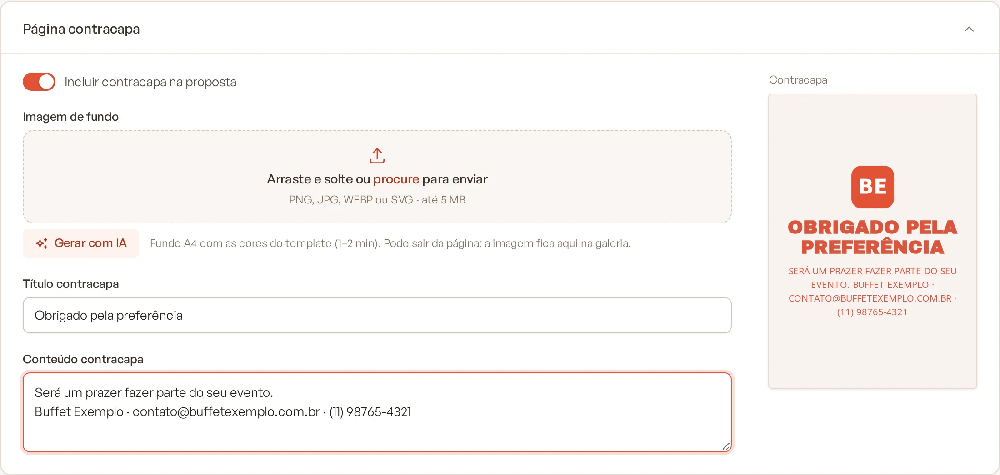
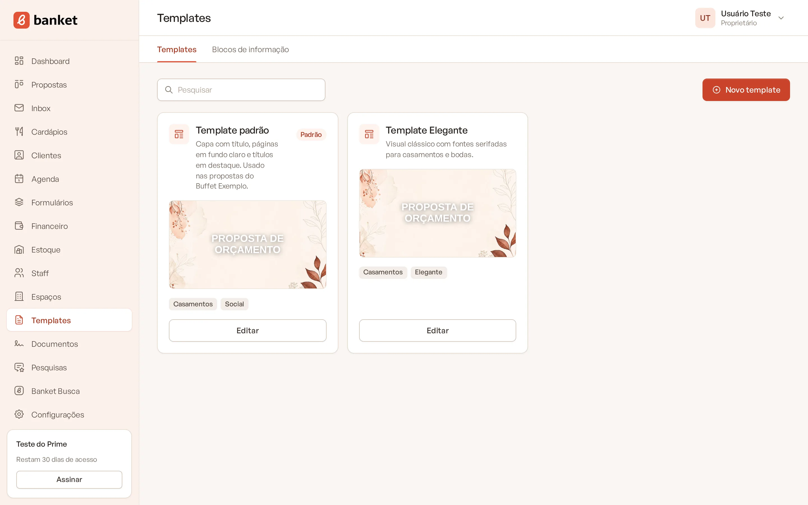

# Criar e editar um template da proposta

O template define a aparência do PDF da proposta que você envia ao cliente: logotipo, fontes, cores, imagens de fundo
e os textos fixos da capa, das páginas de conteúdo e da contracapa. Você pode ter vários templates (por exemplo, um
para casamentos e outro para eventos corporativos) e escolher qual usar em cada orçamento.

> **Disponível em:** planos Essencial, Profissional, Prime e Master · **Quem pode usar:** todos os usuários

## Antes de começar

- Toda empresa já começa com um template padrão. Você pode editá-lo em vez de criar outro.
- Tenha em mãos o logotipo da empresa (PNG, JPG, WebP ou SVG, até 5 MB) e, se quiser, as imagens de fundo.

## Passo a passo

1. No menu lateral, clique em **Templates**.
2. Clique em **Novo template** (ou em **Editar** no card de um template existente).

   

3. No topo, preencha o **Nome do template**. Se quiser, informe a **Descrição** e as **Tags** (separadas por vírgula).

   

4. Abra o card **Identidade visual** e configure:
   - **Logotipo**: arraste o arquivo ou clique para procurar. Ele aparece na capa, no cabeçalho das páginas, no rodapé
     e na contracapa.
   - **Fontes**: escolha a fonte dos **Títulos** e a dos **Parágrafos**.
   - **Cores**: defina a **Cor de fundo**, a **Cor primária (texto)** e a **Cor secundária (títulos)**. Você pode usar
     o seletor de cor ou digitar o código hexadecimal (ex.: `#A61E00`).

   

5. Abra o card **Página capa**:
   - Deixe ligado **Incluir capa na proposta** se quiser uma capa.
   - Escolha a **Imagem de fundo** (opcional).
   - Preencha o **Título capa** (obrigatório) e o **Conteúdo capa**.

   

6. Abra o card **Página conteúdo** (são as páginas com o cardápio, os valores e as condições):
   - Escolha a **Imagem de fundo das páginas** (opcional; prefira imagens bem claras para não atrapalhar a leitura).
   - Preencha o **Título do cabeçalho** (obrigatório) e o **Texto de introdução**.
   - Ligue ou desligue **Exibir o logotipo no rodapé** e escolha a posição: **Esquerda**, **Centro** ou **Direita**.
   - Preencha o **Título rodapé** e o **Conteúdo rodapé**, se quiser.

   

7. Abra o card **Página contracapa**:
   - Ligue **Incluir contracapa na proposta** se quiser uma página final.
   - Escolha a **Imagem de fundo** e preencha o **Título contracapa** e o **Conteúdo contracapa**.

   

8. Clique em **Salvar**. Em páginas longas, o botão **Salvar** acompanha a rolagem no rodapé da tela.

Enquanto você edita, as miniaturas ao lado de cada card mostram como ficam a capa, o conteúdo e a contracapa.

## Entenda os campos

| Campo | O que é |
|---|---|
| Fontes | 12 opções: Archivo Black, Playfair Display, Montserrat, Open Sans, Lora, Poppins, Roboto, Merriweather, Raleway, Cormorant Garamond, Josefin Sans e Libre Baskerville. |
| Cor de fundo | Fundo das páginas. |
| Cor primária (texto) | Texto corrido, itens e valores. |
| Cor secundária (títulos) | Títulos e destaques. |
| Texto de introdução | Aparece no início das páginas de conteúdo. Use `**texto**` para negrito. |
| Template padrão das novas propostas | Marca este template como o padrão da empresa (ver [PDF de exemplo e template padrão](05-pdf-de-exemplo-e-template-padrao.md)). |

## Trocar ou remover uma imagem

Em cada campo de imagem, use **Trocar** para escolher outro arquivo ou **Remover** para tirar a imagem. A mudança só
vale depois de clicar em **Salvar**.

## Duplicar e excluir

- **Duplicar** cria uma cópia com o nome "(cópia)", com as mesmas imagens e textos. É a forma mais rápida de criar
  uma variação.
- **Excluir** apaga o template depois da confirmação. Orçamentos que usavam esse template passam a usar o template
  padrão. O template padrão não pode ser excluído: defina outro como padrão antes.

## Limites do plano

| Plano | Templates |
|---|---|
| Essencial | 1 |
| Profissional | 3 |
| Prime | 10 |
| Master | sem limite |

Ao atingir o limite, **Novo template** e **Duplicar** mostram o aviso do plano com a opção de mudar de plano.

## Perguntas frequentes

### Salvei com erro e as imagens sumiram. O que aconteceu?
Quando algum campo obrigatório falta, a página volta com os textos preenchidos, mas o navegador não permite manter os
arquivos escolhidos. Selecione as imagens de novo e clique em **Salvar**.

### Posso usar um logotipo diferente no rodapé?
Não. O rodapé usa o mesmo logotipo da **Identidade visual**. Você só escolhe se ele aparece e em que posição.

### Alterar o template muda as propostas já enviadas?
Os PDFs já gerados continuam iguais. Os próximos PDFs gerados com esse template saem com o visual novo.

### Como escolho o template de um orçamento específico?
Na tela do orçamento do evento. Veja [Escolher o template da proposta](../04-orcamento/10-escolher-template-da-proposta.md).

## Artigos relacionados
- [Identidade visual com IA](02-identidade-visual-com-ia.md)
- [Imagens de fundo com IA](03-imagens-de-fundo-com-ia.md)
- [PDF de exemplo e template padrão](05-pdf-de-exemplo-e-template-padrao.md)
- [Prévia e PDF da proposta](../04-orcamento/09-previa-e-pdf-da-proposta.md)
