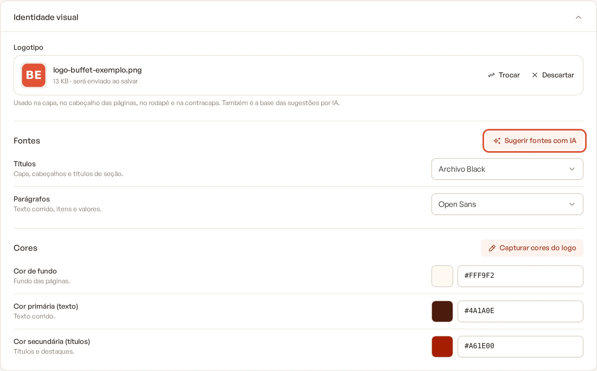
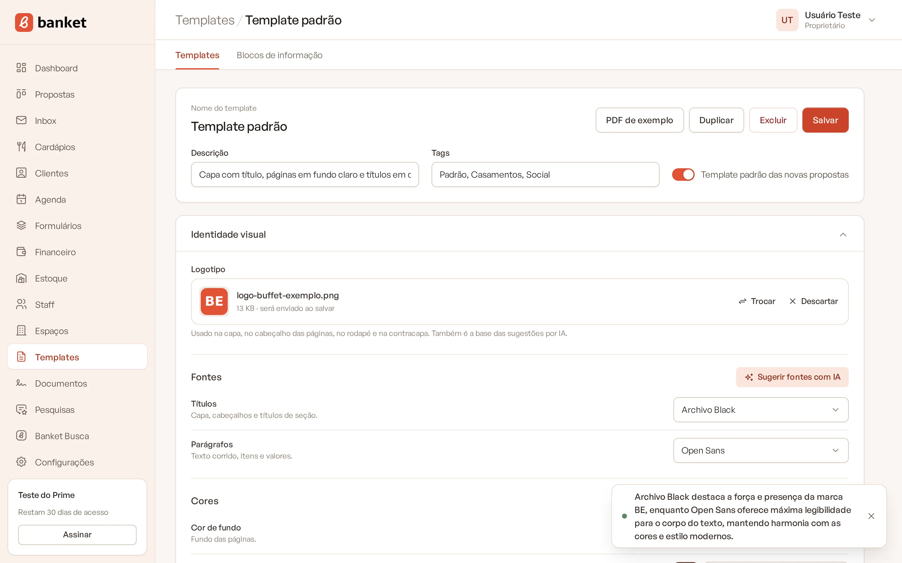
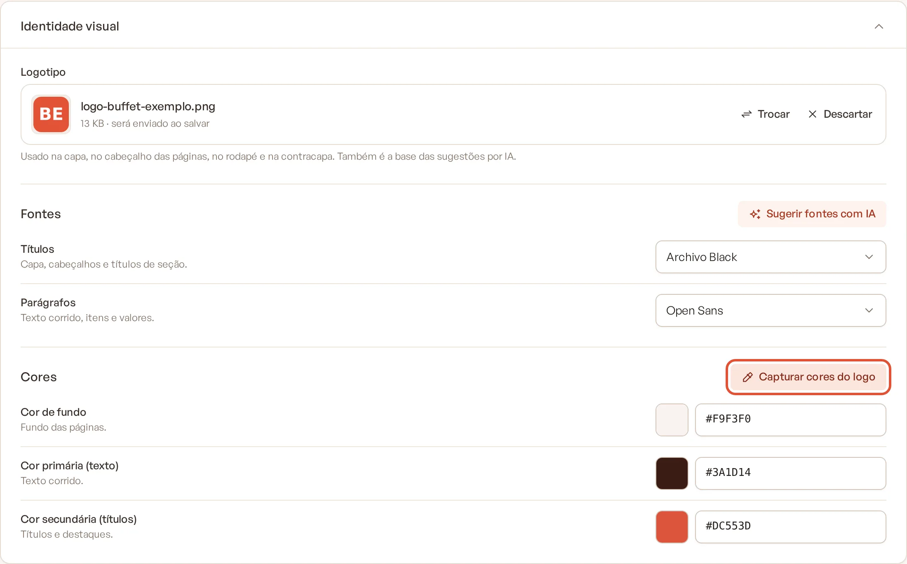

# Sugerir fontes e capturar cores do logo com IA

No card **Identidade visual** do template, dois botões usam inteligência artificial para analisar o seu logotipo e
preencher o visual da proposta: **Sugerir fontes com IA** e **Capturar cores do logo**.

> **Disponível em:** planos Essencial, Profissional, Prime e Master · **Quem pode usar:** todos os usuários

## Antes de começar

O template precisa ter um **Logotipo**. Pode ser o logotipo já salvo ou um arquivo que você acabou de escolher, mesmo
antes de salvar. Sem logotipo, o sistema mostra o aviso "Envie o logotipo para usar as sugestões por IA."

## Sugerir as fontes

1. No menu lateral, clique em **Templates** e abra o template.
2. No card **Identidade visual**, confira se o **Logotipo** está preenchido.
3. Em **Fontes**, clique em **Sugerir fontes com IA**.

   

4. Aguarde alguns segundos. A IA escolhe a fonte dos **Títulos** e a dos **Parágrafos** entre as fontes disponíveis,
   combinando com o estilo do logotipo e com as cores já definidas.
5. Um aviso mostra o motivo da escolha. Confira o resultado nas miniaturas.

   

6. Clique em **Salvar** para manter as fontes sugeridas.

## Capturar as cores

1. No card **Identidade visual**, em **Cores**, clique em **Capturar cores do logo**.
2. A IA extrai a paleta do logotipo e preenche as três cores:
   - **Cor de fundo**: um tom bem claro derivado da paleta (ou branco), para o texto ficar legível;
   - **Cor primária (texto)**: uma cor escura, com bom contraste sobre o fundo;
   - **Cor secundária (títulos)**: normalmente a cor mais marcante da marca.

   

3. Confira o resultado nas miniaturas e ajuste à mão, se quiser.
4. Clique em **Salvar** para manter as cores.

## Dicas

- As sugestões só preenchem os campos. Nada fica gravado até você clicar em **Salvar**.
- Não gostou? Clique de novo para outra sugestão ou escolha à mão.
- Logotipos com fundo transparente funcionam bem. A IA ignora o fundo branco usado na análise.
- Capture as cores antes de gerar as [imagens de fundo com IA](03-imagens-de-fundo-com-ia.md): as imagens usam as
  cores do template.

## Perguntas frequentes

### Tem limite de uso?
Não há limite mensal. Para evitar abusos, a empresa pode pedir até 40 sugestões a cada 10 minutos. Passando disso,
aguarde alguns minutos.

### A IA pode escolher uma fonte que não está na lista?
Não. A sugestão é sempre uma das fontes disponíveis no template.

### Apareceu "A IA não trouxe uma sugestão válida". O que faço?
Clique no botão de novo. Se o erro continuar, tente um arquivo de logotipo com melhor qualidade.

### Essas cores também valem para os documentos e contratos?
Não. Os modelos de documento têm uma identidade visual própria. Veja
[Criar modelo de documento](../16-documentos/01-criar-modelo-de-documento.md).

## Artigos relacionados
- [Criar e editar um template da proposta](01-criar-template.md)
- [Imagens de fundo com IA](03-imagens-de-fundo-com-ia.md)
