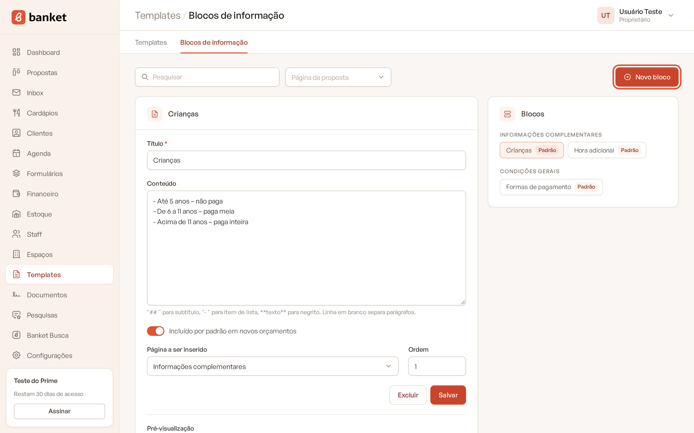
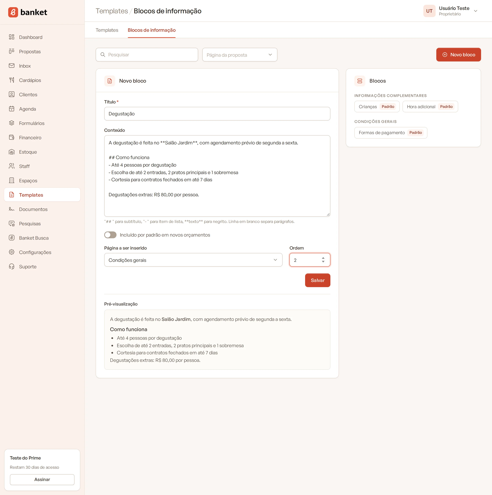
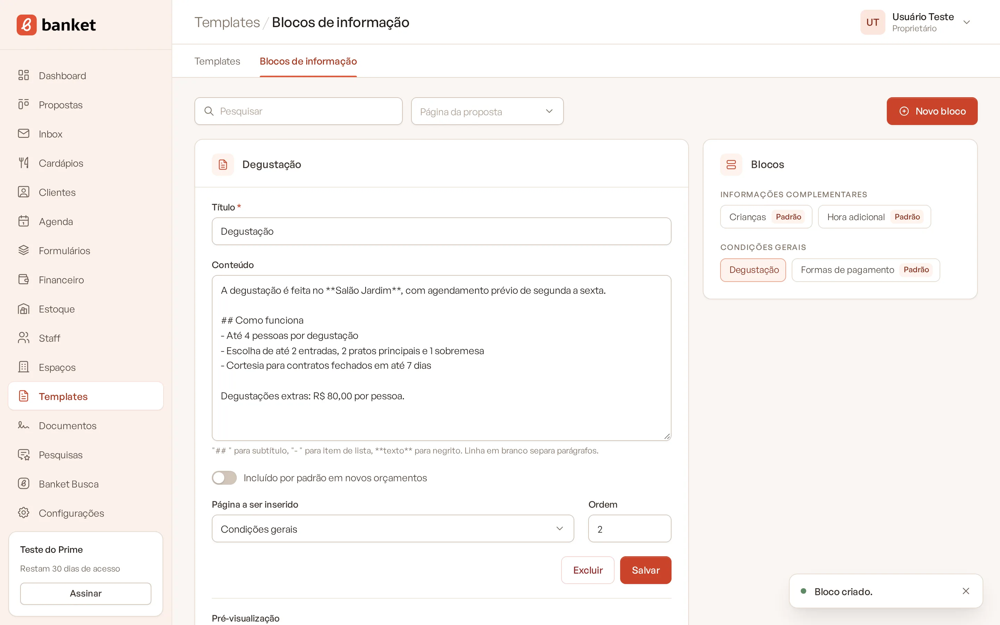

# Blocos de informação da proposta

Blocos de informação são textos que você escreve uma vez e reaproveita em todas as propostas: política para crianças,
hora adicional, formas de pagamento, observações sobre bebidas e assim por diante. Cada bloco é inserido numa página
específica da proposta.

> **Disponível em:** planos Essencial, Profissional, Prime e Master · **Quem pode usar:** todos os usuários

Toda empresa já começa com alguns blocos prontos, como **Crianças**, **Hora adicional** e **Formas de pagamento**.
Edite-os para refletir as regras do seu buffet.

## Criar um bloco

1. No menu lateral, clique em **Templates**.
2. No submenu, clique em **Blocos de informação**.
3. Clique em **Novo bloco**.

   

4. Preencha os campos:
   - **Título** (obrigatório): aparece como título do bloco na proposta.
   - **Conteúdo**: o texto do bloco (veja a formatação abaixo).
   - **Incluído por padrão em novos orçamentos**: ligado, o bloco já entra em todo orçamento novo.
   - **Página a ser inserido**: em que parte da proposta o bloco aparece.
   - **Ordem**: posição do bloco dentro da página (opcional).
5. Confira o resultado em **Pré-visualização**, logo abaixo.

   

6. Clique em **Salvar**.

## Formatação do conteúdo

| Escreva | Para |
|---|---|
| `## Subtítulo` no começo da linha | criar um subtítulo |
| `- ` no começo da linha | criar um item de lista |
| `**texto**` | deixar em negrito |
| uma linha em branco | separar parágrafos |

## Páginas disponíveis

| Página a ser inserido | Onde aparece |
|---|---|
| Cardápio (após os cardápios) | Depois dos cardápios da proposta |
| Bebidas | Na parte de bebidas |
| Staff | Na parte da equipe |
| Informações complementares | Na página de informações complementares |
| Condições gerais | Na página de condições gerais |

## Editar, reordenar e excluir

- À direita, a lista **Blocos** mostra os blocos agrupados por página. Clique num bloco para editá-lo. Os blocos com
  a marca **Padrão** entram automaticamente nos orçamentos novos.
- Para mudar a ordem dentro de uma página, arraste o bloco na lista (ou use Alt + setas com o bloco selecionado).
- Para filtrar a lista, use o filtro **Página da proposta** ou a busca no topo.
- Para excluir, abra o bloco e clique em **Excluir**.

## O que acontece depois

Ao criar um orçamento, os blocos marcados como incluídos por padrão entram como uma **cópia** do texto. Por isso:

- editar um bloco aqui não muda os orçamentos já criados;
- excluir um bloco não apaga o texto das propostas existentes;
- no orçamento, você pode incluir outros blocos, tirar ou ajustar o texto só daquela proposta.

## Perguntas frequentes

### Os blocos dependem do template?
Não. Os blocos são da empresa e valem para qualquer template. O template só define o visual (fontes, cores e fundos).

### Quero um bloco só em algumas propostas. Como faço?
Desligue **Incluído por padrão em novos orçamentos**. O bloco fica disponível para você adicionar no orçamento quando
precisar.

### Onde edito o texto de uma proposta específica?
No orçamento do evento, na seção de textos da proposta. Veja [Textos da proposta](../04-orcamento/07-textos-da-proposta.md).

## Artigos relacionados
- [Textos da proposta](../04-orcamento/07-textos-da-proposta.md)
- [Informações complementares e condições gerais](../04-orcamento/06-informacoes-complementares-e-condicoes-gerais.md)
- [Criar e editar um template da proposta](01-criar-template.md)
