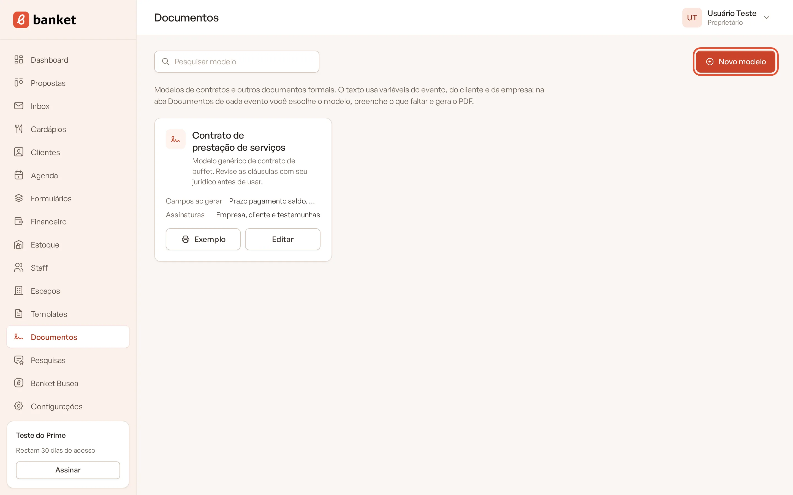
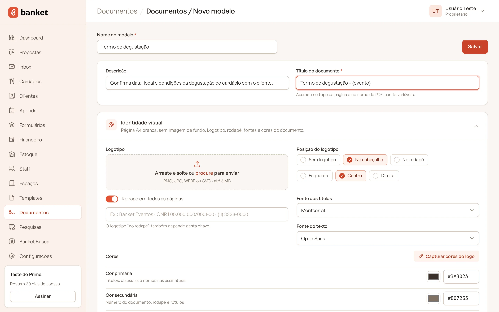
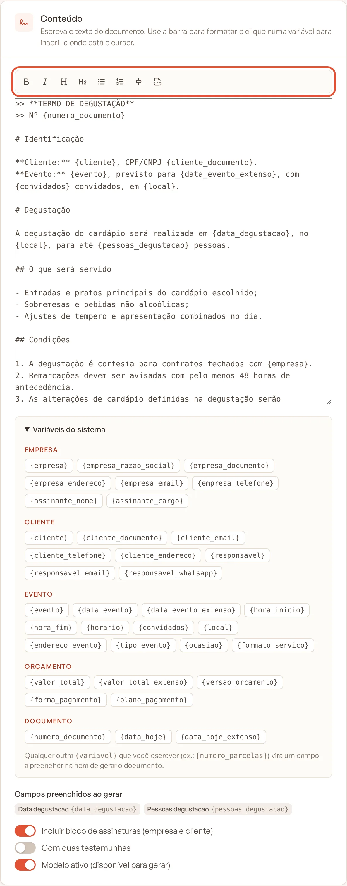
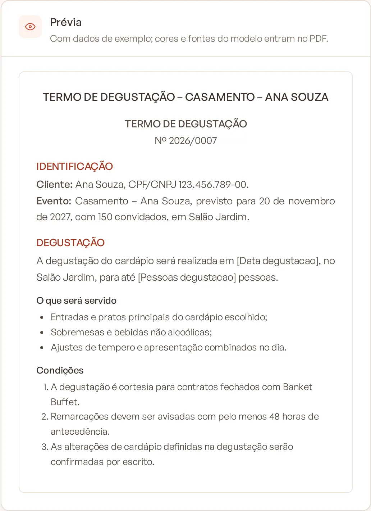
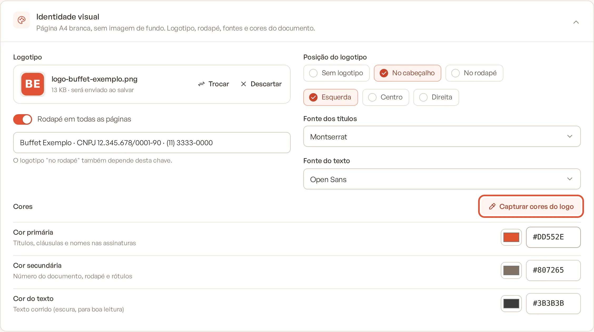
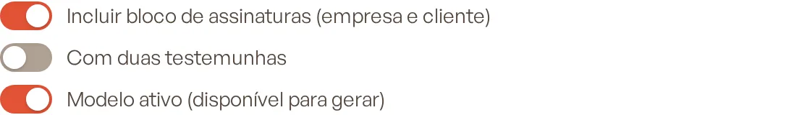
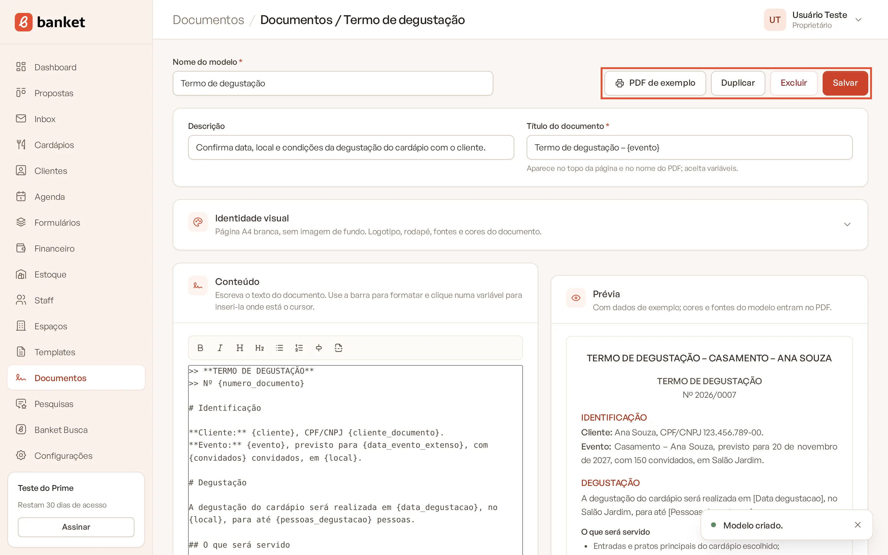

# Criar um modelo de documento

Os modelos de documento são a base dos seus contratos, termos e declarações. Você escreve o texto uma vez, com
variáveis como `{cliente}` e `{data_evento_extenso}`, e o Banket preenche tudo com os dados de cada evento na hora de
gerar o PDF.

> **Disponível em:** planos Essencial, Profissional, Prime e Master · **Quem pode usar:** proprietários e administradores editam os modelos; todos os usuários veem a lista e geram documentos

## Limites do plano

O limite conta os modelos **ativos**:

| Plano | Modelos de documento ativos |
|---|---|
| Essencial | 1 |
| Profissional | 3 |
| Prime | 10 |
| Master | sem limite |

Toda empresa já começa com o modelo "Contrato de prestação de serviços", com um texto genérico de exemplo. Revise-o
antes de usar.

## Criar um modelo

1. No menu lateral, clique em **Documentos**.
2. Clique em **Novo modelo**.

   

3. Preencha:
   - **Nome do modelo**: nome interno (por exemplo, "Contrato de prestação de serviços").
   - **Descrição**: quando usar este documento.
   - **Título do documento**: aparece no topo da página e no nome do PDF. Aceita variáveis, por exemplo
     "Contrato de prestação de serviços – {evento}".

   

4. Escreva o texto no card **Conteúdo** (veja abaixo).
5. Ajuste a **Identidade visual**, se quiser.
6. Clique em **Salvar**.

## Escrever o conteúdo

O card **Conteúdo** tem uma barra de formatação. Selecione o texto e clique no botão desejado:

| Botão | Resultado |
|---|---|
| **Negrito** | Texto em negrito (atalho Ctrl+B ou Cmd+B). |
| **Itálico** | Texto em itálico (atalho Ctrl+I ou Cmd+I). |
| **Título de seção** | Título de cláusula ou seção. |
| **Subtítulo** | Título menor, dentro de uma seção. |
| **Lista** | Itens com marcador. |
| **Lista numerada** | Itens numerados. |
| **Centralizar** | Linha centralizada. |
| **Quebra de página** | Começa uma nova página no PDF a partir daquele ponto. |

Para inserir uma variável, posicione o cursor e clique no chip correspondente em **Variáveis do sistema**. Clicar
num botão de formatação de novo, com o mesmo trecho selecionado, desfaz a formatação.

A **Prévia**, ao lado, mostra o documento com dados de exemplo enquanto você escreve.

## Identidade visual

O documento sai sempre numa página A4 branca, sem imagem de fundo. No card **Identidade visual** você define:

- **Logotipo**: envie a imagem do logo.
- **Posição do logotipo**: **Sem logotipo**, **No cabeçalho** ou **No rodapé**, com o alinhamento **Esquerda**,
  **Centro** ou **Direita**.
- **Rodapé em todas as páginas**: liga o rodapé e o texto dele (por exemplo, razão social, CNPJ e telefone). O
  logotipo "no rodapé" só aparece com esta chave ligada.
- **Fonte dos títulos** e **Fonte do texto**.
- **Cores**: **Cor primária** (títulos, cláusulas e nomes nas assinaturas), **Cor secundária** (número do documento,
  rodapé e rótulos) e **Cor do texto** (texto corrido; prefira uma cor escura).
- **Capturar cores do logo**: a inteligência artificial lê o logotipo enviado e preenche a cor primária e a cor do
  texto com a paleta da marca. Salve para manter.

## Assinaturas e situação do modelo

No fim do card **Conteúdo**:

- **Incluir bloco de assinaturas (empresa e cliente)**: adiciona ao final o local e a data, a linha da contratada
  (razão social, CNPJ, nome e cargo do assinante definidos em **Configurações › Empresa**) e a linha do contratante
  (nome e CPF/CNPJ do cliente).
- **Com duas testemunhas**: acrescenta duas linhas de testemunha, com nome e CPF a preencher à mão.
- **Modelo ativo (disponível para gerar)**: só modelos ativos aparecem na aba **Documentos** do evento.

## Outras ações

No topo do modelo salvo:

- **PDF de exemplo**: gera o PDF com dados fictícios, para conferir texto e visual. Na lista de modelos, o mesmo
  recurso aparece no botão **Exemplo**.
- **Duplicar**: cria uma cópia do modelo, que nasce **inativa** até você revisar.
- **Excluir**: apaga o modelo. Os documentos já gerados com ele continuam guardados nos eventos.

## Perguntas frequentes

### Mudei o modelo. Os documentos antigos mudam também?

Não. Cada documento gerado guarda o texto final e o visual do momento da geração. Reimpressões saem iguais.

### Um usuário da equipe pode editar o modelo?

Não. Só proprietários e administradores criam e editam modelos. Os demais veem a lista, o PDF de exemplo e geram
documentos nos eventos.

### O Banket tem validade jurídica para o meu contrato?

O Banket gera o documento com os dados do evento, mas o texto é seu. Peça a um advogado para revisar o modelo antes de
usá-lo com clientes.

## Artigos relacionados

- [Variáveis e campos extras](02-variaveis-e-campos-extras.md)
- [Gerar documento no evento](03-gerar-documento-no-evento.md)
- [Dados da empresa](../19-configuracoes/01-dados-da-empresa.md)
- [Limites do plano](../20-planos-e-assinatura/09-limites-do-plano.md)
