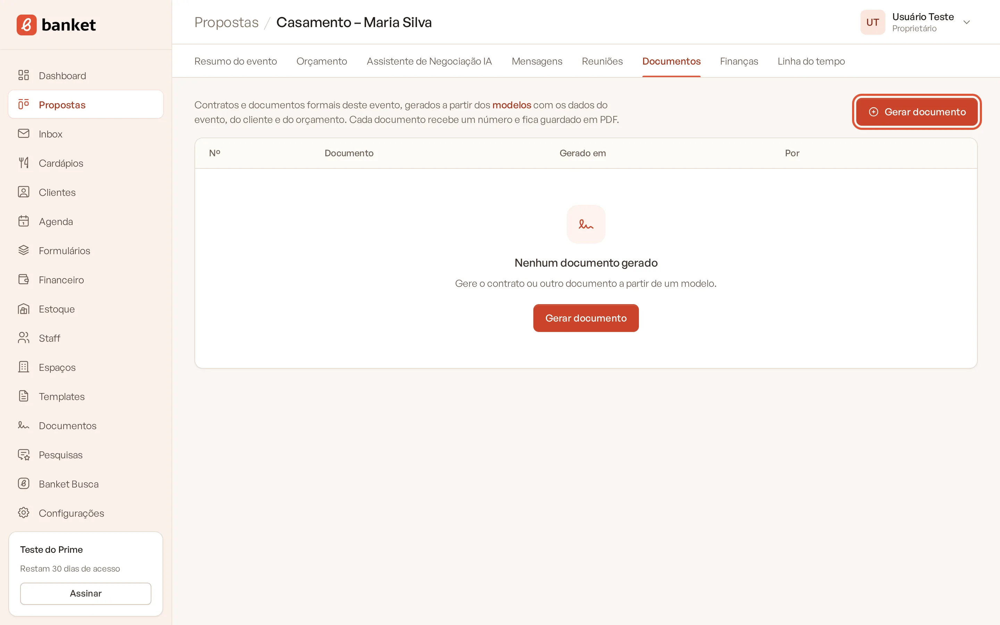
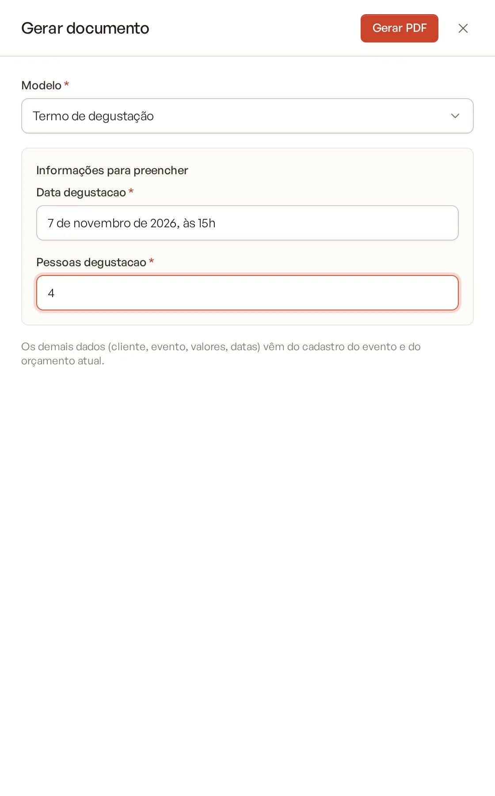
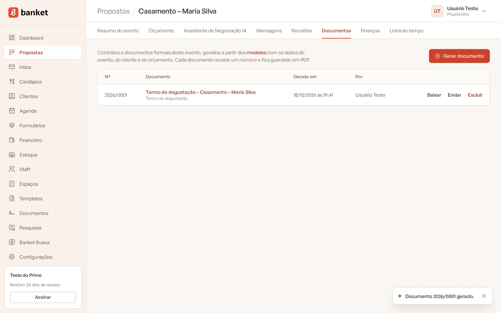

# Gerar documento no evento

Na aba **Documentos** do evento você escolhe um modelo, preenche o que faltar e o Banket gera o PDF numerado com os
dados do evento, do cliente, da empresa e do orçamento atual.

> **Disponível em:** planos Essencial, Profissional, Prime e Master · **Quem pode usar:** todos os usuários

## Antes de começar

- É preciso ter pelo menos um modelo **ativo** em **Documentos**. Sem modelo, o botão **Gerar documento** fica
  desabilitado e a aba mostra o atalho **Ir para Documentos**.
- Confira os dados do evento, do cliente (CPF/CNPJ, endereço) e da empresa (razão social, CNPJ, assinante). O que
  estiver em branco sai em branco no documento.
- Se o documento cita valores, deixe o orçamento na versão certa.

## Passo a passo

1. Abra o evento no **Painel de Propostas**.
2. Clique na aba **Documentos**.
3. Clique em **Gerar documento**.

   

4. Em **Modelo**, escolha o modelo.
5. Se o modelo tiver campos extras, preencha-os em **Informações para preencher**. Todos são obrigatórios.

   

6. Clique em **Gerar PDF**.

   

Ao concluir, aparece a mensagem "Documento 2026/0001 gerado." e o documento entra na lista da aba.

## O que acontece na geração

- **Numeração**: cada documento recebe um número sequencial por empresa e por ano, no formato **ano/número**
  (por exemplo, 2026/0007). A numeração recomeça a cada ano.
- **Texto final**: as variáveis são trocadas pelos dados do momento. O documento guarda esse texto e o visual do
  modelo; se o evento ou o modelo mudarem depois, o documento já gerado não muda.
- **PDF**: o arquivo fica guardado no evento, pronto para baixar e enviar.
- **Linha do tempo**: o evento recebe o registro "Documento ... gerado".

Se o PDF falhar na hora (mensagem "Documento ... gerado, mas o PDF falhou"), o documento já está salvo: o PDF é
gerado de novo quando você clicar em **Baixar**.

## A lista de documentos

A tabela da aba **Documentos** mostra:

| Coluna | Conteúdo |
|---|---|
| **Nº** | Número do documento |
| **Documento** | Título (clique para abrir o PDF no navegador) e o nome do modelo usado |
| **Gerado em** | Data e hora |
| **Por** | Quem gerou |
| **Ações** | **Baixar**, **Enviar** e **Excluir** |

## Perguntas frequentes

### Errei um dado. Como corrijo o documento?

Corrija o dado no evento, no cliente ou no orçamento e gere o documento de novo. O documento novo recebe outro número.
Se quiser, exclua o anterior.

### O número de um documento excluído é reaproveitado?

Não. A sequência continua a partir do maior número já usado no ano.

### Posso gerar o mesmo modelo mais de uma vez no evento?

Sim. Cada geração cria um documento separado, com número próprio (útil para aditivos ou novas versões do contrato).

## Artigos relacionados

- [Baixar e enviar documento](04-baixar-e-enviar-documento.md)
- [Variáveis e campos extras](02-variaveis-e-campos-extras.md)
- [Criar um modelo de documento](01-criar-modelo-de-documento.md)
- [Resumo do evento](../03-propostas-e-eventos/06-resumo-do-evento.md)
