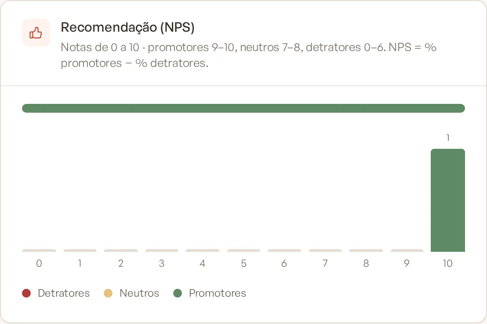
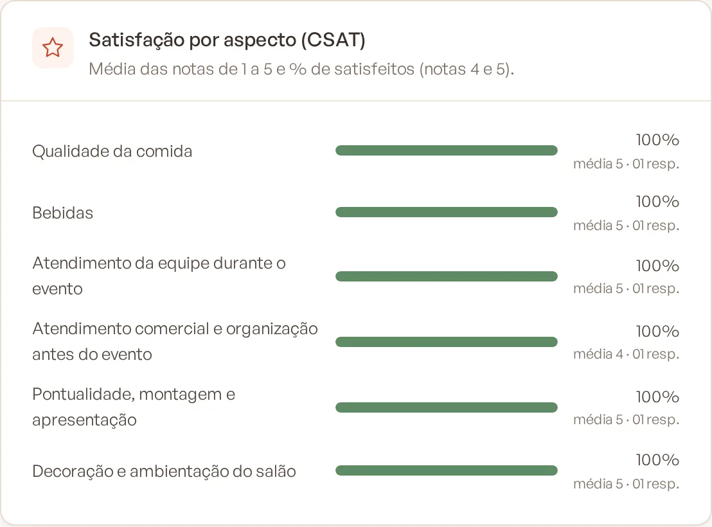

# Entender o NPS e o CSAT

A pesquisa de satisfação do Banket combina dois indicadores muito usados no mercado: o **NPS**, que mede a chance de o
cliente recomendar o seu buffet, e o **CSAT**, que mede a satisfação com cada aspecto do serviço. Perguntas de escolha
e perguntas abertas completam o quadro com ideias de melhoria.

> **Disponível em:** planos Profissional, Prime e Master · **Quem pode usar:** todos os usuários (o questionário é
> editado só por Proprietário e Administrador)

## NPS: recomendação de 0 a 10

O cliente responde: "Em uma escala de 0 a 10, o quanto você recomendaria a [sua empresa] a um amigo ou familiar?". Cada
resposta classifica o cliente em um grupo:

| Nota | Grupo | O que significa |
|---|---|---|
| 9 e 10 | **Promotor** | Gostou muito e tende a indicar o buffet. |
| 7 e 8 | **Neutro** | Ficou satisfeito, mas sem entusiasmo. |
| 0 a 6 | **Detrator** | Saiu insatisfeito e pode falar mal do serviço. |

O NPS é calculado assim: **% de promotores − % de detratores**. Os neutros contam no total, mas não somam nem
subtraem. O resultado vai de −100 a +100.

Exemplo: em 20 respostas, 14 promotores (70%), 4 neutros e 2 detratores (10%). NPS = 70 − 10 = **+60**.

### Zonas de classificação

| NPS | Zona |
|---|---|
| Abaixo de 0 | **Zona crítica** |
| De 0 a 49 | **Zona de aperfeiçoamento** |
| De 50 a 74 | **Zona de qualidade** |
| De 75 a 100 | **Zona de excelência** |

O questionário pode ter **apenas uma** pergunta de NPS.

## CSAT: satisfação de 1 a 5 por aspecto

Para cada aspecto do serviço (comida, bebidas, atendimento, pontualidade…), o cliente dá uma nota:

1. Muito insatisfeito
2. Insatisfeito
3. Neutro
4. Satisfeito
5. Muito satisfeito

Para cada pergunta, o Banket mostra:

- **% de satisfeitos:** quantas respostas foram 4 ou 5.
- **Média:** a média das notas de 1 a 5.

Diferente do NPS, você pode ter quantas perguntas de nota quiser, uma para cada aspecto.

## Perguntas de escolha e abertas

- **Escolha única** e **Múltipla escolha:** mostram quantas vezes cada opção foi escolhida (por exemplo, "O evento
  atendeu às suas expectativas?").
- **Resposta aberta:** o cliente escreve livremente. É onde aparecem elogios, críticas e sugestões.

## Dicas para interpretar

- Olhe o NPS junto com o número de respostas: com poucas respostas, um único cliente muda muito o resultado.
- Use o CSAT para descobrir **onde** melhorar: um NPS baixo costuma vir junto de uma nota baixa em algum aspecto.
- Leia as respostas abertas dos detratores: elas explicam o motivo da nota.

## Perguntas frequentes

### Um NPS de +30 é bom?
Está na zona de aperfeiçoamento: há mais promotores que detratores, mas ainda há espaço para melhorar.

### Por que meu NPS é negativo se a maioria deu nota 7 ou 8?
Notas 7 e 8 são neutras e não contam a favor. Se houver mais detratores (0 a 6) do que promotores (9 e 10), o NPS fica
negativo.

### A nota do Banket Busca é o NPS?
Não exatamente. A nota do Busca é a média das perguntas de 1 a 5. Veja
[Avaliação no Banket Busca](07-avaliacao-no-banket-busca.md).

## Artigos relacionados
- [Configurar o questionário](02-configurar-questionario.md)
- [Indicadores da pesquisa](05-indicadores-da-pesquisa.md)
- [Avaliação no Banket Busca](07-avaliacao-no-banket-busca.md)
