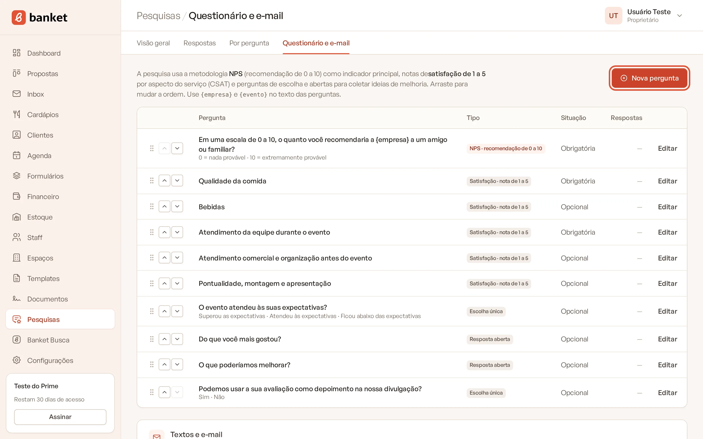
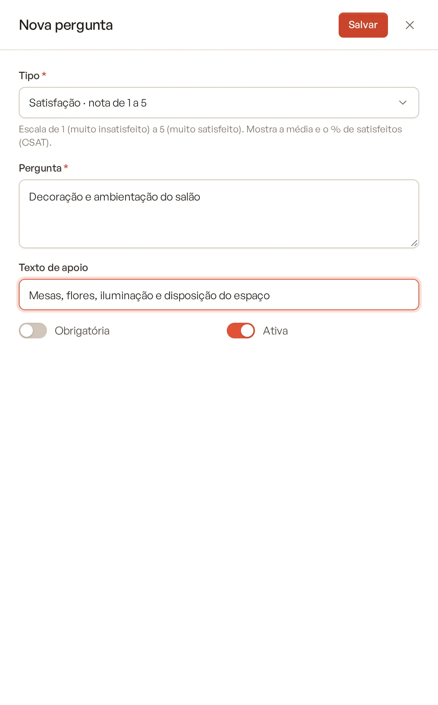
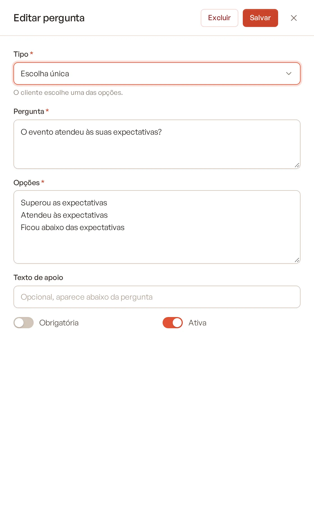
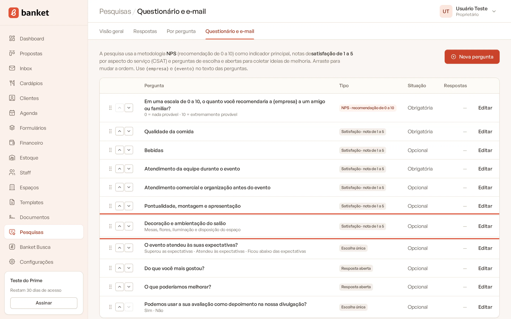
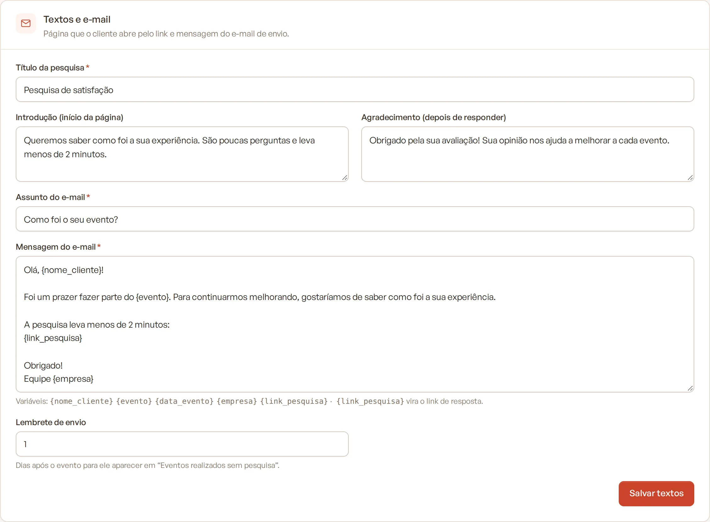

# Configurar o questionário

O questionário é o mesmo para todos os eventos da empresa. Nesta tela você define as perguntas, a ordem, quais são
obrigatórias, os textos que o cliente vê na página da pesquisa, o e-mail de envio e o lembrete.

> **Disponível em:** planos Profissional, Prime e Master · **Quem pode usar:** Proprietário e Administrador

## Como acessar

1. No menu lateral, clique em **Pesquisas**.
2. No submenu, clique em **Questionário e e-mail**.

Usuários com o papel Usuário não veem esta aba.

## O questionário inicial

Toda empresa começa com um questionário pronto, que você pode ajustar:

1. NPS: "Em uma escala de 0 a 10, o quanto você recomendaria a {empresa} a um amigo ou familiar?" (obrigatória)
2. Notas de 1 a 5: Qualidade da comida (obrigatória), Bebidas, Atendimento da equipe durante o evento (obrigatória),
   Atendimento comercial e organização antes do evento, Pontualidade, montagem e apresentação
3. Escolha: "O evento atendeu às suas expectativas?"
4. Abertas: "Do que você mais gostou?" e "O que poderíamos melhorar?"
5. Escolha (Sim/Não): "Podemos usar a sua avaliação como depoimento na nossa divulgação?"

## Adicionar uma pergunta

1. Clique em **Nova pergunta**.
2. Escolha o **Tipo**:
   - **NPS · recomendação de 0 a 10** (só uma por questionário);
   - **Satisfação · nota de 1 a 5**;
   - **Escolha única**;
   - **Múltipla escolha**;
   - **Resposta aberta**.
3. Escreva a **Pergunta**. Você pode usar `{empresa}` e `{evento}`, que viram o nome da sua empresa e o título do
   evento na página do cliente.
4. Nas perguntas de escolha, preencha **Opções**, uma por linha (no mínimo 2 e no máximo 15).
5. Se quiser, preencha o **Texto de apoio**, que aparece abaixo da pergunta.
6. Ligue **Obrigatória** se o cliente precisar responder para enviar.
7. Deixe ligado **Ativa** para a pergunta aparecer na pesquisa.

   

8. Clique em **Salvar**.

## Editar, reordenar e desativar

- **Editar:** clique em **Editar** na linha da pergunta, faça as alterações e clique em **Salvar**.

  

- **Reordenar:** arraste as linhas da tabela para mudar a ordem em que as perguntas aparecem.

  

- **Desativar:** desligue **Ativa**. A pergunta some das próximas pesquisas, mas as respostas antigas continuam nos
  indicadores. Na tabela, ela aparece como **Inativa**.

A coluna **Respostas** mostra quantas respostas cada pergunta já recebeu.

## Excluir uma pergunta

1. Clique em **Editar** na pergunta.
2. Clique em **Excluir** no topo do painel e confirme.

As respostas já recebidas continuam nas pesquisas respondidas, com o texto da pergunta como era. Elas só deixam de
aparecer na tela **Por pergunta**.

## Regras importantes

- O questionário aceita **uma única pergunta NPS**. Para avaliar outros aspectos, use **Satisfação · nota de 1 a 5**.
- Uma pergunta que **já tem respostas não pode mudar de tipo**, para não misturar escalas nos indicadores. Desative-a e
  crie uma nova.
- Mudar o texto de uma pergunta vale para as próximas respostas. As respostas antigas guardam o texto que o cliente
  viu.
- A pergunta de autorização de depoimento (com "depoimento" no texto e a opção "Sim") é usada para publicar o
  depoimento no Banket Busca. Se mudar o texto, mantenha a palavra "depoimento" e a opção "Sim". Veja
  [Avaliação no Banket Busca](07-avaliacao-no-banket-busca.md).

## Textos e e-mail

No card **Textos e e-mail**, ajuste:

| Campo | Para que serve |
|---|---|
| **Título da pesquisa** | Título que o cliente vê na página. |
| **Introdução (início da página)** | Texto antes das perguntas. |
| **Agradecimento (depois de responder)** | Mensagem mostrada depois que o cliente envia. |
| **Assunto do e-mail** | Assunto padrão do e-mail de envio. |
| **Mensagem do e-mail** | Texto padrão do e-mail. Aceita as variáveis `{nome_cliente}`, `{evento}`, `{data_evento}`, `{empresa}` e `{link_pesquisa}` (vira o link de resposta). |
| **Lembrete de envio** | Quantos dias depois do evento (de 0 a 90) ele passa a aparecer em "Eventos realizados sem pesquisa". O padrão é 1 dia. |

Clique em **Salvar textos** para gravar.

## Perguntas frequentes

### Posso ter um questionário diferente para cada tipo de evento?
Não. O questionário é único para a empresa. Use `{evento}` no texto das perguntas para personalizá-las.

### Se eu mudar o questionário, quem já recebeu o link vê a versão nova?
Sim. Quem ainda não respondeu vê as perguntas ativas no momento em que abrir o link.

### Quantas perguntas devo ter?
Pesquisas curtas têm mais respostas. O questionário inicial, com 10 perguntas, leva menos de 2 minutos.

## Artigos relacionados
- [Entender o NPS e o CSAT](01-entender-nps-e-csat.md)
- [Enviar a pesquisa](03-enviar-pesquisa.md)
- [O que o cliente vê](04-o-que-o-cliente-ve.md)
- [Avaliação no Banket Busca](07-avaliacao-no-banket-busca.md)
