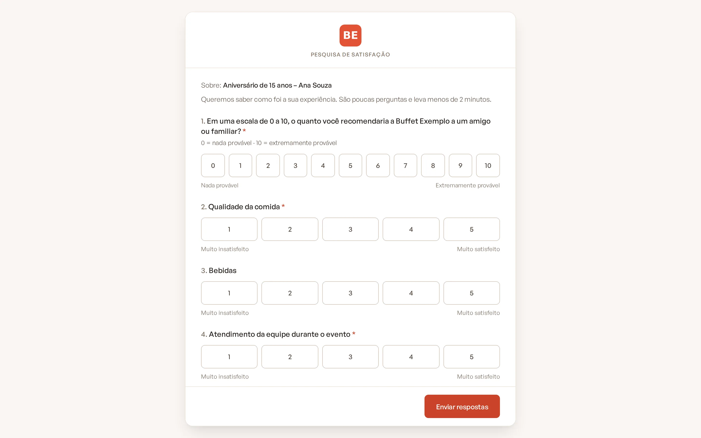
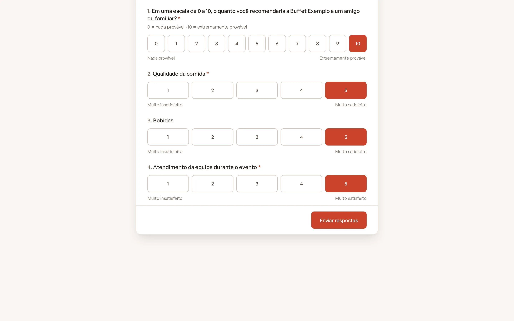
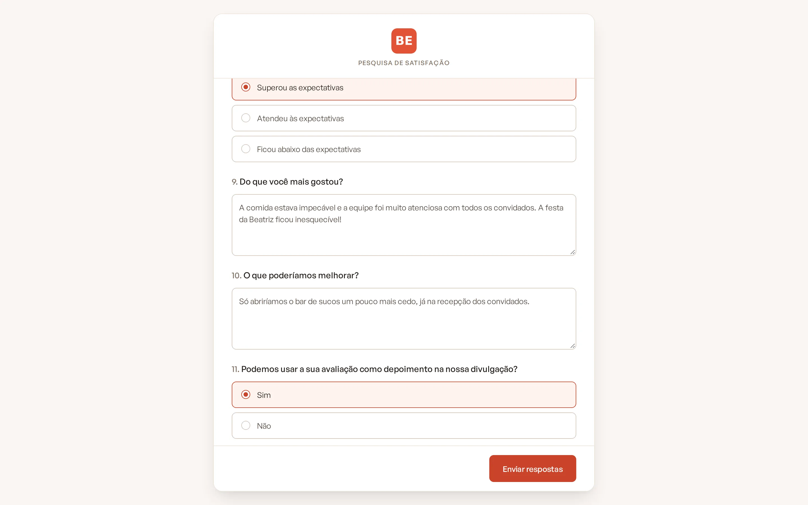
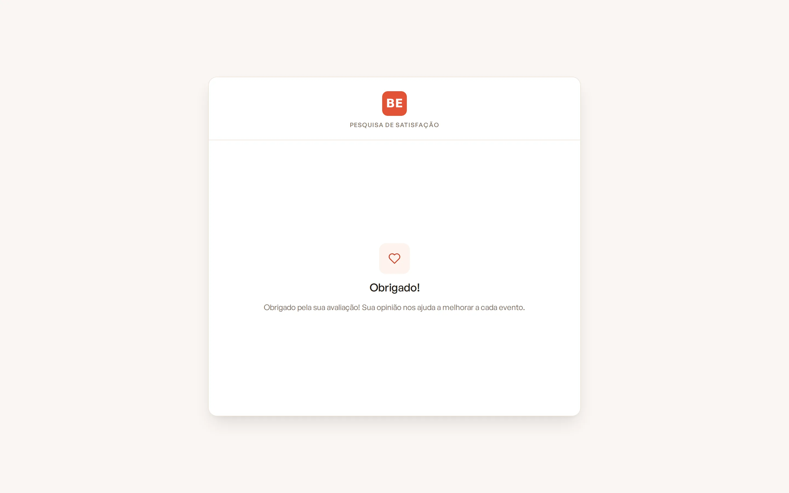
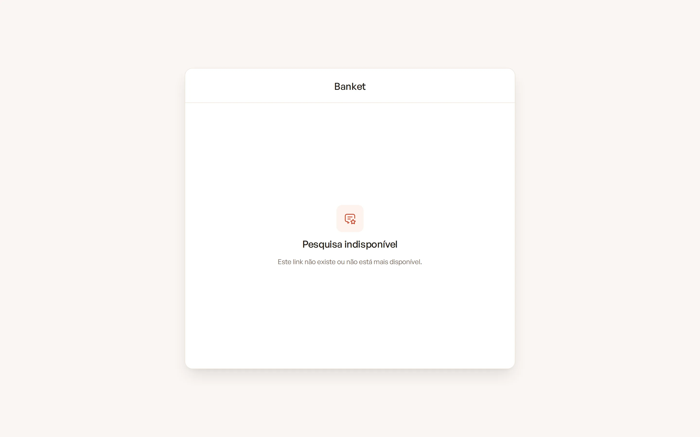
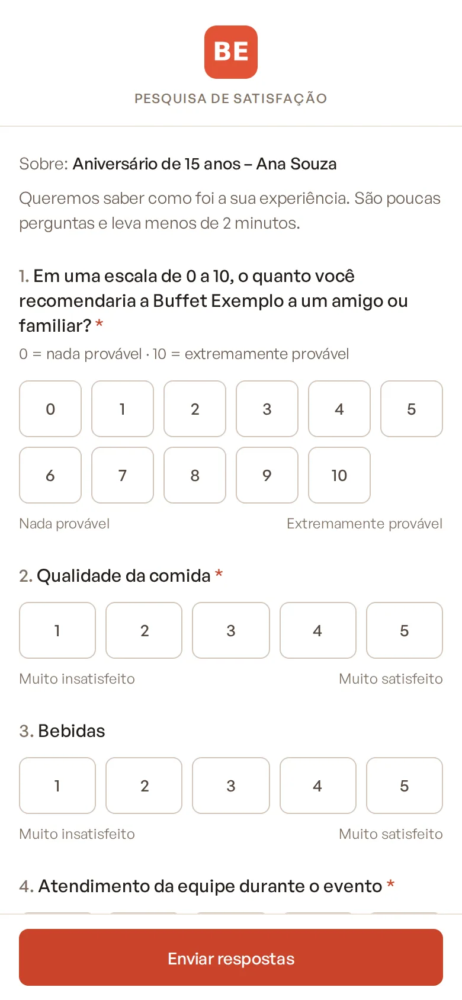

# O que o cliente vê

O cliente responde à pesquisa por uma página própria, aberta pelo link do e-mail (ou pelo link que você copiou e mandou
por outro canal). Ele não precisa criar conta nem fazer login.

> **Disponível em:** planos Profissional, Prime e Master · **Quem pode usar:** o cliente, pelo link recebido

## Como é a página

- No topo, o nome e o logotipo da sua empresa e o **Título da pesquisa**.
- A linha "Sobre:" com o título do evento.
- A **Introdução** definida em **Questionário e e-mail**.
- As perguntas ativas, numeradas, na ordem do questionário. As obrigatórias têm um asterisco (*). O **Texto de apoio**
  aparece logo abaixo da pergunta.
- O botão **Enviar respostas** no fim.

Os textos `{empresa}` e `{evento}` das perguntas aparecem já trocados pelo nome da empresa e o título do evento.

## Como o cliente responde a cada tipo

| Tipo | Como aparece |
|---|---|
| NPS | Botões de 0 a 10, com "Nada provável" e "Extremamente provável" nas pontas. |
| Nota de 1 a 5 | Botões de 1 a 5, com "Muito insatisfeito" e "Muito satisfeito" nas pontas. |
| Escolha única | Lista de opções; só uma pode ser marcada. |
| Múltipla escolha | Lista de opções; quantas quiser. |
| Resposta aberta | Campo de texto livre ("Escreva aqui…"). |

## Depois de enviar

- O cliente vê "Obrigado!" e o **Agradecimento** que você definiu.
- Se tentar abrir o link de novo, vê a mesma tela de agradecimento: cada link aceita uma única resposta.
- Se faltou uma pergunta obrigatória ou houve algum problema, a página mostra o aviso no topo e mantém o que ele já
  tinha preenchido.

## Mensagens que o cliente pode ver

- **"Pesquisa indisponível"**: o link está incorreto ou não existe mais.
- **"Muitas tentativas em sequência. Aguarde alguns minutos e tente novamente."**: proteção contra envios repetidos
  do mesmo endereço.
- **"Responda pelo menos uma pergunta."**: ele tentou enviar a pesquisa em branco.

## Dicas

- Antes de enviar ao primeiro cliente, revise os textos e as perguntas em **Questionário e e-mail**.
- Não responda à pesquisa no lugar do cliente: a resposta de alguém da equipe, logado no Banket, conta nos indicadores
  internos, mas não vira avaliação no Banket Busca.
- O link é pessoal do cliente. Não o publique em redes sociais.

## Perguntas frequentes

### A página funciona no celular?
Sim. A página se adapta à tela do celular.

### O cliente precisa responder a todas as perguntas?
Só às marcadas como obrigatórias. As demais podem ficar em branco.

### Posso ver a página antes de enviar?
O link só é criado no primeiro envio. Para conferir o visual, revise os textos e as perguntas na tela
**Questionário e e-mail**.

## Artigos relacionados
- [Configurar o questionário](02-configurar-questionario.md)
- [Enviar a pesquisa](03-enviar-pesquisa.md)
- [Ver as respostas](06-ver-respostas.md)
