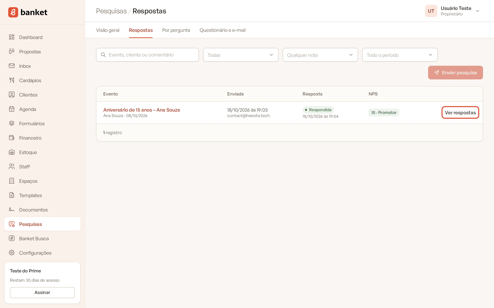
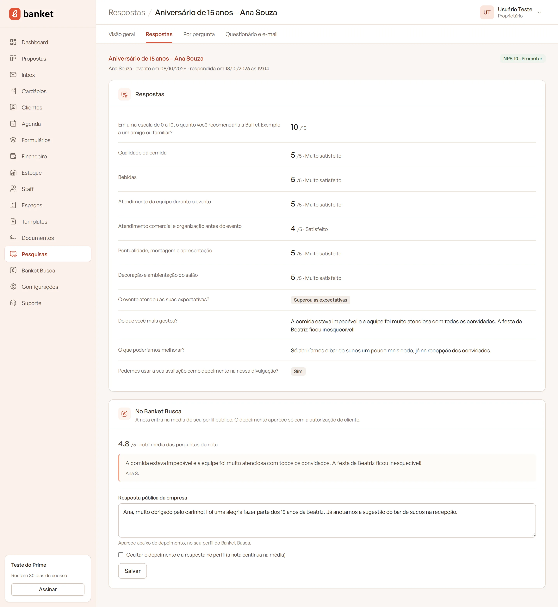
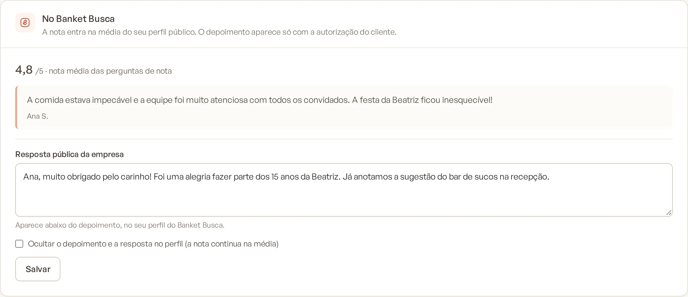
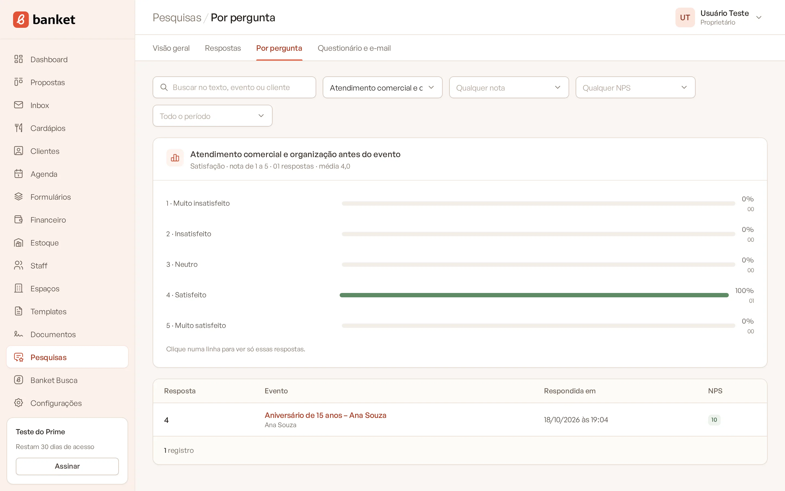
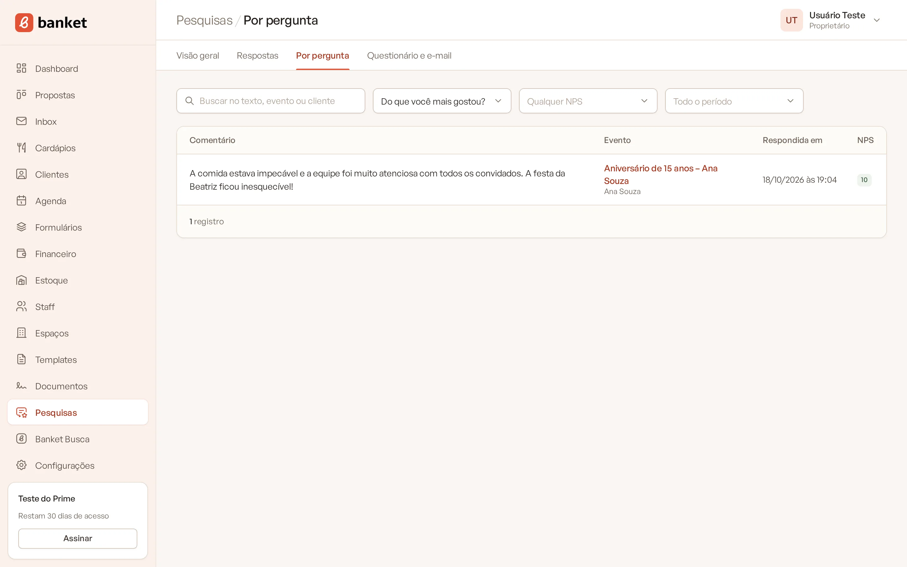

# Ver as respostas

Há duas formas de ver as respostas: **por pesquisa** (tudo o que um cliente respondeu sobre um evento) e **por
pergunta** (todas as respostas a uma mesma pergunta, ideal para ler os comentários abertos).

> **Disponível em:** planos Profissional, Prime e Master · **Quem pode usar:** todos os usuários

## Lista de pesquisas enviadas

1. No menu lateral, clique em **Pesquisas**.
2. No submenu, clique em **Respostas**.

Cada linha mostra:

| Coluna | O que mostra |
|---|---|
| **Evento** | Título do evento (link para o evento), cliente e data. |
| **Enviada** | Data e hora do envio, os destinatários e quantos envios foram feitos. |
| **Resposta** | **Respondida** (com a data) ou **Aguardando**. |
| **NPS** | A nota de 0 a 10 e o grupo: Promotor, Neutro ou Detrator. |
| **Ações** | **Ver respostas** nas respondidas; **Copiar link** e **Reenviar** nas que aguardam. |

### Filtros

- **Busca:** evento, cliente ou texto de um comentário.
- **Situação:** **Todas**, **Respondidas** ou **Aguardando resposta**.
- **Nota:** **Qualquer nota**, **Promotores**, **Neutros** ou **Detratores**.
- **Período:** **Todo o período**, **Últimos 30 dias**, **Últimos 90 dias** ou **Últimos 12 meses**.

## Respostas de uma pesquisa

Clique em **Ver respostas** (ou num comentário da Visão geral) para abrir a pesquisa do evento. A página mostra:

- o evento (link para ele), o cliente, a data do evento e a data da resposta;
- a etiqueta com o NPS e o grupo;
- cada pergunta respondida, na ordem do questionário: a nota de NPS (de 10), a nota de 1 a 5 com o rótulo (por
  exemplo, "4/5 · Satisfeito"), as opções escolhidas ou o texto escrito.

Quando a resposta vale como avaliação pública, aparece também o card **No Banket Busca**. Veja
[Avaliação no Banket Busca](07-avaliacao-no-banket-busca.md).

## Respostas por pergunta

1. No submenu de **Pesquisas**, clique em **Por pergunta**.
2. Escolha a pergunta no filtro **Pergunta**. A página abre na primeira pergunta que já tem respostas.

Para perguntas de nota, NPS e escolha, o card do topo mostra a distribuição: quantas respostas teve cada nota ou
opção, em porcentagem e quantidade, e a média nas perguntas de nota. **Clique numa linha** para ver só as respostas
com aquela nota ou opção; clique de novo para desfazer.

Abaixo, a tabela lista as respostas com o **Comentário** (ou **Resposta**), o **Evento** (link para a pesquisa
completa), **Respondida em** e o **NPS** de quem respondeu.

Filtros desta tela:

- **Busca:** texto da resposta, evento ou cliente;
- **Qualquer nota** / **Qualquer opção:** filtra por uma nota ou opção;
- **Qualquer NPS:** mostra só as respostas de promotores, neutros ou detratores;
- **Período.**

## Dicas

- Para entender os detratores, abra **Por pergunta**, escolha "O que poderíamos melhorar?" e filtre por
  **Detratores**.
- Para encontrar elogios para a divulgação, filtre a pergunta "Do que você mais gostou?" por **Promotores**.

## Perguntas frequentes

### Posso editar a resposta de um cliente?
Não. As respostas ficam como o cliente enviou.

### Excluí uma pergunta. As respostas sumiram?
Não. Elas continuam na página de cada pesquisa respondida, com o texto da pergunta da época. Só deixam de aparecer na
tela **Por pergunta**.

### Recebo algum aviso quando o cliente responde?
A resposta fica registrada na linha do tempo do evento. Se a sua empresa ativou os avisos no WhatsApp com o tipo
"pesquisa respondida", você também recebe a mensagem. Veja
[Avisos no WhatsApp](../19-configuracoes/04-avisos-no-whatsapp.md).

## Artigos relacionados
- [Indicadores da pesquisa](05-indicadores-da-pesquisa.md)
- [Enviar a pesquisa](03-enviar-pesquisa.md)
- [Avaliação no Banket Busca](07-avaliacao-no-banket-busca.md)
- [Linha do tempo e anotações](../03-propostas-e-eventos/08-linha-do-tempo-e-anotacoes.md)
