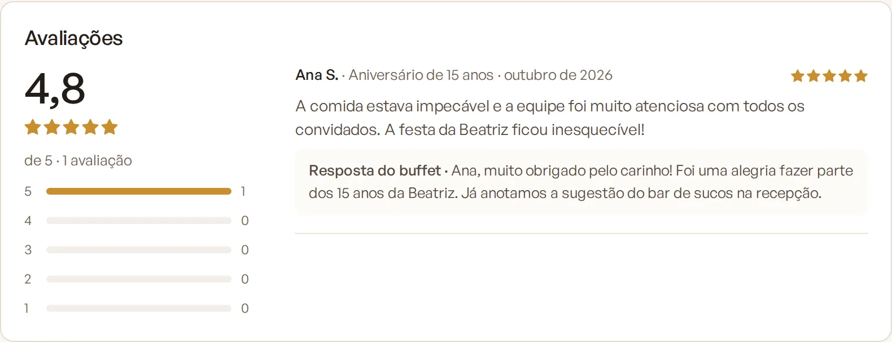
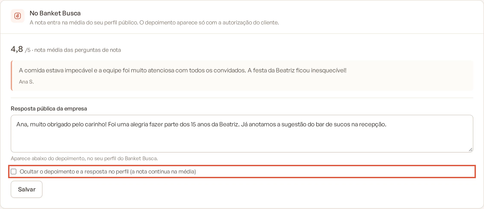

# Avaliação no Banket Busca

As pesquisas de satisfação respondidas pelos seus clientes alimentam a nota e os depoimentos do seu perfil no Banket
Busca. Assim, quem procura um buffet vê avaliações de clientes reais, sem você precisar pedir nada a mais.

> **Disponível em:** planos Profissional, Prime e Master · **Quem pode usar:** todos os usuários veem; responder e
> ocultar depoimentos é só para Proprietário e Administrador

## Como a nota é calculada

- A nota de cada pesquisa (de 1 a 5) é a **média das perguntas de nota de 1 a 5** que o cliente respondeu.
- Se o cliente não respondeu nenhuma pergunta de nota, a nota vem do NPS convertido para a escala de 1 a 5
  (NPS 10 = 5; NPS 0 = 1).
- A nota do perfil é a média de todas as avaliações.

Quando a empresa tem mais de uma unidade no Banket Busca, a pesquisa de um evento realizado no espaço de uma unidade
conta só para o perfil dessa unidade. As demais contam para todos os perfis.

## Quando a resposta vira avaliação pública

A resposta conta como avaliação no Banket Busca apenas quando vem de um cliente de fato:

- o evento está na etapa de aprovado e já aconteceu;
- o cliente e os destinatários do e-mail não são usuários da sua empresa no Banket;
- quem respondeu não estava logado no Banket como usuário da empresa.

Respostas que não atendem a essas regras continuam valendo para os indicadores internos (NPS e CSAT), mas não aparecem
no Banket Busca.

## Quando o depoimento aparece

O depoimento é publicado apenas quando:

1. o cliente respondeu **Sim** à pergunta de autorização ("Podemos usar a sua avaliação como depoimento na nossa
   divulgação?"); e
2. escreveu uma resposta aberta com pelo menos 20 caracteres.

O texto usado é a primeira resposta aberta que atende a essa regra. O nome aparece abreviado, com o primeiro nome e a
inicial do sobrenome (por exemplo, "Maria S.").

Se você editar a pergunta de autorização em **Questionário e e-mail**, mantenha a palavra "depoimento" no texto e a
opção "Sim": é assim que o Banket reconhece a autorização.

## Ver, responder e ocultar uma avaliação

1. No menu lateral, clique em **Pesquisas** e, no submenu, em **Respostas**.
2. Clique em **Ver respostas** na pesquisa.
3. No card **No Banket Busca**, veja a nota que entrou na média e o depoimento (ou o aviso "Sem depoimento no perfil").
4. Para responder publicamente, escreva em **Resposta pública da empresa**. Ela aparece abaixo do depoimento no seu
   perfil.
5. Para tirar o depoimento do perfil, marque **Ocultar o depoimento e a resposta no perfil (a nota continua na média)**.
6. Clique em **Salvar**.

   

O card **No Banket Busca** só aparece nas respostas que viraram avaliação pública.

## Dicas

- Responda aos depoimentos agradecendo e, nas críticas, contando o que vai melhorar. Isso passa confiança a quem lê.
- Envie a pesquisa a todos os eventos realizados: a avaliação também pesa na ordem dos resultados da busca.

## Perguntas frequentes

### Posso apagar uma nota ruim?
Não. Você pode ocultar o depoimento e a resposta, mas a nota continua na média do perfil.

### Por que a resposta de um cliente não aparece no Busca?
Confira se o evento está na etapa de aprovado e já aconteceu, e se a pesquisa não foi respondida por alguém da empresa
ou enviada a um e-mail de usuário da empresa.

### O Banket Busca tem outras avaliações além das pesquisas?
Sim. Pedidos recebidos pelo Banket Busca também podem gerar avaliações. As duas fontes entram juntas na nota do perfil.

## Artigos relacionados
- [Entender o NPS e o CSAT](01-entender-nps-e-csat.md)
- [Ver as respostas](06-ver-respostas.md)
- [Configurar o questionário](02-configurar-questionario.md)
- [O que é o Banket Busca](../18-banket-busca/01-o-que-e-o-banket-busca.md)
- [Como os resultados são ordenados](../18-banket-busca/13-como-os-resultados-sao-ordenados.md)
