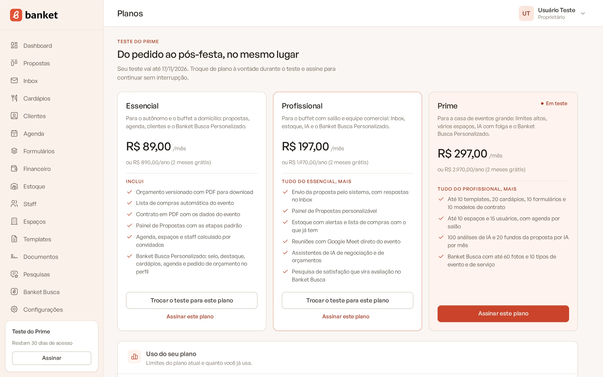
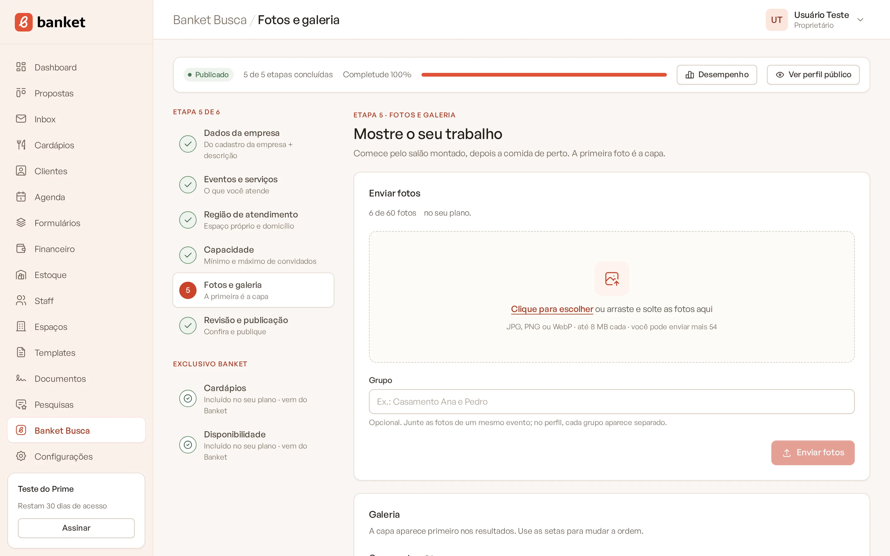
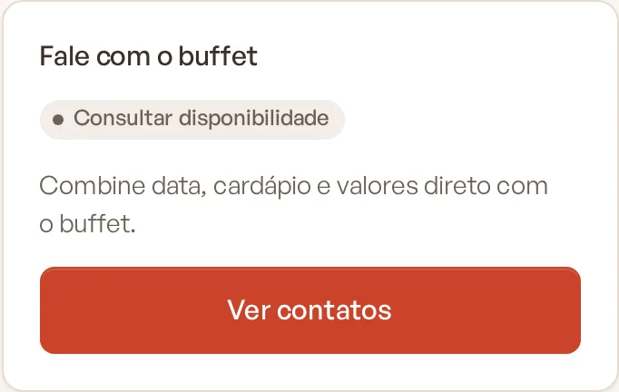

# Perfil Simples e Perfil Personalizado

O seu perfil no Banket Busca tem dois níveis. O **Perfil Simples** é o do plano Busca, gratuito. O **Perfil
Personalizado** vem com qualquer plano pago (Essencial, Profissional, Prime e Master) e traz mais formas de o cliente
chegar até você.

> **Disponível em:** Perfil Simples no plano Busca · Perfil Personalizado nos planos Essencial, Profissional, Prime e
> Master · **Quem pode usar:** Proprietário e Administrador

## O que cada nível oferece

| Recurso | Perfil Simples | Perfil Personalizado |
|---|---|---|
| Perfil público com descrição, região, capacidade e avaliações | Sim | Sim |
| Contatos do buffet para o cliente (WhatsApp, telefone, e-mail, Instagram e site) | Sim | Sim |
| Pedido de orçamento pelo seu formulário, direto no Painel de Propostas | Não | Sim |
| WhatsApp com a mensagem já preenchida (tipo de evento, data e convidados da busca) | Não | Sim |
| Selo **Cliente Banket** no card e no perfil | Não | Sim |
| Impulso na ordem dos resultados e vagas de **Destaque** no topo | Não | Sim |
| Seção **Cardápios** no perfil | Não | Sim |
| Disponibilidade na data pela sua agenda | Não ("Consultar disponibilidade") | Sim |
| Endereço do perfil com o nome do buffet | Não (código do perfil) | Sim |
| Fotos em grupos por evento | Não (fotos gerais) | Sim |
| Aviso de pedido novo por e-mail e no WhatsApp | Não | Sim |

## Limites do plano

| Plano | Fotos | Tipos de evento | Tipos de serviço |
|---|---|---|---|
| Busca (Perfil Simples) | 5 fotos gerais | 3 | 3 |
| Essencial | 30, em grupos | 6 | 6 |
| Profissional | 30, em grupos | 6 | 6 |
| Prime | 60, em grupos | 10 | 10 |
| Master | sem limite | sem limite | sem limite |

Quando você chega ao limite, as opções a mais ficam indisponíveis e aparece o link para conhecer os planos. Ao clicar num
recurso com cadeado, o sistema abre o painel com a oferta de upgrade.

## Se o plano mudar

- **Ao passar para um plano pago**, o perfil vira Personalizado na hora. O que tinha ficado de fora por limite (fotos e
  tipos) volta a aparecer.
- **Ao voltar para o plano Busca** (por exemplo, no fim do teste grátis sem assinatura), o perfil vira Simples. Nada é
  apagado: as fotos e os tipos acima do limite ficam guardados e marcados como **Fora do plano**, mas não aparecem no
  perfil público. O endereço com o nome do buffet volta a ser o código do perfil.

## Perguntas frequentes

### Posso testar o Perfil Personalizado antes de assinar?
Sim. Escolher um plano pago inicia o teste grátis de 30 dias, sem cartão. Durante o teste o perfil já é Personalizado.
Veja [Teste grátis de 30 dias](../20-planos-e-assinatura/02-teste-gratis-de-30-dias.md).

### No Perfil Simples o cliente consegue falar comigo?
Sim. O botão **Ver contatos** mostra WhatsApp, telefone, e-mail, Instagram e site, sempre com um toque. O cliente fala
com você direto, fora do Banket.

### O Perfil Personalizado mostra os meus preços?
Não. O Banket Busca não mostra preço em nenhum perfil.

## Artigos relacionados
- [O que é o Banket Busca](01-o-que-e-o-banket-busca.md)
- [Receber pedidos pelo Banket Busca](11-receber-pedidos-pelo-busca.md)
- [Como os resultados são ordenados](13-como-os-resultados-sao-ordenados.md)
- [Planos do Banket](../20-planos-e-assinatura/01-planos-do-banket.md)
- [Fim do teste e rebaixamento](../20-planos-e-assinatura/08-fim-do-teste-e-rebaixamento.md)
