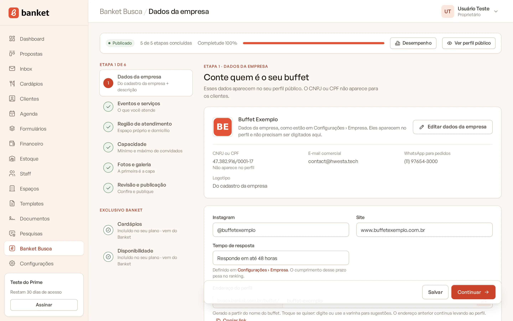
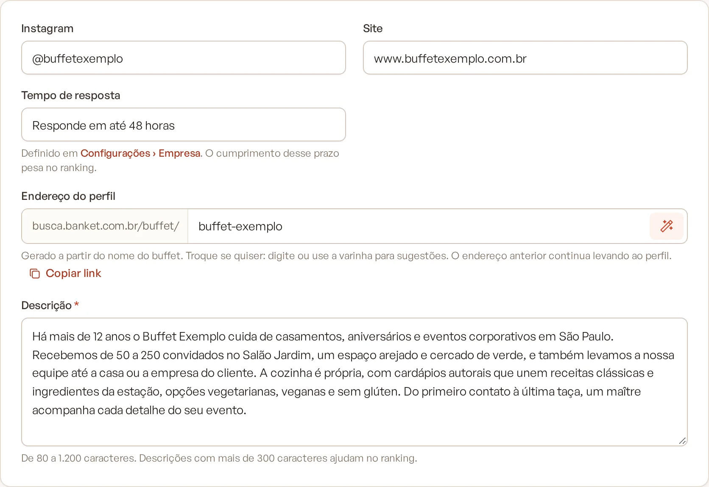
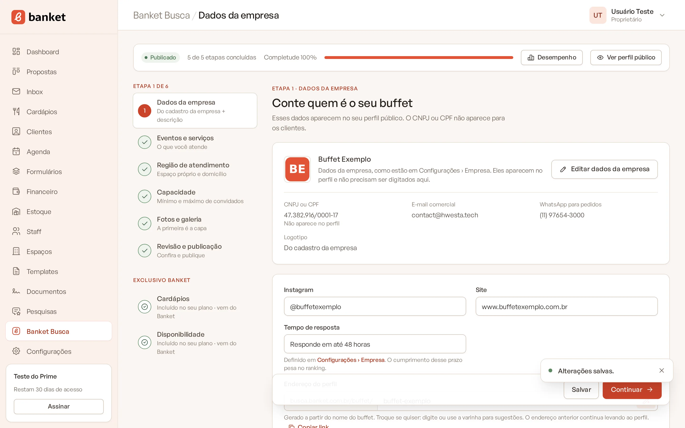

# Etapa 1: dados da empresa

Na primeira etapa você conta quem é o seu buffet. Os dados cadastrais (nome, CNPJ ou CPF, e-mail, telefone e logotipo)
vêm de **Configurações › Empresa** e não precisam ser digitados de novo. Aqui você completa o que é só do perfil:
Instagram, site e a descrição.

> **Disponível em:** todos os planos · **Quem pode usar:** Proprietário e Administrador

## Antes de começar

Confira em **Configurações › Empresa** se estes dados estão preenchidos. Sem eles a etapa não fica concluída:

- **CNPJ ou CPF** válido;
- **E-mail**;
- **Telefone** com DDD (celular ou fixo).

O logotipo não é obrigatório, mas conta para a completude do perfil. Use PNG, JPG ou WebP. Veja
[Dados da empresa](../19-configuracoes/01-dados-da-empresa.md).

## Passo a passo

1. No menu lateral, clique em **Banket Busca** e abra a etapa **Dados da empresa**.
2. Confira o quadro do topo, com os dados da empresa como estão em Configurações. Para mudar algum, clique em **Editar
   dados da empresa**.
   - Se faltar algo, aparece o aviso "Para concluir esta etapa, complete no cadastro da empresa: ..." com o link para
     Configurações.

   

3. Preencha **Instagram** (por exemplo, `@seubuffet`) e **Site**, se tiver.
4. Escreva a **Descrição**: de 80 a 1.200 caracteres. Conte há quanto tempo atende, como é o espaço e a cozinha e o que
   torna o seu buffet especial.

   

5. Nos planos pagos, confira o **Endereço do perfil**. Veja [Endereço do perfil](09-endereco-do-perfil.md).
6. Clique em **Salvar** para ficar na etapa ou em **Continuar** para salvar e ir para a próxima.

   

## Entenda os campos

| Campo | O que é |
|---|---|
| CNPJ ou CPF | Vem de Configurações. Não aparece no perfil público. |
| E-mail comercial | Vem de Configurações. Aparece nos contatos do perfil. |
| WhatsApp para pedidos / Telefone | Vem de Configurações. Celular vira o WhatsApp do perfil; número fixo vira o telefone. |
| Logotipo | Vem de Configurações. |
| Instagram e Site | Aparecem nos contatos do perfil. |
| Tempo de resposta | Somente leitura. É definido em Configurações › Empresa e aparece no perfil (por exemplo, "Responde em até 48 horas"). |
| Link do perfil | No plano Busca, o endereço público do perfil, com o botão **Copiar link**. |
| Descrição | Texto de apresentação do buffet, obrigatório. |

## Dicas

- Descrições com mais de 300 caracteres contam mais para a completude, que ajuda na ordem dos resultados.
- Os dados da empresa são copiados para o perfil sempre que você salva em Configurações › Empresa. Não é preciso voltar
  aqui depois de mudar um telefone, por exemplo.
- O tempo de resposta pesa na ordem dos resultados. Escolha um prazo que você consegue cumprir. Veja
  [Tempo de resposta aos pedidos](../19-configuracoes/03-tempo-de-resposta-aos-pedidos.md).

## Perguntas frequentes

### Por que não consigo editar o nome ou o telefone aqui?
Porque eles são os dados oficiais da empresa e ficam em **Configurações › Empresa**. Assim o perfil e as propostas usam
sempre as mesmas informações.

### Apareceu "Escreva ao menos 80 caracteres na descrição". O que faço?
A descrição precisa ter pelo menos 80 caracteres. Complete o texto e salve de novo. O que você digitou volta preenchido.

### Já tinha publicado e mudei algo. O perfil saiu do ar?
Só se a etapa deixar de estar completa (por exemplo, se a descrição ficar curta demais). Nesse caso aparece o aviso "O
perfil voltou a rascunho: conclua as etapas que faltam para publicar de novo."

## Artigos relacionados
- [Etapa 2: eventos e serviços](04-etapa-2-eventos-e-servicos.md)
- [Endereço do perfil](09-endereco-do-perfil.md)
- [Dados da empresa](../19-configuracoes/01-dados-da-empresa.md)
- [Tempo de resposta aos pedidos](../19-configuracoes/03-tempo-de-resposta-aos-pedidos.md)
